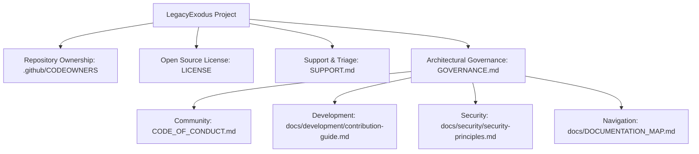

# LegacyExodus Governance & Architectural Boundary Invariants

## 1. Repository Boundary Contract

LegacyExodus maintains a strict architectural separation between the repository container and the application package root:

* **Git Repository Root (`LegacyExodus/`):** Top-level governance, workspace documentation, project container.
* **Canonical Package Root (`LegacyExodus/legacy-exodus-core/`):** Implementation source code, test suites, benchmark infrastructure, and generated artifacts.

### Boundary Invariants
1. **Zero Root-Level Artifact Leakage:** Commands executed from the Git root (`LegacyExodus/`) or package root (`legacy-exodus-core/`) must NEVER create runtime or test artifact directories (`benchmarks/`, `tests/`) at the Git root.
2. **Canonical Internal Artifact Anchors:** All internal benchmark caches (`.cache/`), results (`results/`), corpus manifests (`corpus/`), and fidelity validation outputs (`results/fidelity/fidelity-report.json`) are anchored to `legacy-exodus-core/` via module-relative paths (`import.meta.dir`).
3. **Preservation of User CWD Semantics:** Arbitrary user-supplied relative repository paths passed to CLI commands (e.g. `legacy-exodus analyze <path>`) preserve caller working-directory resolution.
4. **Core Isolation:** Source code under `legacy-exodus-core/src/` must NEVER import from `benchmarks/`.
5. **Symlink Traversal Policy:** Directory scanning intentionally skips symbolic links to protect against directory traversal cycles, duplicate source ingestion, and escaping repository boundaries.

---

## 2. The Three-Universe Evidence & Fidelity Contract

To prevent metric hallucination and mathematical distortion during static analysis validation, LegacyExodus enforces the **Three-Universe Model**:

```text
┌─────────────────────────────────────────────────────────────────────────────┐
│                          THE THREE-UNIVERSE MODEL                           │
├───────────────────────────────┬─────────────────────────────────────────────┤
│ Universe A: Verified          │ Known Ground Truth facts (U_GT^+) and       │
│                               │ Known Negatives (U_GT^-) for verified files │
├───────────────────────────────┼─────────────────────────────────────────────┤
│ Universe B: Scoped /          │ Predictions within validated files that     │
│             Unverified        │ lack corresponding ground truth annotation   │
│                               │ (classified as UNVERIFIED_SCOPED, not FP)   │
├───────────────────────────────┼─────────────────────────────────────────────┤
│ Universe C: Unvalidated       │ Predictions across files outside the        │
│                               │ ground-truth sample (classified as          │
│                               │ UNVALIDATED, not FP)                        │
└───────────────────────────────┴─────────────────────────────────────────────┘
```

### Mathematical & Evaluation Rules

1. **Three-Universe Division:** Fidelity validation divides all engine predictions and ground-truth facts into Positive Ground Truth ($U_{GT}^+$), Known Negatives ($U_{GT}^-$), Scoped Unverified Predictions ($U_{pred} \cap U_{scope} \setminus U_{GT}$), and Unvalidated Predictions ($U_{pred} \setminus U_{scope}$).
2. **Open-World Sample Precision:** When validating an open-world sample of files, unmatched predictions within the validated files are classified as `UNVERIFIED_SCOPED`. Precision in sample-based validation is mathematically undefined and reported as `null` (`N/A (Sample-Based)`), not penalized as false positives.
3. **Closed-World Precision:** Precision is computed exclusively for exhaustively annotated closed universes (such as top-level `package.json` dependencies or framework detection) where the negative space is mathematically bounded:
   $$\text{Precision}_{\text{closed}} = \frac{TP}{TP + FP}$$
4. **Sample Recall:** Evaluated strictly as:
   $$\text{Recall} = \frac{TP}{|U_{GT}^+|}$$
   measuring the percentage of known positive ground-truth facts successfully recovered by the analysis engine.
5. **Actionable Correctness:** Computed as:
   $$\text{Actionable Correctness} = \frac{TP_{\text{actionable}}}{TP_{\text{total}}}$$
   measuring the semantic reliability of recovered assertions within the proven validation surface.
6. **Conservative Migration Safety Verdict:** The verdict `MIGRATION_SAFETY_NOT_YET_ESTABLISHED` is strictly preserved until whole-repository exhaustive safety verification is achieved. Sample-based recall (even at 100%) does NOT establish whole-repository migration safety.

---

## 3. Evidence Freshness & Provenance Verification

All benchmark and fidelity validation runs enforce cryptographic provenance:

1. **Manifest Integrity:** Every analysis run emits a `manifest.json` containing SHA-256 digests for all projected artifacts (`inventory.json`, `symbol-table.json`, `dependency-graph.json`, `call-graph.json`, `control-flow.json`, `data-flow.json`).
2. **Engine & Commit Pinning:** Manifests record engine commit SHA, run ID, and timestamp.
3. **Freshness Lock:** Fidelity validation immediately rejects stale manifests, missing artifacts, or SHA-256 hash mismatches with deterministic errors before computing metrics.

---

## 4. Conservative Semantic Analysis Invariants

1. **Minimal Semantic Fabrication:** The engine must never invent or guess symbols, calls, imports, or data-flow edges.
2. **Dynamic Property Access:** Computed member access (`obj[key]()`) strictly maps to `UNRESOLVED` in the call graph.
3. **External Dependencies:** Module specifiers pointing outside the local source repository (e.g. third-party npm packages) resolve to `resolvedPath: null` (correctly unresolved).
4. **Lexical Shadowing & Scope Hoisting:** Block-scoped bindings (`let`, `const`) adhere to block scopes; `var` declarations hoist to the enclosing function or module scope.

---

## 5. Repository Governance & Policy Hierarchy

The repository governance structure establishes clear authority, ownership, and contribution boundaries:



### Governance Document Map
* **[CODEOWNERS](.github/CODEOWNERS):** Maintainer handles (`@raitaskeen`, `@pamexo`, `@rsexo`) and package ownership rules.
* **[LICENSE](LICENSE):** Canonical MIT open-source license.
* **[SUPPORT.md](SUPPORT.md):** Support policies, bug triage, and reproduction standards.
* **[CODE_OF_CONDUCT.md](CODE_OF_CONDUCT.md):** Contributor Covenant v2.1 community standards.
* **[Contribution Guide](docs/development/contribution-guide.md):** Engineering workflows and PR Definition of Done.
* **[Security Principles](docs/security/security-principles.md):** Trust boundaries and static analysis sandbox rules.
* **[Documentation Map](docs/DOCUMENTATION_MAP.md):** Complete navigation and document taxonomy.

---

## 6. Branch and Truth Governance

LegacyExodus has exactly three permanent branches:

- `main`: promoted integration and release truth.
- `core-foundation`: latest verified implementation integration truth.
- `docs-foundation`: documentation integration truth.

All changes use temporary `fix/*`, `feat/*`, `test/*`, `docs/*`, `perf/*`, `refactor/*`, or `chore/*` task branches. Direct commits to `main` and force-pushes to shared branches are prohibited.

For capability claims, authority descends from current production code to tests, CI gates, concrete architecture, accepted ADRs, current documentation, and then historical material. Documentation branches must query implementation evidence with branch-qualified Git commands; their local package snapshot is not implementation truth.

## 7. Documentation Impact Gate

Every core change must state exactly one outcome:

- `Documentation impact: REQUIRED` — documented behavior, commands, contracts, architecture, configuration, security, storage semantics, capabilities, or limitations changed.
- `Documentation impact: NONE — <reason>` — no documented boundary changed.

Documentation is reconciled through the documentation branch workflow after implementation is verified. Documentation text must never be used to claim an unimplemented capability.
