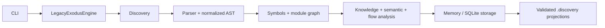

# LegacyExodus

> Understand the Legacy. Engineer the Future.

LegacyExodus is a deterministic local JavaScript/TypeScript repository-intelligence and static-analysis engine. It inventories a repository, parses supported source files, extracts symbols, resolves supported module relationships, builds dependency, knowledge, semantic, control-flow, and data-flow artifacts, and projects validated results to `.discovery/`.

It is intended to evolve into a governed legacy-modernization platform. Code transformation, migration planning, AI/LLM integration, Rust/Axum/SQLx generation, compiler sandboxes, deployment automation, and behavioral-equivalence certification are **target architecture and are not implemented**.

## Current implementation

| Capability | State | Evidence boundary |
|---|---|---|
| Bun + strict TypeScript runtime, lifecycle, CLI | `VERIFIED` | Current source and automated tests |
| JavaScript/TypeScript discovery and Babel-based parsing | `VERIFIED` | Supported static syntax; parser failures remain explicit |
| Lexical symbols, ESM/CommonJS relationships, module/dependency graphs | `VERIFIED` | Conservative resolution; ambiguous/dynamic targets remain unresolved |
| Knowledge graph, semantic call analysis, CFG, DFG, conservative taint facts | `VERIFIED` | Static analysis only; not runtime or behavioral proof |
| In-memory and SQLite storage, run isolation, snapshot reuse | `VERIFIED` | Persisted artifacts are schema- and integrity-validated before reuse |
| Deterministic `.discovery/*.json` projections | `VERIFIED` | Atomic, contained publication with manifest hashes |
| Plugin runtime contracts | `IMPLEMENTED` | No marketplace, dynamic package loading, or sandboxed third-party execution |
| Migration planning and code transformation | `NOT IMPLEMENTED` | Target architecture |
| AI gateway and multi-agent generation | `NOT IMPLEMENTED` | Target architecture |
| Rust/Axum/SQLx generation and equivalence verification | `NOT IMPLEMENTED` | Target architecture |

The exact synchronized implementation boundary is recorded in [Current Implementation](docs/CURRENT_IMPLEMENTATION.md).

<table>
  <tr>
    <td><strong>Observe</strong><br/>Inventory repositories without rewriting source.</td>
    <td><strong>Understand</strong><br/>Build deterministic symbols and static graphs.</td>
    <td><strong>Persist</strong><br/>Store run-scoped evidence and validated projections.</td>
    <td><strong>Stay honest</strong><br/>Keep unknown and future capabilities explicit.</td>
  </tr>
</table>

## Supported inputs and limitations

- First-class analysis targets are repository-local JavaScript and TypeScript, including JSX/TSX and supported ESM/CommonJS patterns.
- Discovery also inventories non-source artifacts; they are not misreported as unsupported source.
- Resolution is deliberately conservative. Dynamic dispatch, runtime metaprogramming, framework behavior, and unsupported syntax may remain unresolved.
- Framework-specific semantics are currently narrow and Express-focused; comprehensive React, NestJS, Angular, Vue, Fastify, and other framework runtime models are future work.
- Taint propagation uses built-in deterministic source, sink, and sanitizer rules; project-configurable or plugin-extensible policy is not implemented.
- Module resolution covers repository-local relative modules and proven `tsconfig` aliases, not full Node, `node_modules`, package `exports`/`imports`, or npm/pnpm/Yarn workspace semantics.
- Static graphs are evidence about source structure, not proof of runtime behavior, vulnerability absence, or migration safety.
- Benchmark fidelity is sample-based. Whole-repository migration safety is not established.
- Large-repository bounded-memory behavior remains an engineering concern; no claim of unlimited scale is made.

## Quick start

Prerequisites: the Bun version declared in [`legacy-exodus-core/package.json`](legacy-exodus-core/package.json).

```bash
cd legacy-exodus-core
bun install --frozen-lockfile
bun run legacy-exodus status
bun run legacy-exodus init ../sample-project
bun run legacy-exodus analyze ../sample-project
bun run legacy-exodus analyze ../sample-project --json
```

`init` creates `.legacy-exodus/config.json`. `analyze` observes source files but writes generated analysis projections under the target repository's `.discovery/` directory; SQLite persistence is available through the documented storage flags.

## Verification

```bash
cd legacy-exodus-core
bun run typecheck
bun test
bun run benchmark audit
bun run src/cli/index.ts --help
```

### Synchronized checkpoint

| Evidence | Result |
|---|---|
| Core integration truth | `origin/core-foundation` at `204f123ac374c3fefa4ccc0f4d5decb80a1e9b9f` |
| Main promotion truth | `origin/main` at `6f88ec57d8275c6a367018d3106b537a26cbc2d1` |
| Verification evidence | Run the canonical commands above for the exact revision under review; live command and hosted-CI output are authoritative. |

The SHAs are synchronization markers, not permanent capability promises.

## Toolchain snapshot

| Component | Current core value |
|---|---|
| Bun | `1.4.2` package manager (`>=1.3.0` engine range) |
| TypeScript | `7.0.2` |
| Babel parser | `8.0.4` |
| Zod | `4.5.4` |
| Commander | `15.0.0` |
| Pino | `10.3.1` |

## Architecture



Current analysis is deterministic for supported inputs and contracts. Unknown or ambiguous relationships must remain explicit rather than being fabricated.

## Target architecture

The four-stage product direction remains:

1. **VyrixScout** — repository discovery (`IMPLEMENTED`).
2. **NolaraStruct** — deterministic program understanding (`PARTIAL`: substantial static-analysis core exists; full language/runtime semantics do not).
3. **ZelvoxForge** — migration planning and transformation (`TARGET ARCHITECTURE`).
4. **VymosGate** — generated-system validation and approval (`TARGET ARCHITECTURE`; current benchmark governance is not this full stage).

See the [documentation index](docs/README.md), [system overview](docs/architecture/system-overview.md), and [pipeline status](docs/pipeline/pipeline-overview.md).

## Navigate

| Need | Start here |
|---|---|
| Current capability boundary | [Current Implementation](docs/CURRENT_IMPLEMENTATION.md) |
| Architecture | [System Overview](docs/architecture/system-overview.md) |
| CLI usage | [Command Reference](docs/development/cli/commands.md) |
| Contribution workflow | [Contributing](CONTRIBUTING.md) |
| Complete documentation map | [Documentation Map](docs/DOCUMENTATION_MAP.md) |

## Repository governance

- `core-foundation`: implementation integration truth.
- `docs-foundation`: documentation integration truth.
- `main`: integrated/release truth.
- All changes use temporary task branches.
- Documentation follows verified implementation; it never changes engine behavior by assertion.

See [CONTRIBUTING.md](CONTRIBUTING.md) and [Security](SECURITY.md). Development agents on the implementation branch also follow the repository's root `AGENTS.md` and `.agents/` skills.

## License

[MIT](LICENSE)
