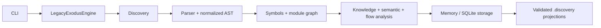

# LegacyExodus

> Understand the Legacy. Engineer the Future.

LegacyExodus is a deterministic local JavaScript/TypeScript repository-intelligence and static-analysis engine. It inventories a repository, parses supported source files, extracts symbols, resolves supported module relationships, builds dependency, knowledge, semantic, control-flow, and data-flow artifacts, and projects validated results to `.discovery/`.

It is intended to evolve into a governed legacy-modernization platform. Code transformation, migration planning, AI/LLM integration, Rust/Axum/SQLx generation, compiler sandboxes, deployment automation, and behavioral-equivalence certification are **target architecture and are not implemented**.

## Current implementation

| Capability | State | Evidence boundary |
|---|---|---|
| Bun + strict TypeScript runtime, lifecycle, CLI | `VERIFIED` | Current source and automated tests |
| JavaScript/TypeScript discovery and Babel-based parsing | `IMPLEMENTED` | Parser failures remain explicit. The Babel dialect is chosen per file extension: `.d.ts` uses declaration mode, `.ts` has no JSX, `.tsx` has JSX, and JavaScript gets JSX plus pragma-only Flow; the source type is fixed per extension (BA-01). Known limit: in JavaScript, a statement that is only `type`, `declare` or `opaque` at a line end followed by an assignment misparses as Flow (rare; valid via ASI) |
| Lexical symbols, ESM/CommonJS relationships, module/dependency graphs | `PARTIAL` | JavaScript lexical scoping and conservative resolution hold. TypeScript enums, namespaces (with their own scope), interfaces, type aliases, `declare function`, `import x = require()` and `export =` are modelled (BA-02); TS `./x.js` to `x.ts` resolution, JSONC tsconfig/jsconfig with `extends`, `paths` precedence and baseUrl-only imports are resolved (BA-03). Still open: class-expression members lose their class (BA-13), namespace imports bind to an arbitrary export (BA-09), dynamic `import()` is not modelled (BA-10), compiled CommonJS calls do not resolve (BA-12), and package/workspace resolution and `node_modules` stay unresolved (#117) |
| Semantic call analysis and CFG | `PARTIAL` | Call targets are resolved only when proven. The CFG is oracle-checked: no loops from unreachable code, unique ids for copied `finally` blocks and clause exception edges for labelled loops (BA-14). Still open: compiled CommonJS calls do not resolve (BA-12) and class-expression members lose their class (BA-13) |
| DFG and taint facts | `PARTIAL` | Flows through loops, `switch`, `try` and short-circuit expressions and direct source arguments are missed, conditional values can be over-labelled, and the taint policy is narrow (BA-04 to BA-07) |
| Knowledge graph | `PARTIAL` | File and symbol nodes with contains/imports edges only (BA-19) |
| In-memory and SQLite storage, run isolation, snapshot reuse | `VERIFIED` | Persisted artifacts are schema- and integrity-validated before reuse |
| Deterministic `.discovery/*.json` projections | `VERIFIED` | Atomic, contained publication with manifest hashes; locale-independent ordering |
| Plugin runtime contracts | `IMPLEMENTED` | No marketplace, dynamic package loading, or sandboxed third-party execution |
| Migration planning and code transformation | `NOT IMPLEMENTED` | Target architecture |
| AI gateway and multi-agent generation | `NOT IMPLEMENTED` | Target architecture |
| Rust/Axum/SQLx generation and equivalence verification | `NOT IMPLEMENTED` | Target architecture |

Finding ids (BA-xx) refer to the [2026-10-28 blind audit](https://github.com/raitaskeen/LegacyExodus/pull/203) (an open draft PR that holds the audit reports). Static analysis is evidence about source structure, not runtime or behavioral proof.

The current capability boundary, with its limits, is recorded in [Current Implementation](docs/CURRENT_IMPLEMENTATION.md).

<table>
  <tr>
    <td><strong>Observe</strong><br/>Inventory repositories without rewriting source.</td>
    <td><strong>Understand</strong><br/>Build deterministic symbols and static graphs.</td>
    <td><strong>Persist</strong><br/>Store run-scoped evidence and validated projections.</td>
    <td><strong>Stay honest</strong><br/>Keep unknown and future capabilities explicit.</td>
  </tr>
</table>

## Supported inputs and limitations

- First-class analysis targets are repository-local JavaScript and TypeScript, including JSX/TSX and supported ESM/CommonJS patterns.
- Discovery also inventories non-source artifacts; they are not misreported as unsupported source.
- Resolution is deliberately conservative. Dynamic dispatch, runtime metaprogramming, framework behavior, and unsupported syntax may remain unresolved.
- Framework-specific semantics are currently narrow and Express-focused, and Express route facts are `INFERRED`: per-router middleware, handlers and mount paths are not yet modelled (BA-08). Comprehensive React, NestJS, Angular, Vue, Fastify, and other framework runtime models are future work.
- Taint propagation uses built-in deterministic source, sink, and sanitizer rules; project-configurable or plugin-extensible policy is not implemented.
- Module resolution covers repository-local relative modules and proven `tsconfig` aliases, not full Node, `node_modules`, package `exports`/`imports`, or npm/pnpm/Yarn workspace semantics.
- Static graphs are evidence about source structure, not proof of runtime behavior, vulnerability absence, or migration safety.
- Benchmark fidelity is sample-based. Whole-repository migration safety is not established.
- Large-repository bounded-memory behavior remains an engineering concern; no claim of unlimited scale is made.

## Quick start

Prerequisites: the Bun version declared in [`legacy-exodus-core/package.json`](legacy-exodus-core/package.json).

```bash
cd legacy-exodus-core
bun install --frozen-lockfile
bun run legacy-exodus status
bun run legacy-exodus init ../sample-project
bun run legacy-exodus analyze ../sample-project
bun run legacy-exodus analyze ../sample-project --json
```

`init` creates `.legacy-exodus/config.json`. `analyze` observes source files but writes generated analysis projections under the target repository's `.discovery/` directory; SQLite persistence is available through the documented storage flags.

## Verification

```bash
cd legacy-exodus-core
bun run typecheck
bun test
bun run benchmark audit
bun run src/cli/index.ts --help
```

`main` is the implementation truth. Run the commands above on the exact revision under review; live command and hosted-CI output are authoritative.

## Toolchain snapshot

| Component | Current core value |
|---|---|
| Bun | `1.4.2` package manager (`>=1.3.0` engine range) |
| TypeScript | `7.0.2` |
| Babel parser | `8.0.4` |
| Zod | `4.5.4` |
| Commander | `15.0.0` |
| Pino | `10.3.1` |

## Architecture



Current analysis is deterministic for supported inputs and contracts. Unknown or ambiguous relationships must remain explicit rather than being fabricated.

## Target architecture

The four-stage product direction remains:

1. **VyrixScout** — repository discovery (`IMPLEMENTED`).
2. **NolaraStruct** — deterministic program understanding (`PARTIAL`: substantial static-analysis core exists; full language/runtime semantics do not).
3. **ZelvoxForge** — migration planning and transformation (`TARGET ARCHITECTURE`).
4. **VymosGate** — generated-system validation and approval (`TARGET ARCHITECTURE`; current benchmark governance is not this full stage).

See the [documentation index](docs/README.md), [system overview](docs/architecture/system-overview.md), and [pipeline status](docs/pipeline/pipeline-overview.md).

## Navigate

| Need | Start here |
|---|---|
| Current capability boundary | [Current Implementation](docs/CURRENT_IMPLEMENTATION.md) |
| Architecture | [System Overview](docs/architecture/system-overview.md) |
| CLI usage | [Command Reference](docs/development/cli/commands.md) |
| Contribution workflow | [Contributing](CONTRIBUTING.md) |
| Complete documentation map | [Documentation Map](docs/DOCUMENTATION_MAP.md) |

## Repository governance

- `main` is the single implementation, documentation and release truth. `core-foundation` and `docs-foundation` are retired as integration branches (2026-10-28).
- All changes use temporary task branches and pull requests into `main`.
- Documentation follows verified implementation; it never changes engine behavior by assertion.

See [CONTRIBUTING.md](CONTRIBUTING.md) and [Security](SECURITY.md). Development agents on the implementation branch also follow the repository's root `AGENTS.md` and `.agents/` skills.

## License

[MIT](LICENSE)
