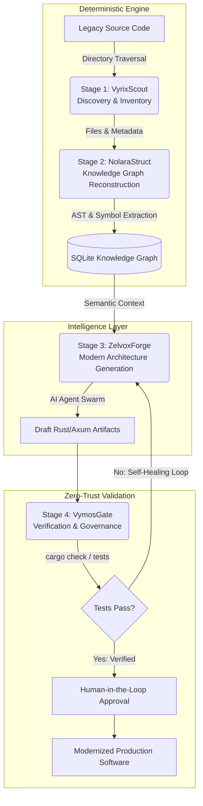

<div align="center">
  <picture>
    
  </picture>

  <h1>LegacyExodus</h1>
  <p><strong>Enterprise-Grade Autonomous Software Modernization Platform</strong></p>

  <p>
    <a href="docs/community/CODE_OF_CONDUCT.md"></a>
    <a href="docs/development/contribution-guide.md"></a>
    <a href="docs/security/security-principles.md"></a>
    <a href="LICENSE"></a>
  </p>
  <p>
    
    
    
    
  </p>

  <p>
    <em>A knowledge-first engineering platform that systematically maps, documents, and safely transforms complex legacy software systems into memory-safe architectures.</em>
  </p>
</div>

---

## 1. Executive Vision

Software modernization must be driven by rigorous deterministic understanding, not by blind, probabilistic code generation. 

LegacyExodus is not a simple Large Language Model (LLM) wrapper, nor is it a basic AST transpiler. It is a **strictly typed, CQRS-based compiler pipeline**. It is designed to ingest massive, undocumented codebases, extract their underlying architectural knowledge, model their business behavior, and produce high-confidence migrations to memory-safe languages (like Rust) under strict human oversight.

> **Principal Insight: The Epistemological Imperative** <br>
> *Understand deterministically first. Transform probabilistically second. Verify cryptographically always.* <br>
> Naive AI tools attempt to modernize software by predicting tokens. LegacyExodus modernizes software by reconstructing the mathematical and topological reality of the system *before* a single line of target code is generated. By treating migration as a continuous, verifiable engineering pipeline rather than a prompt-engineering trick, LegacyExodus preserves business logic, systematically eliminates technical debt, and maintains absolute developer trust.

---

## 2. The Legacy Crisis & The Pipeline Architecture

Millions of mission-critical enterprise applications run on fragile, tightly coupled technology stacks. When attempting to modernize these systems, organizations increasingly turn to naive AI generation—feeding raw legacy files into an LLM and asking for a Rust/Go translation. 

This approach fatally ignores the realities of enterprise software. It results in **topological hallucinations**, missed dependency graphs, and complete architectural failure because LLMs lack the global deterministic context of the application state. LegacyExodus completely decouples *comprehension* from *generation* via four heavily isolated architectural stages.

### The Autonomous Architecture



---

## 3. The Four-Stage Modernization Pipeline

LegacyExodus executes its migration via four distinct, strictly governed architectural stages.

<table>
  <thead>
    <tr>
      <th align="left" width="15%">Pipeline Stage</th>
      <th align="left" width="15%">Codename</th>
      <th align="left" width="50%">Primary Responsibility</th>
      <th align="left" width="20%">Paradigm</th>
    </tr>
  </thead>
  <tbody>
    <tr>
      <td align="left"><b>Stage 1</b></td>
      <td align="left"><code>VyrixScout</code></td>
      <td align="left"><b>Legacy Intelligence Discovery.</b> Maps physical boundaries, detects languages, maps static dependencies, and surfaces framework signals. It builds the initial immutable <code>ProjectState</code> without modifying source files.</td>
      <td align="left">100% Deterministic</td>
    </tr>
    <tr>
      <td align="left"><b>Stage 2</b></td>
      <td align="left"><code>NolaraStruct</code></td>
      <td align="left"><b>Knowledge Reconstruction.</b> Parses ASTs, extracts cross-file symbols, resolves import/export graphs, and discovers abstract business rules. Transforms raw syntax into a vendor-agnostic Knowledge Graph.</td>
      <td align="left">100% Deterministic</td>
    </tr>
    <tr>
      <td align="left"><b>Stage 3</b></td>
      <td align="left"><code>ZelvoxForge</code></td>
      <td align="left"><b>Modern Architecture Generation.</b> AI agents systematically plan architectures and generate modern code (Rust/Axum/SQLx) based <i>strictly</i> on the Knowledge Graph, never the raw source files.</td>
      <td align="left">Probabilistic (AI)</td>
    </tr>
    <tr>
      <td align="left"><b>Stage 4</b></td>
      <td align="left"><code>VymosGate</code></td>
      <td align="left"><b>Verification & Governance.</b> Enforces Zero-Trust security, executes native compilation checks, runs automated testing, and acts as the Human-in-the-Loop (HITL) approval gate.</td>
      <td align="left">100% Deterministic</td>
    </tr>
  </tbody>
</table>

---

## 4. Deep Dive: The Understanding Phase

The true power of LegacyExodus lies not in how it writes code, but in how it *reads* it. Before probabilistic AI is ever engaged, the platform utilizes deterministic parsing to extract the core business logic of the enterprise.

### Core Business Logic Extraction (`NolaraStruct`)
Legacy software hides critical business decisions (e.g., *"If the user has been active for 5 years, bypass the standard authorization check"*) inside deeply nested, undocumented, and fragile `if` statements scattered across multiple controllers. 

If you feed this directly to an LLM, it attempts to recreate the exact syntactic mess in the new language. 

`NolaraStruct` solves this by traversing the Abstract Syntax Tree (AST) and abstracting these conditionals into a semantic, mathematical model. By the time the code generator accesses this data, it is reading a strictly typed `BusinessRule` entity that maps the relationship between preconditions, operations, and state changes. This ensures **zero logical data loss** during migration and produces modernized code that is idiomatic, clean, and fully documented.

---

## 5. Deep Dive: Generation & The Self-Healing Loop

Once the system has been mapped deterministically, LegacyExodus engages its probabilistic AI swarms inside a strictly governed sandbox. 

### The Autonomous Self-Healing Loop
AI code generation is inherently flawed. When migrating to a memory-safe language like Rust, LegacyExodus expects the initial AI-generated output to fail the strict borrow checker. 

Instead of crashing or presenting broken code to the user, `VymosGate` acts as a relentless, deterministic adjudicator:
1. **Compilation Attempt:** `VymosGate` executes `cargo check` on the generated Rust artifact in an isolated sandbox.
2. **Diagnostic Capture:** The native compiler inevitably throws errors (e.g., `E0382: use of moved value`).
3. **Feedback Routing:** `VymosGate` captures the exact JSON diagnostic and routes it back to the `RepairAgent` inside `ZelvoxForge`.
4. **Iterative Repair:** The `RepairAgent` receives the faulty code, the original AST context, and the exact compiler error. It adjusts the lifetimes, ownership rules, or mutability and submits a patch.
5. **Success:** This loop runs continuously at machine speed until the native compiler returns a `0` exit code. 

**No code reaches a human engineer until it is mathematically proven to compile and pass local tests.**

---

## 6. Core Engineering Paradigms

To survive in an enterprise environment, LegacyExodus adheres to strict engineering constraints. We prioritize architectural purity, mathematical traceability, and deterministic safety over rapid prototyping.

> **Principal Insight: Boundaries Define Scalability** <br>
> *In a multi-agent system, synchronous orchestration leads to deadlocks and fragile failure cascades. LegacyExodus contains chaos at the boundary by ensuring AI agents never directly mutate state. They can only suggest Intents (Commands), which are ruthlessly validated by the deterministic core.*

### I. Domain-Driven Design (DDD)
The ubiquitous language of LegacyExodus strictly separates the **Engine** from the **Workflow**. 
*   **The Engine** owns the static representations of reality: `Workspace`, `Project`, `File`, `Symbol`, `Dependency`. 
*   **The Workflow** owns the dynamic transitions of state: `Command`, `MigrationTask`, `Event`, `Diagnostic`.

### II. CQRS & Hybrid Event Sourcing
Agents and deterministic services **never** mutate state directly. 
1.  **Command (Intent):** A component emits a `Command` (e.g., `DiscoverProjectCommand`).
2.  **Governance Validation:** The Orchestrator validates the command against Zero-Trust security policies.
3.  **Event (Fact):** If valid, an immutable `Event` is appended to a `.jsonl` Event Store.
4.  **Projection:** The current state is purely a materialized projection of that log (stored in SQLite/Memory), enabling flawless time-travel debugging, exact audit trails, and instant state rollback.

---

## 7. Current Status: Active Development (Phase 2.2)

LegacyExodus is currently in active implementation. We have successfully completed the foundational architecture and the entire Discovery engine (`VyrixScout`). The platform is no longer just a skeleton; it can safely inspect a real enterprise project and produce deterministic discovery knowledge.

> **Principal Insight: Decoupling Storage from Discovery** <br>
> *In Phase 2.2, we ensured the Discovery Service remains entirely read-only. It does not know how files are written. It communicates solely through a `StorageManager`, allowing us to project discovery artifacts to `.discovery/*.json` today, while maintaining the architectural freedom to swap this for SQLite, Postgres, or Cloud Storage tomorrow without altering the core logic.*

### Operational Capabilities Today:
*   **Enterprise Runtime:** Built on Bun with strict TypeScript, Zod boundary validation, structured Pino logging, and a robust error hierarchy.
*   **CQRS Orchestration:** Fully functioning Command validation, Event appending, synchronous Event Bus, and State Reducer replay logic.
*   **VyrixScout Discovery:** Deterministically scans legacy repositories, respects ignore rules (`.git`, `node_modules`), detects languages via extensions, and parses `package.json` for metadata.
*   **Framework Detection:** Emits signals for detected architectures (e.g., Express, React, MongoDB) based on dependency graphs and directory patterns.
*   **Durable Projections:** Emits isolated, deterministic artifact files (`project.json`, `files.json`, `dependencies.json`, `frameworks.json`, `summary.json`) via a strict Storage Adapter pattern.

---

## 8. Quick Start: Local Discovery Analysis

While LegacyExodus is not yet ready for autonomous code generation (Phase 3), the underlying CQRS engine and `VyrixScout` discovery service are fully functional for local architectural analysis.

### Prerequisites
*   [Bun](https://bun.sh/) (v1.0 or higher)
*   OS: Linux, macOS, or WSL2 (Windows)

### Installation
```bash
# Clone the repository
git clone [https://github.com/raitaskeen/LegacyExodus.git](https://github.com/raitaskeen/LegacyExodus.git)
cd LegacyExodus/legacy-exodus-core

# Install deterministic dependencies
bun install

# Verify strict TypeScript compliance and execute test suite
bun run typecheck
bun test
```

### CLI Usage (Phase 2.2)
You can point LegacyExodus at any existing legacy Node.js/Express repository to generate a deterministic architectural inventory.

```bash
# Check the status of the engine lifecycle and configuration
bun run legacy-exodus status

# List registered plugins in the current runtime context
bun run legacy-exodus plugins list

# Initialize the legacy workspace state
bun run legacy-exodus init ../my-legacy-app

# Run VyrixScout discovery and project the deterministic JSON artifacts
bun run legacy-exodus analyze ../my-legacy-app --json
```

**What happens under the hood?**
The CLI dispatches an `AnalyzeProjectCommand` to the Orchestrator. The engine reads the directory without modifying it, inventories the files deterministically, and publishes `FileDiscovered` and `DependencyDetected` events. Finally, the `FileDiscoveryProjectionAdapter` safely outputs the artifacts to a local `.discovery/` directory.

---

## 9. The Enterprise Documentation Hub

LegacyExodus relies on a massive, highly structured documentation hub. In this repository, architecture must be fully reasoned, documented, and peer-reviewed *before* code is written. 

If you are a contributor, open-source maintainer, or enterprise architect, reading the foundational documents is mandatory.

> **Principal Insight: Documentation as Code** <br>
> *Our documentation is not an afterthought; it is the contract by which the system operates. We use Architecture Decision Records (ADRs) to permanently log the "Why" behind every structural shift.*

### 🏛 The Constitution
*   **[`docs/PROJECT_CONTEXT.md`](docs/PROJECT_CONTEXT.md):** The core philosophy, engineering axioms, and strict rules of engagement.
*   **[`docs/AI_CONTEXT.md`](docs/AI_CONTEXT.md):** The Copilot/AI operating manual for maintaining architectural consistency.

### 📐 System Architecture & Design
*   **[`system-overview.md`](docs/architecture/system-overview.md):** High-level mapping of the platform.
*   **[`domain-model.md`](docs/domain/domain-model.md):** The definitive ubiquitous language and entity relationship map.
*   **[`governance-model.md`](docs/security/governance-model.md):** How we enforce Zero-Trust, isolate AI agents, and prevent prompt injection.

### 📜 Architecture Decision Records (ADRs)
*   **[`ADR-001: Project State Architecture`](docs/adr/ADR-001-project-state-architecture.md):** The decision to use Hybrid Event Sourcing over direct CRUD mutations.
*   **[`ADR-002: Event System Governance`](docs/adr/ADR-002-event-system-governance.md):** How Optimistic Concurrency and CQRS protect the platform.

*(For a complete index of all internal documentation—including API contracts, testing strategies, and stage architecture—please refer to the [`docs/DOCUMENTATION_MAP.md`](docs/DOCUMENTATION_MAP.md)).*

---

## 10. Technology Stack, Governance, and Security

Every tool in the LegacyExodus stack is chosen for speed, type safety, and local execution capabilities to support massive enterprise codebases (100,000+ files).

*   **Runtime:** `Bun` — Chosen for its ultra-fast File I/O, native TypeScript execution, and built-in SQLite driver.
*   **Language:** `TypeScript` (Strict) — Enforces rigorous data contracts. Paired with `Zod`, it guarantees that malformed AI outputs crash at the boundary layer rather than corrupting the internal state.
*   **Target Architecture:** `Rust` / `Axum` / `SQLx` — The ultimate destination for modernized code (`ZelvoxForge`). Chosen for strict memory safety, fearless concurrency, and enterprise performance.

### Governance & Contributing
We operate under strict enterprise contribution guidelines. We welcome open-source collaboration, but all architectural changes must be heavily scrutinized against our core axioms.
1.  Familiarize yourself with our [Domain Model](docs/domain/domain-model.md) and [ADRs](docs/adr).
2.  Open an Architecture Proposal Issue and draft a new ADR before modifying state or event flow.
3.  AI must never bypass the Orchestrator or the Event Bus.
4.  No PR will be reviewed without accompanying unit/integration tests for deterministic services.

Please review our [Code of Conduct](docs/community/CODE_OF_CONDUCT.md) and [Contributing Guide](docs/development/contribution-guide.md).

### Security & Responsible Disclosure
Security is a non-negotiable engineering primitive. If you discover a vulnerability—specifically regarding sandbox escapes, prompt injection risks via malicious legacy comments, or event-log corruption vectors—**do not open a public issue.** Please refer to our [Security Policy](docs/security/security-principles.md) for responsible disclosure protocols.

---

### Recent Contributions

<div align="center">
  <!-- Repobeats contribution tracker -->
  <a href="https://github.com/raitaskeen/LegacyExodus/graphs/contributors">
    
  </a>
</div>

---

## License

LegacyExodus is open-source software licensed under the **[BSD-3-Clause License](LICENSE)**. 

<div align="center">
  <br>
  <i>Built for the future of software engineering.</i>
</div>
