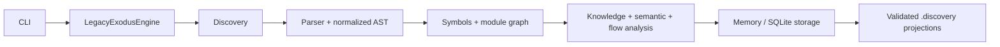

# LegacyExodus

> Understand the Legacy. Engineer the Future.

LegacyExodus is a deterministic local JavaScript/TypeScript repository-intelligence and static-analysis engine. It inventories a repository, parses supported source files, extracts symbols, resolves supported module relationships, builds dependency, knowledge, semantic, control-flow, and data-flow artifacts, and projects validated results to `.discovery/`.

It is intended to evolve into a governed legacy-modernization platform. Code transformation, migration planning, AI/LLM integration, Rust/Axum/SQLx generation, compiler sandboxes, deployment automation, and behavioral-equivalence certification are **target architecture and are not implemented**.

## Current implementation

| Capability | State | Evidence boundary |
|---|---|---|
| Bun + strict TypeScript runtime, lifecycle, CLI | `VERIFIED` | Current source and automated tests |
| JavaScript/TypeScript discovery and Babel-based parsing | `IMPLEMENTED` | Parser failures remain explicit; a file too deep for the parser's stack is a resource limit, not a syntax error (NA-10). The Babel dialect is chosen per file extension (BA-01). Ignore rules and skipped symbolic links are reported, never silently dropped (BA-15, NA-07). Known limit: in JavaScript, a statement that is only `type`, `declare` or `opaque` at a line end followed by an assignment misparses as Flow (rare; valid via ASI) |
| Lexical symbols, ESM/CommonJS relationships, module/dependency graphs | `PARTIAL` | JavaScript lexical scoping and conservative resolution hold. TypeScript declarations (BA-02), TS module resolution (BA-03), class expressions (BA-13), namespace imports (BA-09), dynamic `import()` (BA-10), compiled CommonJS (BA-12) and workspace packages by name (S3) are modelled. Not resolved by design: third-party packages in `node_modules` and package `exports`/`imports` maps |
| Semantic call analysis and CFG | `PARTIAL` | Every call site is a fact: a callee no name denotes (`a().b()`, `o[k]()`, `super.m()`) is an explicit UNRESOLVED call, never absent (NA-01). A target is RESOLVED only when proven; `with` and direct `eval` make names unproven (NA-02). Fact ids are edit-stable (ADR-008). Every CFG resolves; the CFG is oracle-checked (BA-14). Implicit calls (getters, `toString`, iterators, Proxies) are not call edges |
| DFG and taint facts | `PARTIAL` | Data flow runs on the CFG: joins at loops, `switch`, `try` and short-circuits; control-only use is not data (BA-04 to BA-06). Flows cross files, including a call result used directly (NA-03a). Policy `builtin-3`: Express request sources, `child_process`/`vm`/`eval`/`Function` sinks, and file-path (`fs`) and request-URL (`http`, `https`, `fetch`) sinks judged on that argument only (BA-07, NA-03b). Also tracked: a value through a returned object field (NA-03c), into an array-method callback (NA-03d), and SQL run through a client instance such as `mysql.createConnection().query` (NA-03e). The conformance known-gaps ledger is empty |
| Knowledge graph | `PARTIAL` | File and symbol nodes with contains/imports edges only (BA-19) |
| In-memory and SQLite storage, run isolation, snapshot reuse | `VERIFIED` | Persisted artifacts are schema- and integrity-validated before reuse; a refused snapshot is reported with its reason (NA-11). Concurrent writers wait for the SQLite lock and fail with `STORAGE_BUSY` past it (NA-08). Known limit: reusing a snapshot holds it in memory (8.9 GB on Ghost; ADR-011 proposed, NA-16) |
| Deterministic `.discovery/*.json` projections | `VERIFIED` | Facts are identical across runs, machines, timezones and locales, and fact artifacts are byte-identical across CLI runs: run identity lives in `manifest.json` only (ADR-010, NA-06). Atomic, contained publication with manifest hashes |
| Plugin runtime contracts | `IMPLEMENTED` | No marketplace, dynamic package loading, or sandboxed third-party execution |
| Migration planning and code transformation | `NOT IMPLEMENTED` | Target architecture |
| AI gateway and multi-agent generation | `NOT IMPLEMENTED` | Target architecture |
| Rust/Axum/SQLx generation and equivalence verification | `NOT IMPLEMENTED` | Target architecture |

Finding ids refer to the [2026-10-28 blind audit](https://github.com/raitaskeen/LegacyExodus/pull/203) (BA-xx) and the 2026-11-08 fresh audit (NA-xx); both reports and the live remediation queue are on the `audit/2026-10-28-blind-audit` branch (draft PR #203). Static analysis is evidence about source structure, not runtime or behavioral proof.

The current capability boundary, with its limits, is recorded in [Current Implementation](docs/CURRENT_IMPLEMENTATION.md).

<table>
  <tr>
    <td><strong>Observe</strong><br/>Inventory repositories without rewriting source.</td>
    <td><strong>Understand</strong><br/>Build deterministic symbols and static graphs.</td>
    <td><strong>Persist</strong><br/>Store run-scoped evidence and validated projections.</td>
    <td><strong>Stay honest</strong><br/>Keep unknown and future capabilities explicit.</td>
  </tr>
</table>

## Supported inputs and limitations

- First-class analysis targets are repository-local JavaScript and TypeScript, including JSX/TSX and supported ESM/CommonJS patterns.
- Discovery also inventories non-source artifacts; they are not misreported as unsupported source.
- Resolution is deliberately conservative. Dynamic dispatch, runtime metaprogramming, framework behavior, and unsupported syntax may remain unresolved.
- Framework-specific semantics are narrow and Express-focused. Express routes and middleware are modelled per router, in registration order, through mounts (BA-08), and stay `INFERRED`. React, NestJS, Angular, Vue, Fastify and other framework runtime models are future work.
- Taint propagation uses built-in deterministic source, sink, and sanitizer rules; project-configurable or plugin-extensible policy is not implemented.
- Module resolution covers repository-local modules, proven `tsconfig` paths and npm/Yarn/pnpm workspace packages by name (S3). Third-party packages in `node_modules` and package `exports`/`imports` maps are not resolved.
- Static graphs are evidence about source structure, not proof of runtime behavior, vulnerability absence, or migration safety.
- Benchmark fidelity is sample-based. Whole-repository migration safety is not established.
- Measured scale: Ghost (about 7,200 analyzed files) takes about 3.5–4 minutes at 1.7–2.2 GB peak memory on a fresh analysis, and a synthetic 10,000-file repository stays under its CI ceiling. Memory still grows with repository size, and snapshot reuse is far heavier (NA-16); no claim of unlimited scale is made.

## Quick start

Prerequisites: the Bun version declared in [`legacy-exodus-core/package.json`](legacy-exodus-core/package.json).

```bash
cd legacy-exodus-core
bun install --frozen-lockfile
bun run legacy-exodus status
bun run legacy-exodus init ../sample-project
bun run legacy-exodus analyze ../sample-project
bun run legacy-exodus analyze ../sample-project --json
```

`init` creates `.legacy-exodus/config.json`. `analyze` observes source files but writes generated analysis projections under the target repository's `.discovery/` directory; SQLite persistence is available through the documented storage flags.

## Verification

```bash
cd legacy-exodus-core
bun run typecheck
bun test
bun run benchmark audit
bun run src/cli/index.ts --help
```

`main` is the implementation truth. Run the commands above on the exact revision under review; live command and hosted-CI output are authoritative.

## Toolchain snapshot

| Component | Current core value |
|---|---|
| Bun | `1.4.2` package manager (`>=1.3.0` engine range) |
| TypeScript | `7.0.2` |
| Babel parser | `8.0.4` |
| Zod | `4.5.4` |
| Commander | `15.0.0` |
| Pino | `10.3.1` |

## Architecture



Current analysis is deterministic for supported inputs and contracts. Unknown or ambiguous relationships must remain explicit rather than being fabricated.

## Target architecture

The four-stage product direction remains:

1. **VyrixScout** — repository discovery (`IMPLEMENTED`).
2. **NolaraStruct** — deterministic program understanding (`PARTIAL`: substantial static-analysis core exists; full language/runtime semantics do not).
3. **ZelvoxForge** — migration planning and transformation (`TARGET ARCHITECTURE`).
4. **VymosGate** — generated-system validation and approval (`TARGET ARCHITECTURE`; current benchmark governance is not this full stage).

See the [documentation index](docs/README.md), [system overview](docs/architecture/system-overview.md), and [pipeline status](docs/pipeline/pipeline-overview.md).

## Navigate

| Need | Start here |
|---|---|
| Current capability boundary | [Current Implementation](docs/CURRENT_IMPLEMENTATION.md) |
| Architecture | [System Overview](docs/architecture/system-overview.md) |
| CLI usage | [Command Reference](docs/development/cli/commands.md) |
| Contribution workflow | [Contributing](CONTRIBUTING.md) |
| Complete documentation map | [Documentation Map](docs/DOCUMENTATION_MAP.md) |

## Repository governance

- `main` is the single implementation, documentation and release truth. `core-foundation` and `docs-foundation` are retired as integration branches (2026-10-28).
- All changes use temporary task branches and pull requests into `main`.
- Documentation follows verified implementation; it never changes engine behavior by assertion.

See [CONTRIBUTING.md](CONTRIBUTING.md) and [Security](SECURITY.md). Development agents on the implementation branch also follow the repository's root `AGENTS.md` and `.agents/` skills.

## License

[MIT](LICENSE)
