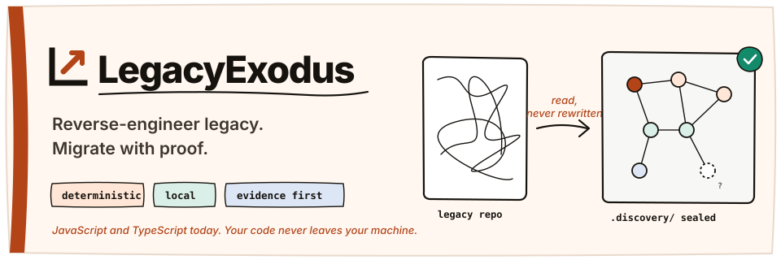
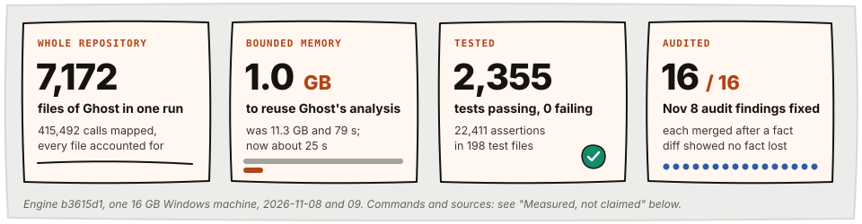
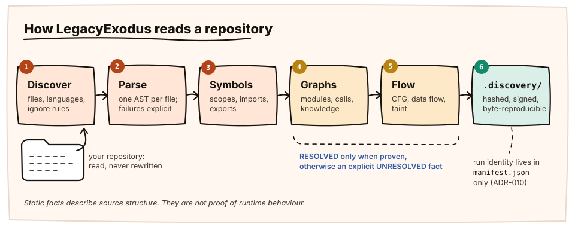
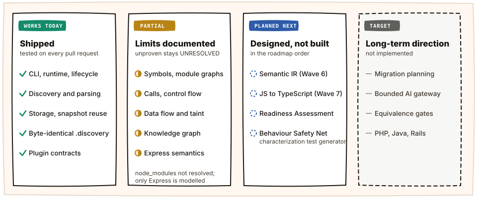
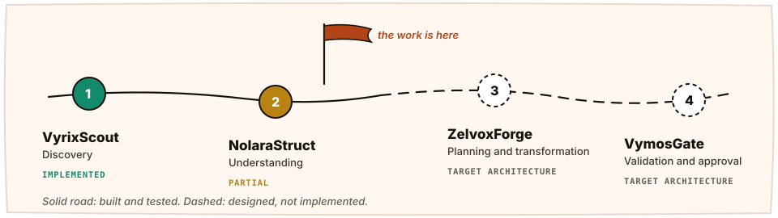

<p align="center">
  
</p>

<p align="center">
  <a href="https://github.com/raitaskeen/LegacyExodus/actions/workflows/ci.yml"></a>
  <a href="LICENSE"></a>
  <a href="https://legacyexodus.tech"></a>
</p>

<p align="center">
  <a href="#at-a-glance">At a glance</a> ·
  <a href="#how-it-reads-a-repository">How it works</a> ·
  <a href="#what-works-today">What works today</a> ·
  <a href="#measured-not-claimed">Measured</a> ·
  <a href="#quick-start">Quick start</a> ·
  <a href="#where-it-is-going">Roadmap</a> ·
  <a href="#find-your-way">Docs</a>
</p>

**LegacyExodus reads a legacy JavaScript or TypeScript repository and turns it into deterministic, source-traceable evidence:** every file, symbol, call, control-flow path and data flow, sealed in `.discovery/` and identical on every run. It runs on your machine and never rewrites your code.

That evidence is the ground a safe migration stands on. Migration itself, meaning planning, transformation, AI-assisted generation and equivalence checks, is **target architecture and is not implemented**. Everything below marks which side of that line it is on.

## At a glance

<p align="center">
  
</p>

## How it reads a repository

<p align="center">
  
</p>

<table>
  <tr>
    <td width="25%" valign="top"><b>Observe</b><br/><sub>Every file is inventoried and given a disposition: analysed, non-source, unclassified, unsupported or failed. Nothing is dropped silently.</sub></td>
    <td width="25%" valign="top"><b>Understand</b><br/><sub>Symbols, module and call graphs, control flow, data flow and taint, each built from proven facts only, under the assumptions <a href="docs/CURRENT_IMPLEMENTATION.md#assumptions-behind-resolved">listed here</a>.</sub></td>
    <td width="25%" valign="top"><b>Seal</b><br/><sub>Facts are written to <code>.discovery/</code> with hashes in a signed manifest. Two runs write byte-identical fact files.</sub></td>
    <td width="25%" valign="top"><b>Stay honest</b><br/><sub>What the engine cannot prove becomes an explicit <code>UNRESOLVED</code> fact, never a guess.</sub></td>
  </tr>
</table>

## What works today

<p align="center">
  
</p>

| Capability | State | Boundary |
|---|:---:|---|
| Runtime, lifecycle, CLI (`status`, `init`, `analyze`, `test`, `verify`, `plugins list`) | `VERIFIED` | Bun and strict TypeScript |
| Discovery and Babel parsing of JS, TS, JSX and TSX | `IMPLEMENTED` | Parser failures and resource limits are explicit; skipped symbolic links and ignore rules are reported |
| Storage (memory, SQLite) and validated snapshot reuse | `VERIFIED` | Reuse verifies each artifact while copying it: about 1 GB and 25 s on Ghost |
| Deterministic `.discovery` projections | `VERIFIED` | Byte-identical fact artifacts; run identity lives in `manifest.json` only |
| Symbols, ESM and CommonJS, module and dependency graphs | `PARTIAL` | TS resolution, `tsconfig` paths and workspace packages resolve; packages in `node_modules` do not |
| Call analysis and control-flow graphs | `PARTIAL` | Every call site is a fact; a target is `RESOLVED` only when proven, under the [stated assumptions](docs/CURRENT_IMPLEMENTATION.md#assumptions-behind-resolved) |
| Data flow and taint | `PARTIAL` | Cross-file flows; Express sources; process, eval, file-path, request-URL and SQL sinks; built-in policy only |
| Knowledge graph | `PARTIAL` | File and symbol nodes, contains and imports edges |
| Framework semantics | `PARTIAL` | Express routes and middleware only |
| Plugin runtime contracts | `IMPLEMENTED` | No marketplace and no sandbox |
| Migration planning, transformation, AI generation, equivalence gates | `NOT IMPLEMENTED` | Target architecture |

The full boundary, with every limit and the audit finding behind it, is in **[Current Implementation](docs/CURRENT_IMPLEMENTATION.md)**. Static analysis is evidence about source structure, not proof of runtime behaviour.

## Measured, not claimed

Every figure comes from a command in this repository, run on a pinned public corpus. On every pull request CI runs the tests, the accuracy report, the fact diff and the scale gate, and a failing one blocks the merge. The Ghost figures are measured locally.

<table>
  <tr>
    <th align="left">Repository</th>
    <th align="right">Files analysed</th>
    <th align="right">Calls mapped</th>
    <th align="right">Time</th>
    <th align="right">Peak memory</th>
  </tr>
  <tr><td><b>Ghost</b> <sub>v6.73.0</sub></td><td align="right">7,172</td><td align="right">415,492</td><td align="right">183 s</td><td align="right">2.4 GB</td></tr>
  <tr><td><b>Fastify</b> <sub>v5.3.3</sub></td><td align="right">287</td><td align="right">31,016</td><td align="right">14.2 s</td><td align="right">460 MB</td></tr>
  <tr><td><b>Express</b> <sub>4.21.2</sub></td><td align="right">152</td><td align="right">12,243</td><td align="right">5.6 s</td><td align="right">282 MB</td></tr>
  <tr><td><b>This engine</b> <sub>b3615d1</sub></td><td align="right">142</td><td align="right">9,400</td><td align="right">6.8 s</td><td align="right">333 MB</td></tr>
  <tr><td><b>express-session</b> <sub>v1.18.1</sub></td><td align="right">13</td><td align="right">2,231</td><td align="right">1.2 s</td><td align="right">265 MB</td></tr>
</table>

<sub>Engine <code>b3615d1</code>, one 16 GB Windows machine. The corpus: <code>bun run benchmarks/cli.ts run benchmarks/corpus/&lt;tier&gt; --runs 3</code> on 2026-11-09, median of three fresh runs, byte-identical output on all three. Ghost: <code>bun run benchmarks/cli.ts scale ghost</code>, its fastest recorded fresh run on this engine code (ADR-011 measurements, 2026-11-08); fresh runs on a busy machine take longer. Memory is the engine process's peak.</sub>

<table>
  <tr>
    <td width="50%" valign="top">
      <b>Scale Gate</b> &nbsp;<code>CI</code><br/>
      <sub>A synthetic 10,000-file repository is analysed fresh, then reused in a second process. Ceilings: 2,800 MiB fresh and 1,800 MiB reuse. Last measured on the CI runner: 1,038 MiB and 708 MiB.</sub>
    </td>
    <td width="50%" valign="top">
      <b>Fact Diff</b> &nbsp;<code>CI</code><br/>
      <sub>Express, Fastify, the engine's own source and a governance fixture are analysed before and after each change. A lost fact fails the pull request unless the owner signs off with <code>facts-lost-explained</code>.</sub>
    </td>
  </tr>
  <tr>
    <td width="50%" valign="top">
      <b>Conformance corpus</b> &nbsp;<code>tests/conformance</code><br/>
      <sub>Expected facts per language feature, including taint flows proven by running the program. The known-gaps ledger is empty, and the test fails if a listed gap starts to hold.</sub>
    </td>
    <td width="50%" valign="top">
      <b>Reproducible output</b> &nbsp;<code>ADR-010</code><br/>
      <sub>Two runs of the same repository write identical fact artifacts, checked by <code>tests/integration/reproducible-projections.test.ts</code>.</sub>
    </td>
  </tr>
</table>

## Quick start

Prerequisite: the Bun version declared in [`legacy-exodus-core/package.json`](legacy-exodus-core/package.json).

<table>
  <tr>
    <td width="50%" valign="top">

**Analyse a repository**

```bash
cd legacy-exodus-core
bun install --frozen-lockfile
bun run legacy-exodus init ../my-project
bun run legacy-exodus analyze ../my-project
```

`analyze` reads your sources and writes its evidence to `../my-project/.discovery/`. Add `--json` for machine-readable output.

</td>
    <td width="50%" valign="top">

**Verify the engine**

```bash
cd legacy-exodus-core
bun run typecheck
bun test
bun run benchmark audit
bun run benchmarks/cli.ts accuracy
```

`main` is the implementation truth: run these on the exact revision you review.

</td>
  </tr>
</table>

## Where it is going

<p align="center">
  
</p>

| Next | What it is | State |
|---|---|:---:|
| **Wave 6, Semantic IR** | A language-neutral representation built only from proven facts, each unit carrying its evidence state | `PLANNED` |
| **Wave 7, JS → TypeScript** | The first migration path, checked by the project's own tests plus characterization tests | `PLANNED` |
| **Migration Readiness Assessment** | The first product: a report on one repository from the evidence above | `PLANNED` |
| **Behaviour Safety Net** | A characterization test generator. It must run customer code, which the engine never does, so it gets its own design review first | `PLANNED` |
| **Wave 8, more languages** | PHP, then Java, then Ruby on Rails, each with its own conformance corpus | `PLANNED` |

The full plan and its evidence are in the **[Roadmap](ROADMAP.md)**.

## Find your way

<table>
  <tr>
    <td width="33%" valign="top"><b><a href="docs/CURRENT_IMPLEMENTATION.md">Current Implementation</a></b><br/><sub>The exact capability boundary, with every limit.</sub></td>
    <td width="33%" valign="top"><b><a href="docs/architecture/system-overview.md">System Overview</a></b><br/><sub>How the engine is put together.</sub></td>
    <td width="33%" valign="top"><b><a href="docs/adr/README.md">Decision Records</a></b><br/><sub>Why it is built this way: ADR-001 to ADR-011.</sub></td>
  </tr>
  <tr>
    <td valign="top"><b><a href="docs/development/cli/commands.md">CLI Reference</a></b><br/><sub>Every command and flag.</sub></td>
    <td valign="top"><b><a href="ROADMAP.md">Roadmap</a></b><br/><sub>What is next, and the gates every change passes.</sub></td>
    <td valign="top"><b><a href="docs/README.md">Documentation hub</a></b><br/><sub>Everything else, by purpose.</sub></td>
  </tr>
  <tr>
    <td valign="top"><b><a href="CONTRIBUTING.md">Contributing</a></b><br/><sub>Branches, pull requests and the review gates.</sub></td>
    <td valign="top"><b><a href="SECURITY.md">Security</a></b><br/><sub>How to report a vulnerability.</sub></td>
    <td valign="top"><b><a href="https://legacyexodus.tech">legacyexodus.tech</a></b><br/><sub>Products, evidence and research notes.</sub></td>
  </tr>
</table>

<details>
<summary><b>Toolchain</b></summary>

| Component | Version |
|---|---|
| Bun | `1.4.2` package manager (`>=1.3.0` engine range) |
| TypeScript | `7.0.2` |
| Babel parser | `8.0.6` |
| Zod | `4.6.7` |
| Commander | `15.0.0` |
| Pino | `10.4.0` |

</details>

<details>
<summary><b>Repository governance</b></summary>

- `main` is the single implementation, documentation and release truth.
- Every change goes through a task branch and a pull request into `main`, past the gates above.
- Documentation follows verified implementation; it never changes engine behaviour by assertion.
- Audit findings: the [2026-10-28 blind audit](https://github.com/raitaskeen/LegacyExodus/pull/203) (BA-xx) and the 2026-11-08 fresh audit (NA-xx). Both reports and the remediation queue are on the `audit/2026-10-28-blind-audit` branch.
- Development agents follow the root `AGENTS.md` and `.agents/`.

</details>

## License

[MIT](LICENSE)
