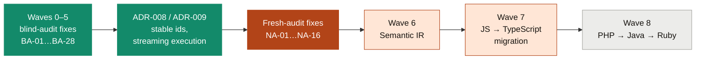
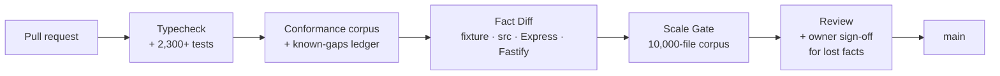

# LegacyExodus Architecture & Milestone Roadmap

This roadmap tracks the development progress of LegacyExodus across deterministic repository intelligence, verification hardening, migration fidelity, and future transformation stages.

---

## Roadmap Status Taxonomy

Every capability and milestone is strictly classified into one of the following states:

* **`COMPLETED`**: Fully implemented in the repository, supported by deterministic automated regression tests, benchmark verification, and provenance locks.
* **`IN PROGRESS`**: Active development and hardening.
* **`PLANNED`**: Prioritized for upcoming implementation milestones within existing architectural boundaries.
* **`DEFERRED`**: Intentionally scheduled for future consideration pending exhaustive whole-repository ground truth.
* **`TARGET ARCHITECTURE`**: Long-term platform vision (e.g. AI-assisted transformation, compiler sandboxing, Rust code synthesis) not present in current core implementation.

---

## Where we are (2026-11-08)

| Track | Scope | Status | Evidence |
|---|---|:---:|---|
| **Waves 0–5** | Fixes for the 2026-10-28 blind audit: parser dialects, TS declarations and resolution, CFG-based data flow, taint policy, Express model, discovery policy, dead code, stable identity | **`COMPLETED`** | PRs #204–#250; the conformance ledger was empty at the end. BA-19 (knowledge-graph unification) and BA-25 (plugin capabilities) are not scheduled |
| **ADR-008, ADR-009** | Edit-stable fact identity; whole-run fact lists on disk | **`COMPLETED`** | #238–#257. Ghost peak memory fell from 9.9 GB to about 2 GB, with fact-diff 0/0 at every step |
| **Fresh-audit fixes** | NA-01…NA-16 from the [2026-11-08 audit](https://github.com/raitaskeen/LegacyExodus/pull/203) | **`IN PROGRESS`** | Merged: NA-01, NA-02, NA-03a, NA-03b, NA-04, NA-05, NA-07, NA-08, NA-09, NA-10, NA-11, NA-13; dependency updates are merging one at a time behind a fact-diff (NA-14). NA-06 step 1 (ADR-010, byte-identical fact artifacts) merged; NA-03c/d/e in review. Open: NA-16 (ADR-011 accepted), ADR-010 step 2, NA-12, NA-15 (this refresh) |
| **Accuracy harness** | Recall and precision per fact category on the conformance corpus; runtime-proven taint ground truth | **`IN PROGRESS`** | `bun run benchmarks/cli.ts accuracy`; CI publishes it with every PR (#273) |
| **Wave 6, Semantic IR** | A language-neutral IR built from proven facts only, each unit carrying its evidence state | **`PLANNED`** | Starts after the fresh-audit fixes. Entry criteria are in the remediation queue |
| **Wave 7, first migration** | JS → TypeScript (owner decision, 2026-11-03), verified by the project's own tests plus characterization tests | **`PLANNED`** | Builds on Wave 6 |
| **Wave 8, languages** | PHP, then Java, then Ruby on Rails, each through the existing adapter seams with its own conformance corpus and pinned benchmark | **`PLANNED`** | Owner order, 2026-11-03 |

### Gates every change passes

A fact the engine loses fails Fact Diff unless the owner labels the PR `facts-lost-explained` after the PR explains every loss. Ghost (about 7,200 analyzed files) is diffed locally for engine changes.

---

## Track 3 (historical) — Scalability, Verification Hardening & Migration Fidelity

> Tracks 3 and 4 record milestones as they were closed in August and September 2026; their test counts are of that time. Current status is the table above.

| Milestone | Scope | Status | Verified Evidence / Notes |
|---|---|:---:|---|
| **P1.0** | Fidelity Validation Audit & Metric Correctness | **`COMPLETED`** | Verified precision, recall, and Three-Universe evaluation model. |
| **P1.1** | CommonJS Export Granularity | **`COMPLETED`** | Object literal and named export extraction. |
| **P1.2** | Whole-Repository Semantic Trust | **`COMPLETED`** | Stratified sampling and multi-category ground truth. |
| **P1.3** | Streaming Projection Serialization & Memory Bounding | **`COMPLETED`** | `StreamingJsonWriter` chunk-buffered JSON serialization with 64KB backpressure. |
| **P1.4** | Stage-Bounded Storage Lifecycle | **`COMPLETED`** | Memory disposal across analysis pipeline stages. |
| **P1.5** | Tier-3 Migration Fidelity Baseline & Freshness Lock | **`COMPLETED`** | Express v4.21.2 validation + SHA-256 provenance manifests. |
| **P1.6** | Repository Boundary & Execution-Context Hardening | **`COMPLETED`** | Centralized CWD-independent benchmark paths, elimination of root artifact leakage, and boundary regression suite. |
| **P1.7A** | Express Semantic Fidelity Hardening (Prototype Symbols & Call Resolution) | **`COMPLETED`** | Statically provable prototype/property symbols, chained CommonJS export unwrapping, NewExpression & apply/call unwrapping. |
| **P1.7B** | Whole-Repository Multi-File Ground-Truth Scaling | **`COMPLETED`** | Expanded ground truth across 25 production/core files each for Express v4.21.2 (142 GT facts, 4,165 scoped predictions, 100% recall, 100% actionable correctness) and Fastify v5.3.3 (154 GT facts, 6,330 scoped predictions, 100% recall, 100% actionable correctness) under the Three-Universe model. Migration safety verdict strictly preserved as `MIGRATION_SAFETY_NOT_YET_ESTABLISHED`. |
| **P1.7C** | Pre-Claude Audit Evidence Integrity & Semantic Correctness Hardening | **`COMPLETED`** | Fixed open-world fidelity metric semantics (`UNVERIFIED_SCOPED`, `precision = null`), hardened JavaScript `var` function/module hoisting, implemented deferred function assignment symbol extraction, and enforced scope-aware CommonJS export marking. 306/306 tests passing, 0 regressions, full determinism confirmed. |
| **P1.7D** | Controlled Forensic Weakness Discovery & Remediation | **`COMPLETED`** | Fixed destructuring pattern binding extraction (`FINDING-SYM-04`), default parameter expression filtering (`FINDING-SYM-05`), assigned function `var` scope hoisting (`FINDING-SYM-06`), and class constructor instantiation call resolution (`FINDING-SEM-02`). 329/329 tests passing, 0 regressions, full determinism confirmed. |
| **P1.8** | Core Runtime Lifecycle, Storage & Graph Hardening | **`COMPLETED`** | Fixed semantic `.bind()` receiver resolution (F-001), normalized `SymbolExtractionError` contract (F-002), implemented in-flight analysis draining on shutdown (F-004/F-006), hardened concurrent atomic file replacement with bounded retry on Windows (F-005), implemented SQLite storage provider with schema versioning (`PRAGMA user_version = 1`) and busy timeout (F-007), canonicalized POSIX module path resolution and cycle resolution (F-008), enforced dynamic Engine SHA freshness validation (F-023), and established AST validation provenance (`WeakSet` trust boundary, `Frozen ≠ Validated`). |
| **P1.9** | CLI Foundation, Command Discovery & Verification Hardening | **`COMPLETED`** | Implemented unified CLI theme engine (`classic`, `aurora`, `mono`), `HelpPresenter` with workflow-grouped discovery and safety badges, test explorer with dynamic domain taxonomy (`legacy-exodus test [domain]`, `--list`, `-v, --verbose`, `--bail`), 4-gate verification dashboard (`legacy-exodus verify`), F-024 terminal-width column budgeting and ANSI-safe truncation, and strict JSON output purity. 660/660 tests passing across 87 files (7,281 assertions), 10/10 governance checks, 3-tier bit-for-bit determinism. |
| **P1.10** | Security, Lifecycle, Storage & Flow Hardening | **`COMPLETED`** | Hardened discovery freshness verification (`REUSE-01`), restored analysis records on reuse (`REUSE-02`), consumed in-memory validated bytes eliminating TOCTOU (`REUSE-03`), direct Git subprocess invocation (`SEC-01`), manifest path containment (`SEC-02`), `.discovery` root and manifest symlink rejection (`SEC-03`), SQLite payload deep immutability (`DAT-01`), terminal event reduction (`EVT-01`), memory scalability & bit-for-bit determinism (`PRF-01` / `DET-01`), CFG loop fall-through correction (`CFG-01`), awaitable single-flight shutdown barrier (`RUNTIME-01`), storage driver auto-inference and path validation (`STORAGE-01`), and event reducer stale metadata cleanup (`EVENT-01` / `EVENT-02`). 800/800 tests passing across 92 files (8,536 assertions). |

---

## Track 4 (historical) — Enterprise Intelligence Scaling & Documentation Foundation

| Milestone | Scope | Status | Notes |
|---|---|:---:|---|
| **DOC-01** | Enterprise Documentation Foundation & Reality Synchronization | **`COMPLETED`** | Synchronize README, ROADMAP, CHANGELOG, GOVERNANCE, and docs with verified repository state (800 tests across 92 files, 8,536 assertions, 10/10 governance checks, 3-tier determinism, 366 GT facts across Express and Fastify). |
| **P2.0** | Whole-Repository Closed-World Ground-Truth Scaling | **`PLANNED`** | Expand ground truth surface from 25 representative files toward exhaustive whole-repository coverage for Tier-2 and Tier-3 targets. |
| **P2.1** | Non-Source Fixture & Template Classifier Hardening | **`PLANNED`** | Enhance discovery classification for EJS, Pug, Handlebars, and test fixture files to resolve Express completeness `NEEDS_REVIEW`. |
| **P2.2** | TypeScript Compiler API Integration | **`PLANNED`** | Complement Babel AST parser with native TypeScript type-checker symbols for `.ts` / `.tsx` codebases. |

---

## Track 5 — Target Architecture & Future Transformation Vision

> **Note:** Capabilities in Track 5 represent long-term architectural vision and are NOT implemented in the current repository code.

| Milestone | Capability | Status | Target Architecture Description |
|---|---|:---:|---|
| **V1.0** | Unified Intermediate Representation (IR / SSA) | **`TARGET ARCHITECTURE`** | Canonical language-agnostic SSA intermediate representation for cross-language migration analysis. |
| **V2.0** | ZelvoxForge AI Transformation Swarm | **`TARGET ARCHITECTURE`** | Governed multi-agent generation producing candidate modern implementations from verified knowledge graph slices. |
| **V3.0** | VymosGate Compiler Sandbox & Self-Healing Loop | **`TARGET ARCHITECTURE`** | Isolated compiler verification executing `cargo check` and `cargo test` with automated repair heuristics. |
| **V4.0** | Rust / Axum / SQLx Production Code Generation | **`TARGET ARCHITECTURE`** | Memory-safe, high-concurrency target backend synthesis with full semantic traceability. |
