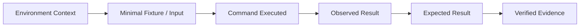

# Support Policy & Guidelines

LegacyExodus is an open-source, deterministic, knowledge-first modernization engine designed to analyze legacy software systems and construct evidence-backed structural, semantic, and flow intelligence.

---

## 1. Repository Maintainers

LegacyExodus is maintained by the following code owners:

* **[@raitaskeen](https://github.com/raitaskeen)**
* **[@pamexo](https://github.com/pamexo)**
* **[@rsexo](https://github.com/rsexo)**

Repository code ownership mappings across all packages and directories are codified in **[`.github/CODEOWNERS`](.github/CODEOWNERS)**.

---

## 2. Before Requesting Support

Before opening an issue or discussion, please consult the authoritative project documentation:

1. **[README](README.md):** Project overview, verified capabilities, and quickstart.
2. **[Documentation Map](docs/DOCUMENTATION_MAP.md):** Master navigation sitemap and role-based reading paths.
3. **[Project Context](docs/PROJECT_CONTEXT.md):** Pipeline architecture, stage boundaries, and intelligence trace.
4. **[Environment Setup](docs/development/environment-setup.md):** Bun toolchain requirements and local verification.
5. **[CLI Troubleshooting](docs/development/cli/troubleshooting.md):** Common runtime errors, parse recovery, and memory scaling.
6. **[Security Principles](docs/security/security-principles.md):** Boundary rules and trust boundaries.

---

## 3. Reporting a Technical Issue

Please submit reproducible defects via the **GitHub Issue Tracker**.

### What to Include in a Bug Report:
* **Host Environment:** Operating system (Windows, Linux, macOS) and architecture (`x64`, `arm64`).
* **Runtime Version:** Output of `bun --version` (minimum required: `1.3.0`).
* **LegacyExodus Commit/Version:** Exact Git commit SHA or release version.
* **Exact Command Executed:** e.g. `bun run src/cli/index.ts analyze ../target-repo --json`.
* **Observed Output:** Full error log, terminal trace, or unexpected behavior.
* **Expected Output:** Concrete explanation of what should have occurred.
* **Minimal Reproduction:** The smallest standalone code sample or repository reproducing the issue.

> [!CAUTION]
> **Data Privacy & Secret Redaction:** Never include API keys, passwords, database credentials, private tokens, proprietary intellectual property, or confidential customer data in issue descriptions or logs.

---

## 4. Issue Reproduction Standard

LegacyExodus prioritizes issues that are accompanied by a reproducible test case or minimal source fixture:

---

## 5. Analysis Accuracy & Conservative Semantics

LegacyExodus operates under **fail-closed, conservative static analysis**:

* The engine intentionally avoids guessing or fabricating relationships when AST or semantic evidence is ambiguous.
* A call target or import resolving to `UNRESOLVED` or `null` (e.g. dynamic property access `app[fn]()` or external packages) is expected conservative behavior and not necessarily a defect.
* When reporting an analysis-accuracy discrepancy, provide the exact source snippet and explain why the construct can be statically proven from AST evidence without dynamic runtime evaluation.

---

## 6. Security Vulnerability Reporting

Please **do not disclose security-sensitive vulnerabilities in public GitHub issues**.

For security-sensitive vulnerabilities:
* Utilize GitHub's **Private Vulnerability Reporting** feature if enabled on the repository.
* If private reporting is unavailable, reach out privately to the repository maintainers listed in **[`.github/CODEOWNERS`](.github/CODEOWNERS)**.
* Include sufficient reproduction steps to evaluate the vulnerability without exposing sensitive payloads publicly.

---

## 7. Documentation Issues

To report documentation issues (such as stale file paths, broken relative links, outdated commands, or unclear architectural descriptions):
* Submit an issue or pull request referencing the specific file path and line number.
* Cite the matching source code or test evidence in `legacy-exodus-core/`.

---

## 8. Feature Requests

Feature requests are welcome when aligned with the project's static analysis and modernization mission. Useful requests include:
* Concrete legacy modernization use case and rationale.
* Concrete examples of source code constructs or architectural patterns.
* Explanation of why the capability cannot be achieved with existing stages.
* Distinction between **Current Implementation** enhancements and **Target Architecture** vision.

---

## 9. Support Scope & SLA

* **Best-Effort Support:** Support, issue triage, and code reviews are provided by maintainers on a best-effort, open-source basis.
* **No Commercial SLA:** LegacyExodus does not provide formal commercial SLAs or guaranteed response turnaround times.
* **Evidence-First Resolution:** Issues backed by minimal reproducers and failing tests receive highest priority.

---

## 10. Related Governance Documentation

* **[CODEOWNERS](.github/CODEOWNERS):** Repository code ownership rules.
* **[LICENSE](LICENSE):** Canonical MIT open-source license.
* **[Contribution Guide](docs/development/contribution-guide.md):** Contributor rules and Definition of Done.
* **[Code of Conduct](CODE_OF_CONDUCT.md):** Contributor Covenant v2.1 standards.
* **[GOVERNANCE.md](GOVERNANCE.md):** Repository boundaries, Three-Universe evidence model, and determinism invariants.
* **[ROADMAP.md](ROADMAP.md):** Track status and milestone delivery plans.
* **[Documentation Map](docs/DOCUMENTATION_MAP.md):** Complete navigation sitemap.
