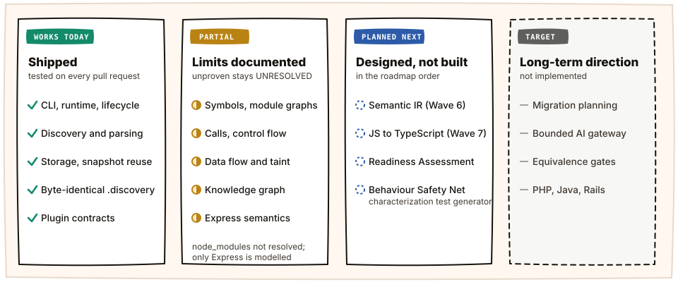

# Current Implementation

**Documentation state:** `PARTIAL`. Re-labelled on 2026-10-28 from the [blind audit](https://github.com/raitaskeen/LegacyExodus/pull/203); finding ids (BA-xx) refer to it.

**Implementation truth:** `main`. `core-foundation` and `docs-foundation` are retired as integration branches (2026-10-28). No SHA is pinned here; verify the exact revision you review.

This page is the concise status boundary for LegacyExodus. Implementation source, executable tests, and verified runtime behavior remain authoritative if this page drifts. Finding ids NA-xx refer to the 2026-11-08 fresh audit; all sixteen are merged.

<p align="center">
  
</p>

## Current core (implemented; limits below)

- Bun runtime and strict TypeScript contracts.
- Engine facade, runtime lifecycle, command/orchestrator boundary, event bus/store, and durable event journal. Durable command commit defines success; post-commit synchronous notification failures are separately recorded and logged without implying rollback.
- Repository discovery with deterministic inventory, source/non-source classification, package/framework signals, and isolated enumeration failures.
- Babel-based JavaScript/TypeScript/JSX/TSX parsing, including standard decorator syntax, into normalized immutable AST contracts. Decorator semantics are not interpreted. The Babel dialect is chosen per file extension: `.d.ts` uses declaration mode, `.ts` has no JSX, `.tsx` has JSX, and JavaScript gets JSX plus pragma-only Flow; the source type is fixed per extension (BA-01).
- Lexical symbol extraction, ESM/CommonJS modelling, module resolution, dependency cycles, and a knowledge graph of file and symbol nodes with contains/imports edges (BA-19, not yet unified with flow facts). TypeScript declarations and namespaces (BA-02); TS module resolution with JSONC `tsconfig`/`jsconfig`, `extends`, `paths` and baseUrl (BA-03); class expressions and switch/static-block scopes (BA-13); namespace imports (BA-09); dynamic `import()` and computed loads as explicit unknowns (BA-10); compiled CommonJS (BA-12); npm/Yarn/pnpm workspace packages by name (S3). Third-party packages in `node_modules` and package `exports`/`imports` maps stay unresolved.
- Semantic call/reference analysis. Every call site is a fact; a callee no name denotes is an explicit UNRESOLVED call (NA-01), a tagged template calls its tag, and a call is RESOLVED only when its target is proven under the assumptions listed in [Assumptions behind RESOLVED](#assumptions-behind-resolved); `with` bodies and files with a direct `eval` resolve nothing they could rebind (NA-02). Fact ids are edit-stable keys (ADR-008). Express routes and middleware are modelled per router, in registration order, through mounts, and stay `INFERRED` (BA-08). Dead-code findings are `INFERRED`; a function an unresolved call names is not reported dead (NA-09).
- Control-flow graphs (every graph resolves) and data flow on the CFG: joins at loops, `switch`, `try` and short-circuit expressions, control-only use is not data (BA-04 to BA-06), interprocedural transfer for proven targets including a call result used directly (NA-03a). Taint policy `builtin-3`: Express request sources keyed by resolved bindings (BA-07), `child_process`/`vm`/`eval`/`Function` sinks, and file-path and request-URL sinks judged on that argument only (NA-03b). The sanitizers (`escape-html`, `validator.escape`, DOMPurify `sanitize`, a global `sanitize`) escape HTML, so a sanitized value is clean only at the response-body sinks (`res.send`, `write`, `end`, `render`, `json`, `jsonp`) and stays tainted at every other sink, `res.redirect`, `sendFile` and `download` included (XA-01). A sanitized value passed through an unknown call stays clean at a response-body sink. Values also flow through a returned object field (NA-03c), into array-method callbacks such as `forEach`/`map`/`reduce` (NA-03d), and SQL sinks cover client instances (`mysql`, `mysql2`, `pg`, `sqlite3` and `better-sqlite3` connections, pools and databases, NA-03e). The conformance known-gaps ledger is empty.
- Locale-independent ordering (by UTF-16 code unit) of every projected artifact.
- In-memory and SQLite storage providers, streamed run-scoped queries, analysis-run atomicity, validated snapshot reuse, deep persisted-contract validation, and caller-controlled transient session reset. A refused snapshot is reported with its status and reason (NA-11). A second process waits for the SQLite lock and fails with `STORAGE_BUSY` past the timeout (NA-08).
- Contained `.discovery` projections with atomic per-file replacement and integrity manifests. Durable analysis records are canonical; `.discovery` is a derived command deliverable. If fresh-run projection fails after commit, the engine rejects with `DISCOVERY_PROJECTION_FAILED_AFTER_COMMIT` and explicitly reports that the selected storage provider already committed the analysis.
- CLI commands: `status`, `init`, `analyze`, `test`, `verify`, and `plugins list`.
- Plugin contracts, registry, loader, and lifecycle hooks. The current in-process `PluginContext` is intentionally capability-empty and frozen; it exposes no raw Logger, EventBus, or StorageManager.

## Partial or conservative areas

- JavaScript/TypeScript static semantics are not equivalent to runtime execution.
- Dynamic imports, computed calls, reflection, mutation-heavy receiver inference, and unsupported syntax may remain unresolved.
- Taint analysis is a deterministic foundation, not complete vulnerability detection.
- Knowledge, semantic, and flow artifacts are static evidence, not business-rule or behavioral-equivalence certification.
- Fidelity evidence is sample-based and does not establish whole-repository migration safety.
- Whole-run fact lists live on disk (ADR-009). Measured on Ghost (about 7,200 analyzed files): 3.5–5 min and 1.7–2.6 GB peak memory fresh (runs from 2026-11-04 to 2026-11-09); a synthetic 10,000-file repository stays under its CI ceiling. Snapshot reuse streams too (ADR-011): each fact artifact is hashed while copied, only the verified copy is read, and its lists are restored on disk, validated item by item. Ghost reuse: about 1 GB and 25 s (was 11.3 GB and 79 s); the Scale Gate checks reuse against its own ceiling. Memory still grows with repository size. Unlimited scale is not claimed.
- Multi-artifact `.discovery` publication is not one filesystem transaction. A failed projection can leave a partial or previously valid directory; manifest and workspace validation determine whether it is reusable. No public projection-only retry command is implemented.
- Plugins are in-process instances with ambient Bun/Node authority. Marketplace loading, permission manifests, process isolation, and filesystem/network sandboxing are not implemented. Future host interaction requires separately designed narrow capability facades.

## Assumptions behind RESOLVED

A RESOLVED call is proven on these assumptions. Code that breaks one can make a RESOLVED fact false.

- **No reflection or computed access from other files.** Another file does not read or write a method by a computed key or by reflection (`proto[name] = f`, `Reflect.get(o, "run")`, `Object.assign` of methods).
- **`this.m()` inside a class** resolves to the class's own `m` only when all of these hold:
  - the class is declared in the analysed files, and neither it nor any class extending it escapes its file (open world; the `closedWorld` switch is off and not configurable, owner decision 2026-11-09; XA-02);
  - no class extending it in the repository defines `m`;
  - no file other than its own writes a property named `m` on any object except `this` and its own `exports` (a name-based rule, XA-03);
  - the method the call runs in is never read as a value anywhere (`obj.run` passed as a callback, `const { run } = obj`);
  - its own file reads none of `this` (in its body), the class, `C.prototype`, a variable holding `new C()` or `new C()` itself by a computed key as a value (XA-04). A computed read of any other object in that file, such as `items[i]`, is assumed not to reach an instance.
- **Class bodies are strict mode:** an unbound method call has no `this`.
- **CommonJS order:** a call that runs in the same function before its `require` declarator stays UNRESOLVED (XA-05). A call in a nested function is assumed to run after the module's requires.
- **Factory objects (Phase C1):** `x.m()` resolves to a function of the object literal a repository factory returns when `x` is bound once to a call resolved to that factory, every return of the factory gives that one never-reassigned literal (no spread), `m` is defined there once and not as a getter or setter, the factory's file writes no property named `m`, and no other file writes a property named `m` on an object other than `this` and its own exports. A computed key or computed write (`fastify[kState] = …`) is assumed not to produce the name `m`; `Object.assign` or `Object.defineProperty` onto the object is not followed.
- **EXTERNAL calls (ADR-012)** name a package, Node module or standard global, not a function in the repository, on the same assumptions:
  - a package import is EXTERNAL when no file writes a property onto the import (B1);
  - a call on an unbound standard global (`Object.keys`, `process.nextTick`) is EXTERNAL when no file writes that path or a prefix of it; `require` is EXTERNAL only in CommonJS (B1b);
  - an alias of such a path (`var isArray = Array.isArray`) and a built-in method on a literal or `new` value bound once (`const out = []; out.push(x)`) are EXTERNAL when the file writes no property of the method's name and no file writes the built-in's prototype or the method on it (B1c). Another file giving an escaped literal its own method of that name is assumed not to happen.

## Known deferred capabilities

- **#111 / IA-HIGH-002 — framework semantics:** current analysis is generic deterministic JavaScript/TypeScript analysis plus narrow Express route and middleware recognition for proven patterns. Comprehensive React, NestJS, Angular, Vue, Fastify, or other framework runtime semantics are not implemented.
- **#112 / IA-HIGH-003 — taint policy boundary:** sources, sinks and sanitizers live in one versioned policy module (`src/flow/taint-policy.ts`, version `builtin-3`), matched by the binding a name actually resolves to (BA-07). A project-configurable or plugin-extensible policy is not implemented.
- **#117 / IA-MED-004 — package/workspace resolution:** resolution covers repository-local modules, proven `tsconfig`/`jsconfig` paths, and npm/Yarn/pnpm workspace packages by name, including a workspace package's `exports` (S3). Third-party packages in `node_modules` and package `imports` maps are not resolved.

## Not implemented

- Language-independent IR or SSA.
- Migration planning or source rewriting.
- AI/LLM gateway or agent orchestration.
- Rust, Axum, SQLx, or other target-language generation.
- Generated-code compilation/repair sandbox.
- Behavioral-equivalence certification or autonomous deployment.
- Distributed/multi-tenant analysis service or dashboard.

## Verification commands

Run from `legacy-exodus-core/`:

```bash
bun install --frozen-lockfile
bun run typecheck
bun test
bun run benchmark audit
bun run src/cli/index.ts --help
```

Record live results rather than copying historical totals into evergreen documentation.

## Verification snapshot

Verification totals are intentionally not copied into this evergreen page; run the canonical commands and record their live output for the exact revision under review.

## CI and security boundary

Current `main` workflow truth includes immutable action SHA pins, least-privilege permissions, disabled checkout credential persistence, Bun 1.4.2, frozen installs, job timeouts, superseded-run cancellation and these jobs: `Verify Core` (typecheck, tests, benchmark audit, an accuracy report on the conformance corpus that fails on a regression), `Windows Path Smoke`, `Scale Gate` (synthetic 10,000-file corpus under a memory ceiling) and `Fact Diff` (facts lost and gained on the governance fixture, the engine's own source, Express and Fastify; lost facts fail it unless the owner labels the PR `facts-lost-explained`). The ruleset `main-branch-protection` requires `Verify Core`, `Windows Path Smoke`, `Fact Diff` and `Scale Gate` (owner decision, 2026-11-09). The Ghost scale run and its fact diff are local, not in CI.

CodeQL and Dependency Review are unavailable under the current private-repository/account configuration. The unusable historical CodeQL workflow was intentionally removed; its absence is not evidence that application security is complete.

## Historical audit queue integrity

The historical unresolved queue remains separate from current capability status: `PERF-002`, `MEM-001`, `SEC-004`, `SEC-003`, `SEM-002`, `MODULE-001`, `DFG-001`, `TAINT-001`, `ARCH-002`, `ARCH-003`, `CI-001`, and `TOOL-002`.

This list records identifiers, not newly validated findings or severity conclusions. `PERF-002` remains `BLOCKED` if its authoritative original definition has not been recovered; a new performance observation must not reuse that identifier. No item in this queue is closed by this documentation pass.
