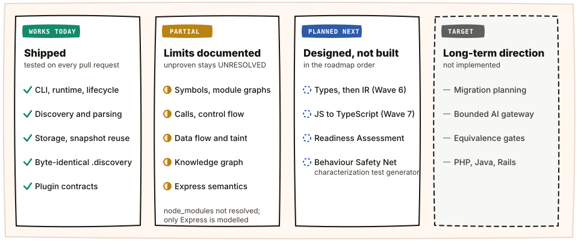

# Current Implementation

**Documentation state:** `PARTIAL`. Re-labelled on 2026-10-28 from the [blind audit](https://github.com/raitaskeen/LegacyExodus/pull/203); finding ids (BA-xx) refer to it.

**Implementation truth:** `main`. `core-foundation` and `docs-foundation` are retired as integration branches (2026-10-28). No SHA is pinned here; verify the exact revision you review.

This page is the concise status boundary for LegacyExodus. Implementation source, executable tests, and verified runtime behavior remain authoritative if this page drifts. Finding ids NA-xx refer to the 2026-11-08 fresh audit; all sixteen are merged.

<p align="center">
  
</p>

## Current core (implemented; limits below)

- Bun runtime and strict TypeScript contracts.
- Engine facade, runtime lifecycle, command/orchestrator boundary, event bus/store, and durable event journal. Durable command commit defines success; post-commit synchronous notification failures are separately recorded and logged without implying rollback.
- Repository discovery with deterministic inventory, source/non-source classification, package/framework signals, and isolated enumeration failures.
- Babel-based JavaScript/TypeScript/JSX/TSX parsing, including standard decorator syntax, into normalized immutable AST contracts. Decorator semantics are not interpreted. The Babel dialect is chosen per file extension: `.d.ts` uses declaration mode, `.ts` has no JSX, `.tsx` has JSX, and JavaScript gets JSX plus pragma-only Flow; the source type is fixed per extension (BA-01). A `.js`, `.jsx`, `.ts` or `.tsx` file is parsed with module rules first. If that reports errors and the file has no import or export syntax, it is parsed again as sloppy CommonJS, as Node runs it: `delete x`, `with` and legacy octals are allowed, and so is a top-level `return` inside the module wrapper. The retry is kept only if it has no errors (RT-N3). A file that still fails to parse is listed under `parserFailures` and contributes no facts. Every claim assumes such a file writes nothing.
- Lexical symbol extraction, ESM/CommonJS modelling, module resolution, dependency cycles, and a knowledge graph of file and symbol nodes with contains/imports edges (BA-19, not yet unified with flow facts). TypeScript declarations and namespaces (BA-02); TS module resolution with JSONC `tsconfig`/`jsconfig`, `extends`, `paths` and baseUrl (BA-03); class expressions and switch/static-block scopes (BA-13); namespace imports (BA-09); dynamic `import()` and computed loads as explicit unknowns (BA-10); compiled CommonJS (BA-12); npm/Yarn/pnpm workspace packages by name (S3), and a package loading itself: `#name` through the nearest `package.json` `imports` map, and its own name through its `exports` (XB-02). Only `./` targets that are files inside that package count; the nearest `package.json` decides, so one without `imports` hides an outer one. A conditional target is picked as Node (24) picks it: the first key, in the object's own order, that matches how the file is loaded (`require` or `import`, plus `node`, `node-addons`, `module-sync` and `default`; custom `--conditions` are not modelled). `source` is also tried, for tools that load a package from its source. The resolver is not told whether a file uses `require` or `import`, so a target that reaches different repository files for the two, or that names another package, stays unresolved (RT-M6). A `./` target that is no file in the repository, even after mapping build output to `src`, does not count: it is assumed to be build output compiled from the file the other ways reach, as with `source: ./src/x.ts` beside `require: ./build/cjs/x.js`. At least one way must reach a file. A dependency declared as `file:` or `link:` with a folder inside the project is installed as that folder, so it resolves like a package there: through its `exports`, else its `main`, else its index (RT-M8). The nearest `package.json` above the importer that declares the name decides which folder, or that it is a registry package. A folder outside the project is not repository code, and a tarball target is never resolved. A call through a `#` import, a workspace package, the importer's own package name, or a folder dependency (declared on the way up, or anywhere in the project when none on the way up declares the name, since it may be hoisted) that does not resolve is UNRESOLVED, never EXTERNAL. A Node (24) built-in name (`url`, `fs/promises`, any `node:` specifier) is Node's own module, as at Node runtime: it never resolves to a workspace package, self-reference, `paths` alias or `baseUrl` file of the same name (RT-L4). A browser bundle that aliases a built-in name to repository code is not modelled. `test`, `sqlite`, `sea` and `test/reporters` are built-ins only with the `node:` prefix, so bare they name packages. Third-party packages in `node_modules` stay unresolved.
- Semantic call/reference analysis. Every call site is a fact; a callee no name denotes is an explicit UNRESOLVED call (NA-01), a tagged template calls its tag, and a call is RESOLVED only when its target is proven under the assumptions listed in [Assumptions behind RESOLVED](#assumptions-behind-resolved); `with` bodies and files with a direct `eval` resolve nothing they could rebind (NA-02). Fact ids are edit-stable keys (ADR-008). Express routes and middleware are modelled per router, in registration order, through mounts, and stay `INFERRED` (BA-08). Dead-code findings are `INFERRED`; a function an unresolved call names is not reported dead (NA-09).
- Control-flow graphs (every graph resolves) and data flow on the CFG: joins at loops, `switch`, `try` and short-circuit expressions, control-only use is not data (BA-04 to BA-06), interprocedural transfer for proven targets including a call result used directly (NA-03a). Taint policy `builtin-3`: Express request sources keyed by resolved bindings (BA-07), `child_process`/`vm`/`eval`/`Function` sinks, and file-path and request-URL sinks judged on that argument only (NA-03b). The sanitizers (`escape-html`, `validator.escape`, DOMPurify `sanitize`, a global `sanitize`) escape HTML, so a sanitized value is clean only at the response-body sinks (`res.send`, `write`, `end`, `render`, `json`, `jsonp`) and stays tainted at every other sink, `res.redirect`, `sendFile` and `download` included (XA-01). A sanitized value passed through an unknown call stays clean at a response-body sink. Values also flow through a returned object field (NA-03c), into array-method callbacks such as `forEach`/`map`/`reduce` (NA-03d), and SQL sinks cover client instances (`mysql`, `mysql2`, `pg`, `sqlite3` and `better-sqlite3` connections, pools and databases, NA-03e). The conformance known-gaps ledger is empty.
- Locale-independent ordering (by UTF-16 code unit) of every projected artifact.
- In-memory and SQLite storage providers, streamed run-scoped queries, analysis-run atomicity, validated snapshot reuse, deep persisted-contract validation, and caller-controlled transient session reset. A refused snapshot is reported with its status and reason (NA-11). A second process waits for the SQLite lock and fails with `STORAGE_BUSY` past the timeout (NA-08).
- Contained `.discovery` projections with atomic per-file replacement and integrity manifests. Durable analysis records are canonical; `.discovery` is a derived command deliverable. If fresh-run projection fails after commit, the engine rejects with `DISCOVERY_PROJECTION_FAILED_AFTER_COMMIT` and explicitly reports that the selected storage provider already committed the analysis.
- CLI commands: `status`, `init`, `analyze`, `test`, `verify`, and `plugins list`.
- Plugin contracts, registry, loader, and lifecycle hooks. The current in-process `PluginContext` is intentionally capability-empty and frozen; it exposes no raw Logger, EventBus, or StorageManager.

## Partial or conservative areas

- JavaScript/TypeScript static semantics are not equivalent to runtime execution.
- Dynamic imports, computed calls, reflection, mutation-heavy receiver inference, and unsupported syntax may remain unresolved.
- Taint analysis is a deterministic foundation, not complete vulnerability detection.
- Knowledge, semantic, and flow artifacts are static evidence, not business-rule or behavioral-equivalence certification.
- Fidelity evidence is sample-based and does not establish whole-repository migration safety.
- Whole-run fact lists live on disk (ADR-009). Measured on Ghost (about 7,200 analyzed files): 3.2–6.1 min and 1.7–2.6 GB peak memory fresh (runs from 2026-11-04 to 2026-11-20; a single run varies a lot with machine load); a synthetic 10,000-file repository stays under its CI ceiling. Snapshot reuse streams too (ADR-011): each fact artifact is hashed while copied, only the verified copy is read, and its lists are restored on disk, validated item by item. Ghost reuse: about 1 GB and 25 s (was 11.3 GB and 79 s); the Scale Gate checks reuse against its own ceiling. Memory still grows with repository size. Unlimited scale is not claimed.
- Multi-artifact `.discovery` publication is not one filesystem transaction. A failed projection can leave a partial or previously valid directory; manifest and workspace validation determine whether it is reusable. No public projection-only retry command is implemented.
- Plugins are in-process instances with ambient Bun/Node authority. Marketplace loading, permission manifests, process isolation, and filesystem/network sandboxing are not implemented. Future host interaction requires separately designed narrow capability facades.

## Assumptions behind RESOLVED

A RESOLVED call is proven on these assumptions. Code that breaks one can make a RESOLVED fact false.

- **No reflection or computed access from other files.** Another file does not read or write a method by a computed key or by reflection (`proto[name] = f`, `Reflect.get(o, "run")`, `Object.assign` of methods). A key written as a string or numeric literal or as a template literal without substitutions (`o["m"]`, `` o[`m`] ``) is a name, not a computed key (RT-M2).
- **Instance and object methods (rules 1 and 2):** `c.m()` with `c` bound once to `new C()` resolves to the `m` declared once in `C`'s body, and `app.m()` on a never-reassigned `app` to the one function assigned to `app.m`, only when its file writes no other property named `m` and no other file writes a property named `m` on an object other than `this` and its own exports (XA-03's name-based rule, RT-H1). A write on `this` in another file counts unless it is inside a class element (RT-N1, see below).
- **`this.m()` inside a class** resolves to the class's own `m` only when all of these hold:
  - the class is declared in the analysed files, and neither it nor any class extending it escapes its file (open world; the `closedWorld` switch is off and not configurable, owner decision 2026-11-09; XA-02);
  - `m` is the only element of that name and staticness in the class body: a later getter, setter, field or method of the same name replaces it; overload signatures and `declare` fields are type-only and do not count, and a computed key is assumed not to produce `m` (RT-L6, also for rules 1 and 2 on a class's methods);
  - no class extending it in the repository defines `m`, and no object in the repository owns a property named `m` while its prototype is set to a value that is not `null` or an object literal (`{ __proto__: base, m() {} }`, `Object.create(base, { m: … })`, `Object.setPrototypeOf(child, base)` or `child.__proto__ = base` with `child` an object literal or a name declared with one) (RT-M4). The descriptor object of `Object.create` may also be a name declared with a literal. A spread of such a name (`{ __proto__: base, ...extra }`) owns the keys of `extra`'s literal. A computed key there, a spread of any other value, or a descriptor or child object that is neither a literal nor a name declared with one (a parameter, a call result), is assumed not to produce `m`;
  - no file other than its own writes a property named `m` on any object except `this` and its own `exports` (a name-based rule, XA-03). Only a `this` inside a class element (a method, constructor, field or static block, arrow functions in them included) or at the top of a file is exempt: in a plain function, function expression or object method `this` may be any object (`patch.call(app)`), so a write on it counts (RT-N1). A class method whose name is read as a value anywhere in the run (`P.prototype.patch.call(app)`, `const { patch } = P.prototype`, `cb(this.patch)`), or whose class is read by a computed key as XA-04 describes (`P.prototype[k].call(app)`), may run with any `this`, so its `this.x = …` writes count too (RT-N2). The rule is by name, so a method sharing a name read as a value elsewhere counts as well. Getters, setters, constructors, fields and static blocks are assumed to run on their own instance or class: borrowing one needs reflection (`Object.getOwnPropertyDescriptor`), which is not followed. A file's own exports also cover a top-level alias of its exports object holding a value made in that file (`var proto = module.exports = function …`, `const api = module.exports`, `var res = Object.create(…); module.exports = res`), written by a top-level statement (C3); `exports` and `module.exports` are a file's own only while every value the file stores in them is made there (an object, function or class literal, `Object.create(…)`, a top-level function or class declared once, or a top-level name declared once with such a value) and no parameter or variable of the file is named `exports` or `module`; after `module.exports = require("./x")` or `exports = other`, a write on them counts as a write on another module's object (RT-M3). A file's own exports also cover a top-level alias of its exports object holding a value made in that file (`var proto = module.exports = function …`, `const api = module.exports`, `var res = Object.create(…); module.exports = res`), written by a top-level statement (C3);
  - the method the call runs in is never read as a value anywhere (`obj.run` passed as a callback, `const { run } = obj`);
  - its own file reads none of `this` (in its body), the class, `C.prototype`, a variable holding `new C()` or `new C()` itself by a computed key as a value (XA-04). A computed read of any other object in that file, such as `items[i]`, is assumed not to reach an instance.
- **Class bodies are strict mode:** an unbound method call has no `this`.
- **What counts as a write (RT-M1).** When a rule asks whether another file writes a property name (XA-03), whether a file writes another module's export (OR-01), or whether any file writes a package member or a standard global (B1, B1b), every store counts: an assignment of any operator, each target of a destructuring assignment (`[o.m] = …`, `({ k: o.m } = …)`, defaults and rest included), the head of a `for…in` or `for…of` loop, `++`/`--`, and `delete o.m` (RT-L3), looking through parentheses and TypeScript wrappers (`(o.m as any) = …`). The same forms count for the checks C1, C1b, C2 and C3a make in their own file (RT-M1, factory side). A computed key with a static value counts as that name everywhere: `o["m"]`, `` o[`m`] ``, `o[0]`, and a literal-key `Object.defineProperty`/`Reflect.defineProperty(o, "m", …)` or `(exports, "add", …)` (RT-M2), `Reflect.set(o, "m", f)` or `Reflect.deleteProperty(o, "m")` (RT-L3), in the factory's own file and, for XA-03's name rule, in any other file.
- **CommonJS order:** a call that runs in the same function before its `require` declarator stays UNRESOLVED (XA-05). A call in a nested function is assumed to run after the module's requires.
- **Require cycles (RT-M9).** Files that load each other while they load form a cycle. These loads are `require` (and TypeScript's `import x = require(…)`) outside any function, plus static `import`/`export … from`. An import that compiles away is no load: `import type`, `export type … from`, and in a TypeScript file an import whose names are used only as types, unless the file has a decorator (decorator metadata can keep such an import). Which file of a cycle loads first depends on the entry point, which is not known, and a file loaded inside the cycle gets the other's exports object as it is at that moment. Two rules follow:
  - a file that replaces `module.exports` after loading a file of its own cycle may leave that file holding the old object for the whole run, so a call through an import of it, in a file of the same cycle, is UNRESOLVED;
  - a call made while a file loads (outside every function), through an import of a file of its own cycle, is UNRESOLVED, since that file may still be loading.

  An importer outside the cycle cannot load while the cycle does, so it gets the final exports object and keeps its claims. Setting `module.exports` before the `require` that closes the cycle keeps the exports proven. A call inside a function, a top-level callback included, keeps the assumption above that it runs after the modules have loaded.
- **Directory imports (XB-08).** A relative specifier that names a directory (`./lib`) resolves through the directory's `package.json` `main`, else its index file, as `require`, TypeScript and bundlers resolve it. Node's own ESM loader refuses a directory import (`ERR_UNSUPPORTED_DIR_IMPORT`). In a file Node runs as native ESM, the import then fails and none of the importer's calls run, so a call it resolves through that import is a claim about code that never executes.
- **When a declared value counts (RT-L2).** The rules that read the value a binding is declared with use it only when the declarator runs whenever the binding's scope is entered, with no branch, loop body, `try`, `switch` case or label between that scope and the declarator (a `for` loop's init runs whenever the loop is reached), or when every use of the binding comes after the declarator, in the same function and inside the branch it sits in. These rules are the C1 and C2 receivers (`x = make()`, `x = new F()`, `x = Object.create(P)`), EXTERNAL built-in methods on a value bound once (`const out = []`), and the object a container method starts from. So `if (…) { var x = make(); }` may leave `x` undefined after the block, and `x.run()` there stays UNRESOLVED. `if (…) { var x = make(); x.run(); }` and `if (…) { const x = make(); x.run(); }` resolve. One use anywhere else, a nested function included, leaves every use of that `var` unresolved. As for CommonJS order, a call in a nested function is assumed to run after the module has loaded: `use(); const x = make(); function use() { return x.run(); }` stays RESOLVED, although Node throws on that early call (`x` is not initialized yet).
- **Block functions in sloppy code (Annex B).** In sloppy code, a function declared in a block or `switch` case assigns the enclosing function's binding of that name when the block runs. That binding's value is therefore not proven anywhere in that function: a local call (`run()`), an import (`var express = require("./lib"); if (…) { function express() {…} }`, RT-L9), or a module export (`module.exports = { run }` beside a block `run`, RT-L8, which then counts as an export whose value can change). Only the enclosing function's binding is affected, so a block function inside `g` leaves the module's own `run` alone. Strict code (ES modules, `"use strict"`, class bodies) keeps block functions block-scoped.
- **Factory objects (Phase C1):** `x.m()` resolves to a function of the object literal a repository factory returns when `x` is bound once to a call resolved to that factory, the factory is neither `async` nor a generator (XB-06: those return a Promise or an iterator), its body has a `return` among its own statements (RT-L1: a body that can run past its last statement returns `undefined`, as in `if (flag) return o;`; functions declared after that `return` are hoisted, the rest never runs; this holds for every factory below, C1b, C1c and C3b included), every return of the factory gives that one never-reassigned literal (no spread), `m` is defined there once and not as a getter or setter, the factory's file writes no property named `m`, and no other file writes a property named `m` on an object other than `this` and its own exports. A computed key or computed write whose key is not a static string, number or substitution-free template (`fastify[kState] = …`) is assumed not to produce the name `m`; `Object.assign` or `Object.defineProperty` onto the object is not followed. Phase C1b widens this:
  - the factory may return one object literal directly (`return { server, listen }`, its only `return`);
  - `m`'s value may be a member of a repository module the file `require`s whole and never reassigns (`decorate: decorator.add`), found through that module's plainly built exports object (C3a) or a top-level `module.exports.add = f` / `exports.add = f` in a file that never replaces `module.exports`;
  - `m`'s value may be a property destructured from another repository factory's result by a statement of the factory's body (`const { listen } = createServer()`), with the binding declared once and never assigned, followed through at most four such references;
  - a top-level write `o.m = f` in the factory's body before its `return` replaces the literal's value when every write of a property named `m` in the file is such a write (the last one wins);
  - a name the factory binds itself (a parameter or a local) matches only a function declared in the factory's own scope, never a module function of the same name.

  Calls the factory makes with the object (`avvio(fastify, …)`) are assumed not to write `m` after the factory's last write.

  Phase C1c adds two cases:
  - `x` may be bound through an assignment chain (`var app = module.exports = express()`), whose value is the call's result, when the file writes no property named `m` at all: through the chain the object is also the file's exports, which writes such as `module.exports.m = …` reach;
  - a function whose only `return` gives a binding of its body declared once, directly, from a call (`function createApp() { var app = express(); …; return app; }`, no assignment chain) is a factory that forwards that call's result. The binding may appear only as its declarator, in `return app`, and as the object of a non-computed method call `app.m(…)`: any other use (an argument, a spread, an alias, a template, `delete`, a write) disqualifies it. The function must be at module scope; the callee must be a module-scope function of the file or a repository module it imports, neither bound by the function itself, and no function of the callee's name may be declared anywhere else in the file (a block-level declaration replaces the module binding in sloppy mode, Annex B). The lookup follows such forwards and `module.exports = require(…)` re-exports at most 8 hops deep.

  For C1b and C1c alike, a name means a module-scope import or function only when the factory is at module scope and does not bind the name itself, and a literal value `{ run }` resolves to a function only when that is the file's one function of the name, at module scope, with no import of the name (a factory nested in another function matches only its own functions).
- **Prototypes (Phase C2):** `x.m()` resolves to `F.prototype.m` when `x` is bound once to `new F(…)`, `F` is a plain function (not `async`, not a generator, XB-06) declared at the top of its file whose body returns nothing but `this` or `new F(…)` and copies no unknown names onto `this` (XB-07: no `Object.assign(this, …)`, `Object.defineProperties(this, …)`, `Object.defineProperty(this, key, …)` with a non-literal key, or computed `this[key] = …`, nested arrow and other functions included; `this.x = …` with a literal name counts as a write of `x`), `F` is never reassigned or passed to a call, `F.prototype` is never replaced or passed to a call, `F.prototype.m` is assigned a function once in a top-level statement, the file writes no other property named `m` (a literal-key `Object.defineProperty` counts as a write), and no other file writes a property named `m` on an object other than `this` and its own exports. Exceptions (C2b): one top-level link to a parent, `F.prototype = Object.create(X.prototype)`, `Object.setPrototypeOf(F.prototype, X.prototype)` or `inherits(F, X)` from `util` or the `inherits` package, placed before every method, where `X` is a package or Node module import (assumed to give instances only data fields), a standard error, or a constructor declared at the top of the same file; and `Object.defineProperty(F, "name", …)` or `Object.defineProperty(F.prototype, "name", …)` with a literal name. With a parent, or when `m` is a name every object inherits from `Object.prototype` (`toString`, `toLocaleString`, `valueOf`, `hasOwnProperty`, `isPrototypeOf`, `propertyIsEnumerable`, and the `__defineGetter__` family; XB-05), a top-level call of the same file before the last method assignment stays UNRESOLVED, and a call inside a function is assumed to run after the module has loaded. `x.m()` with `x` bound once to `Object.create(P)` (one argument) resolves as `P.m()` would, on the same cross-file condition. For any other name, a call that runs before the assignment throws, since a fresh prototype has no `m` and neither has `Object.prototype`. Reflection onto the instance from outside the constructor (`Object.assign(x, …)`) is not followed, as for C1, and a call that receives `this` inside the constructor (`mixin(this)`) is assumed not to write the name.
- **CommonJS exports objects (Phase C3a):** `m.name()` with `m = require("./x")` resolves to `x`'s member when `x` builds its exports object plainly: one top-level `module.exports = { … }` (its only write of `module.exports`, with no spread or computed key; getters and duplicate keys are left out), or a top-level alias `var app = exports = module.exports = {}` or `const app = module.exports`, never reassigned, filled by top-level `app.name = function …`. The value must be a function. A name written by name anywhere else in `x` (a literal-key `Object.defineProperty` counts) is left out, and so is everything when the exports object or its alias is passed to a call. A computed write (`app[method] = …`) is assumed not to produce the name, as for C1. The cross-file condition is XA-03's.
- **Copies onto a factory's object (Phase C3b):** a factory that returns a function or object literal it builds with top-level copies, `mergeDescriptors(o, source, overwrite)` from the `merge-descriptors` package or `Object.assign(o, …sources)`, is replayed in order: without overwrite the first holder of a name keeps it, with overwrite (the default, and always for `Object.assign`) the last one does. A source is a repository module whose exports object C3a understands (every name it writes counts as held), or `EventEmitter.prototype` from `events` (its own property names in Node 18 and later, an assumption about the runtime); a name from it is EXTERNAL `events:EventEmitter.prototype.<name>`. A copy inside a branch or nested function, or from any other source, leaves every name unresolved, as does a name the factory's file writes. A factory reached through `module.exports = require("./x")` re-exports is followed when each file writes `module.exports` once.
- **EXTERNAL calls (ADR-012)** name a package, Node module or standard global, not a function in the repository, on the same assumptions:
  - a package import is EXTERNAL when no file writes the called member or a prefix of it (`x.a = …` blocks `x.a.b()`; `x.a.prototype.c = …` leaves `x.a()` EXTERNAL) (B1);
  - "writes" in B1 and B1b also covers a write through an alias and by reflection (XB-03). A name declared with a global, built-in prototype or package value (`const c = console`, `var ArrayProto = Array.prototype`, `const p = path`), followed through chains and never assigned anywhere in its file, writes what it names: `c.log = …` writes `console.log`. `Object.assign(t, { k })`, `Object.defineProperties(t, { k })`, `Object.defineProperty(t, "k", …)`, `Reflect.defineProperty`, `Reflect.set` and `Reflect.deleteProperty` (RT-L3) on such a target, aliased or not, write each literal key, or the whole target when a key is not known. A write inside a function counts. An alias reassigned anywhere in its file is assumed not to write through its first value, and a target reached any other way (a parameter, a function's result, an array element) is not followed. Aliases of repository modules are not followed here; their direct writes count as before (OR-01). A direct write on a repository module whose exports object may hold a package's value (`module.exports = require("fs")`, an import binding or a member of one, also through `export default` and files that re-export files) is a write on that package. One that re-exports an unbound standard global or a member of one (`module.exports = JSON`, `= process`) makes it a write on that global path. A module whose exports value comes from anywhere else (a call's result, `new`, a parameter, an alias) is assumed to hold no package or global value, as for a target reached any other way above (RT-L7);
  - a call on an unbound standard global (`Object.keys`, `process.nextTick`) is EXTERNAL when no file writes that path or a prefix of it; `require` is EXTERNAL only in CommonJS (B1b), which includes a `.ts`, `.tsx` or `.cts` file compiled to CommonJS: the nearest `tsconfig.json` above it sets `module` to `commonjs`, or to a Node setting (`node16` to `nodenext`) where the file is `.cts` or its nearest `package.json` has no `"type": "module"`, followed through relative `extends` only (B2). A file other than `.cjs` or `.cts` whose nearest `package.json` says `"type": "module"` is never CommonJS, whatever its config says, since Node runs it (or its compiled output beside it) as an ES module (RT-L5). That config is assumed to be the one that compiles the file;
  - an alias of such a path (`var isArray = Array.isArray`) and a built-in method on a literal or `new` value bound once (`const out = []; out.push(x)`) are EXTERNAL when the file writes no property of the method's name, makes no prototype swap and no reflective write with an unknown key or source whose target is the binding or a plain alias of it (`out.__proto__ = …`, `Object.setPrototypeOf(out, …)`, `Object.assign(out, src)`, `Object.defineProperty(out, k, …)`, also through `const assign = Object.assign`) (RT-M5, option (2)). A parameter, a call result or `this` that receives the value, and a reflective writer handed on any other way (`fn(Object)`), are assumed not to change its prototype or methods reflectively, as XB-03 assumes for globals and packages, and no file writes the built-in's prototype or the method on it (B1c). A computed write (`out[k] = …`) is assumed not to produce the method's name. Another file giving an escaped literal its own method of that name is assumed not to happen.

## Known deferred capabilities

- **#111 / IA-HIGH-002 — framework semantics:** current analysis is generic deterministic JavaScript/TypeScript analysis plus narrow Express route and middleware recognition for proven patterns. Comprehensive React, NestJS, Angular, Vue, Fastify, or other framework runtime semantics are not implemented.
- **#112 / IA-HIGH-003 — taint policy boundary:** sources, sinks and sanitizers live in one versioned policy module (`src/flow/taint-policy.ts`, version `builtin-3`), matched by the binding a name actually resolves to (BA-07). A project-configurable or plugin-extensible policy is not implemented.
- **#117 / IA-MED-004 — package/workspace resolution:** resolution covers repository-local modules, proven `tsconfig`/`jsconfig` paths, and npm/Yarn/pnpm workspace packages by name, including a workspace package's `exports` (S3). Package `imports` maps and self-references resolve (XB-02); third-party packages in `node_modules` are not resolved.

## Not implemented

- Language-independent IR or SSA.
- Migration planning or source rewriting.
- AI/LLM gateway or agent orchestration.
- Rust, Axum, SQLx, or other target-language generation.
- Generated-code compilation/repair sandbox.
- Behavioral-equivalence certification or autonomous deployment.
- Distributed/multi-tenant analysis service or dashboard.

## Verification commands

Run from `legacy-exodus-core/`:

```bash
bun install --frozen-lockfile
bun run typecheck
bun test
bun run benchmark audit
bun run src/cli/index.ts --help
```

Record live results rather than copying historical totals into evergreen documentation.

## Verification snapshot

Verification totals are intentionally not copied into this evergreen page; run the canonical commands and record their live output for the exact revision under review.

## CI and security boundary

Current `main` workflow truth includes immutable action SHA pins, least-privilege permissions, disabled checkout credential persistence, Bun 1.4.2, frozen installs, job timeouts, superseded-run cancellation and these jobs: `Verify Core` (typecheck, tests, benchmark audit, an accuracy report on the conformance corpus that fails on a regression), `Windows Path Smoke`, `Scale Gate` (synthetic 10,000-file corpus under a memory ceiling), `Fact Diff` (facts lost and gained on the governance fixture, the engine's own source, Express and Fastify; lost facts fail it unless the owner labels the PR `facts-lost-explained`. A call fact holds its target: the symbol of a `RESOLVED` call, the module and member of an `EXTERNAL` one, the reason of an `UNRESOLVED` one (AUD-07c). A changed `EXTERNAL` target is a lost fact; an `UNRESOLVED` call that becomes `RESOLVED` or `EXTERNAL`, or stays `UNRESOLVED` for another reason, at the same site is listed apart and does not fail it) and `Call Oracle` (on pull requests: Express's and Fastify's own test suites, instrumented. Any `RESOLVED` call that entered a function other than the one its target names, or any statement claimed unreachable or function claimed dead that ran, fails it. The oracle reads the function a target names from the source at the target's position: the function or method itself, a class's constructor, or the function value of a declarator, property, assignment or export, following a plain name to its binding in the nearest scope that binds it (when that scope binds it once), and a call into a function whose every `return` gives the same function (AUD-04). A `RESOLVED` call whose target names no function it can find is counted as not checkable, by target kind, in the job summary. A run whose suite fails, or that observes fewer call sites or executes fewer statements than the corpus's floor, is no evidence and fails it too (AUD-16); each test process writes its observations to a file of its own, because Windows reuses process ids within one run, and the tests run without `GITHUB_ACTION`, whose GitHub reporter in Fastify's runner crashed after the tests passed. Fastify test files that fail without the engine are left out and named in the summary, each with its reason: one that checks the version (the pinned commit's `package.json` and `fastify.js` disagree), two that compare a plugin's source text, which the call oracle's probes change, one that races a 5 ms socket timer and loses it in some instrumented runs, and an HTTP/2 test that times out on Linux CI and on Windows). The ruleset `main-branch-protection` requires `Verify Core`, `Windows Path Smoke`, `Fact Diff` and `Scale Gate` (owner decision, 2026-11-09); `Call Oracle` is not a required check. The Ghost scale run and its fact diff are local, not in CI.

The repository has been public since 2026-11-12. CodeQL and Dependency Review are not configured. The historical CodeQL workflow, unusable while the repository was private, was removed; its absence is not evidence that application security is complete.

## Historical audit queue integrity

The historical unresolved queue remains separate from current capability status: `PERF-002`, `MEM-001`, `SEC-004`, `SEC-003`, `SEM-002`, `MODULE-001`, `DFG-001`, `TAINT-001`, `ARCH-002`, `ARCH-003`, `CI-001`, and `TOOL-002`.

This list records identifiers, not newly validated findings or severity conclusions. `PERF-002` remains `BLOCKED` if its authoritative original definition has not been recovered; a new performance observation must not reuse that identifier. No item in this queue is closed by this documentation pass.
