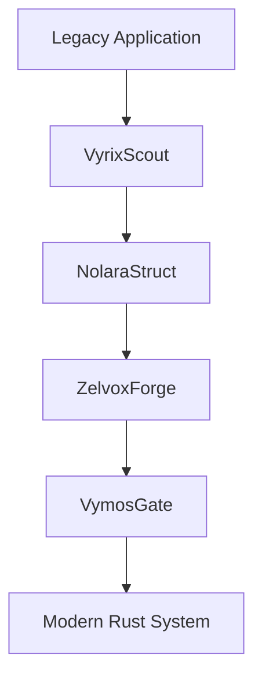
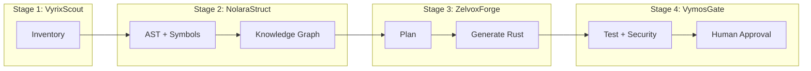

# LegacyExodus Project Context
**Version:** v2.0 (Enterprise Architecture Edition)
**Document Role:** Foundational Architecture Context

---

## 1. Project Identity

**Project Name:** LegacyExodus

LegacyExodus is an enterprise, knowledge-first software modernization platform designed to transform fragile, under-documented legacy systems into modern, maintainable, secure, and scalable architectures.

It exists because most modernization efforts fail when they treat migration as a code conversion problem instead of a system understanding problem. In legacy environments, critical behavior is often hidden in implicit assumptions, middleware chains, side effects, configuration drift, and undocumented business rules. Translating syntax without reconstructing this meaning creates operational risk.

LegacyExodus addresses this by establishing deterministic system intelligence before any transformation is executed.

### Why LegacyExodus Exists
Organizations are constrained by business-critical legacy systems that are expensive to maintain, difficult to scale, and risky to rewrite. Traditional paths are often inadequate:

- Full rewrites are costly, slow, and high-risk.
- Syntax translators are fast but shallow.
- Generic AI generation can be useful but inconsistent without architecture grounding.

LegacyExodus provides a governed modernization path that emphasizes understanding, traceability, and controlled delivery confidence.

### What LegacyExodus Is Not
LegacyExodus is **not**:

- A transpiler
- A line-by-line converter
- A prompt-only AI code generator

### What LegacyExodus Is
LegacyExodus is:

- A **knowledge-first modernization intelligence system**
- A staged architecture that separates discovery, modeling, generation, and validation
- A human-governed AI platform with deterministic control surfaces

**Core principle:**
**Understand first. Transform second. Trust always.**

---

## 2. Vision Statement

LegacyExodus aims to become the reference platform for safe, explainable, and continuously improving software modernization.

Its long-term vision is to provide organizations with the capability to:

- Understand legacy ecosystems as living systems, not static files
- Reconstruct architecture and behavioral intent at scale
- Modernize incrementally with governance and confidence scoring
- Maintain continuous system intelligence after migration
- Evolve toward autonomous modernization assistance while preserving human control over high-risk decisions

LegacyExodus is designed not only to migrate software, but to establish a durable modernization intelligence layer that supports future evolution.

---

## 3. Mission Statement

LegacyExodus exists to:

1. **Understand legacy systems deeply** through deterministic analysis
2. **Extract hidden knowledge** from code, structure, and behavior
3. **Build machine-readable system intelligence** for planning and decision support
4. **Generate modern architectures and implementations** with AI-assisted orchestration
5. **Validate migration quality and safety** through technical and governance gates
6. **Maintain human control** at critical decision points for enterprise trust

---

## 4. Core Philosophy

## 4.1 Knowledge First Architecture

Transformation without understanding introduces silent defects. LegacyExodus prioritizes system intelligence as the primary output of early stages.

Before generation, the platform performs:

- System discovery
- Architecture recovery
- Business logic extraction
- Dependency and boundary understanding
- Behavioral pattern analysis

This prevents shallow conversions and enables modernization decisions grounded in system reality.

---

## 4.2 Event-Driven Architecture

Every significant operation emits a domain event. Events are the audit spine of the platform.

Examples include:

- `FileDiscovered`
- `DependencyMapped`
- `ASTGenerated`
- `KnowledgeExtracted`
- `MigrationGenerated`
- `ValidationCompleted`

### Why Events Matter

- **Auditability:** Every decision path is inspectable
- **Replayability:** Workflows can be replayed for diagnosis or recovery
- **Scalability:** Services communicate asynchronously through defined facts
- **Debuggability:** Failures can be traced to exact transition points
- **Observability:** Progress, bottlenecks, and confidence can be monitored systematically

---

## 4.3 Human-Governed AI

AI is an accelerator, not an authority.

LegacyExodus treats AI as a probabilistic subsystem that proposes candidate outputs and reasoning artifacts. Final trust is established through validation and human governance.

Governance model includes:

- Approval gates for high-impact changes
- Confidence scoring for generated artifacts
- Human review workflows for ambiguous transformations
- Traceable rationale for acceptance or rejection

This preserves accountability while still leveraging automation at scale.

---

## 4.4 Modular Architecture

Capabilities are isolated into independent services to reduce coupling and support parallel evolution.

Key modules include:

- Parser Service
- Graph Service
- Knowledge Service
- AI Gateway
- Compiler Service
- Storage Service
- Orchestrator

Isolation improves maintainability, testability, and controlled extensibility across stages.

---

## 4.5 Safe Migration Over Fast Migration

Speed is valuable only if correctness is preserved.
LegacyExodus prioritizes trustworthy modernization outcomes over throughput.

Primary optimization target: **confidence-adjusted correctness**, not raw generation speed.

---

## 5. System Overview

LegacyExodus operates as a four-stage modernization pipeline:



### Stage Summary

| Stage | Purpose | Status | Input | Output | Importance |
|---|---|---|---|---|---|
| VyrixScout | Deterministic discovery and inventory | **IMPLEMENTED** | Legacy codebase + configs | Legacy System Inventory | Establishes factual system baseline |
| NolaraStruct | Semantic reconstruction and modeling | **IMPLEMENTED** | Inventory + source structure | Machine-readable system understanding (knowledge model) | Converts syntax into architectural intelligence |
| ZelvoxForge | Transformation planning and code generation | **PLANNED / TARGET ARCHITECTURE** | Knowledge model + modernization strategies | Candidate modern implementation | Produces modernization artifacts with rationale |
| VymosGate | Validation and governance | **PLANNED / TARGET ARCHITECTURE** | Candidate implementation + validation policies | Production-ready migration decision | Ensures safety, quality, and release confidence |

---

## 6. Four Core Migration Stages

## 6.1 VyrixScout (Discovery & Intelligence Collection)

**Purpose:** Identify what exists and how the legacy system is composed.

**Responsibilities:**

- Filesystem analysis
- Language detection
- Framework detection
- Dependency discovery
- Configuration analysis
- Metadata extraction

**Input:** Repository/workspace files, manifests, configuration surfaces
**Output:** **Legacy System Inventory**

VyrixScout forms the deterministic ground truth that all downstream reasoning depends on.

---

## 6.2 NolaraStruct (Knowledge Modeling)

**Purpose:** Convert discovered artifacts into structured understanding.

**Responsibilities:**

- AST generation
- Symbol extraction
- Dependency graph construction
- Knowledge graph construction
- Architecture reconstruction

**Input:** Legacy System Inventory + source artifacts
**Output:** **Machine-readable system understanding**

NolaraStruct elevates the system from file-level data to architecture-level intelligence.

---

## 6.3 ZelvoxForge (Transformation & Generation)

**Purpose:** Generate modernization candidates using orchestrated AI and deterministic constraints.

**Responsibilities:**

- AI agent orchestration
- Architecture planning
- Rust-oriented generation
- Modernization strategy selection
- Transformation reasoning capture

**Input:** Knowledge model + migration policies + target architecture patterns
**Output:** **Candidate modern implementation**

ZelvoxForge produces implementation artifacts that are traceable to modeled intent, not just source syntax.

---

## 6.4 VymosGate (Validation & Governance)

**Purpose:** Determine whether a migration candidate is safe, correct, and ready for promotion.

**Responsibilities:**

- Testing and verification
- Security checks
- Behavioral validation
- Human approval workflows
- Release confidence assessment

**Input:** Candidate implementation + test/validation criteria
**Output:** **Production-ready migration decision**

VymosGate ensures modernization quality before deployment decisions are made.

---

## 7. Technology Stack Philosophy

## 7.1 Core Engine: TypeScript + Bun

The core runtime uses TypeScript with Bun to optimize execution speed of platform development and orchestration learning cycles.

**Why this choice:**

- High development velocity for platform iteration
- Strong ecosystem for AI and developer tooling
- Productive type-guided engineering workflows
- Efficient runtime for orchestration-heavy operations

This supports rapid capability evolution during MVP and near-term platform hardening.

---

## 7.2 Modernization Target: Rust

Rust is the primary target for generated systems because modernization goals include safety, reliability, and long-term maintainability—not only code translation.

**Why Rust:**

- Memory safety guarantees
- Predictable performance characteristics
- Reliability under concurrency and load
- Strong suitability for long-lived enterprise services

Rust aligns with LegacyExodus objectives for resilient modernization outcomes.

---

## 7.3 Frontend Visualization: React + TypeScript + Vite + Tailwind CSS

The frontend is an operational control center, not a static dashboard.

It provides visibility into:

- Migration progress and stage status
- Dependency and knowledge graph insights
- AI reasoning artifacts and confidence indicators
- Validation state and approval workflows

This interface supports transparency, governance, and human decision quality.

---

## 8. Architecture Principles

## 8.1 Traceability
Every generated artifact should map back to source evidence, transformation intent, and validation outcomes.

## 8.2 Reproducibility
Given the same inputs, configuration, and policies, migration workflows should be repeatable and explainably variant when differences occur.

## 8.3 Extensibility
Languages, parsers, agents, and generation strategies should be pluggable through clear contracts and modular boundaries.

## 8.4 Security First
The platform must protect:

- Source code and intellectual property
- Generated artifacts
- AI interaction surfaces
- Secrets and credentials across execution paths

## 8.5 Explainability
For every major transformation, the platform should answer:

- What changed?
- Why did it change?
- How confident is this change?

---

## 9. Target Users

## 9.1 Enterprise Organizations
Need controlled modernization of mission-critical systems with governance, audit trails, and risk-managed delivery.

**How LegacyExodus helps:**
Provides staged modernization with traceability, approval gates, and confidence-based release decisions.

## 9.2 Software Engineering Teams
Need practical migration acceleration without losing architectural correctness.

**How LegacyExodus helps:**
Automates discovery and generation while preserving human control over critical architecture and business logic decisions.

## 9.3 Legacy System Maintainers
Need to preserve undocumented behavior while reducing technical debt.

**How LegacyExodus helps:**
Reconstructs hidden system knowledge and converts it into structured intelligence before transformation.

---

## 10. Current MVP Scope

**Current modernization focus:**

- **Input:** Node.js / Express.js legacy backends
- **Output:** Rust / Axum / SQLx modern backends

**Target success profile:**
A legacy Express backend with 50+ files can be analyzed and migrated with high automation support, while routing complex or high-risk logic through explicit human approval workflows.

---

## 11. Future Evolution

Planned platform evolution includes:

- Multi-language modernization expansion
- Cloud-native architecture modernization support
- Autonomous documentation and knowledge refresh
- Security posture modernization during migration
- Performance optimization recommendation layers
- Collaborative autonomous engineering agents under governance constraints

These capabilities extend the platform while preserving the same foundational principles: knowledge-first reasoning, explainable transformation, and human-governed trust.

---

## 12. Operating Model Summary



---

## 13. Repository Boundary & Execution-Context Architecture

LegacyExodus enforces a strict architectural distinction between the repository container and the application package root:

```text
LegacyExodus/                          <-- Git Repository Root (Governance, Workspace Container)
├── .git/
├── .gitignore
├── CHANGELOG.md
├── README.md
├── docs/
└── legacy-exodus-core/                <-- Canonical Package / Application Root
    ├── package.json
    ├── src/                           <-- Engine Implementation
    ├── tests/                         <-- Canonical Unit & Integration Tests
    └── benchmarks/                    <-- Canonical Benchmark Infrastructure
        ├── paths.ts                   <-- Centralized Path Anchors (import.meta.dir)
        ├── .cache/                    <-- External Benchmark Repositories
        ├── corpus/                    <-- Benchmark Definitions (tier-1, tier-2, tier-3)
        └── results/                   <-- Performance & Determinism JSON Runs
            └── fidelity/              <-- Migration Fidelity Reports (fidelity-report.json)
```

### Execution-Context Invariants

1. **CWD Independence:** All internal benchmark infrastructure, cache directories (`.cache/`), result outputs (`results/`), and fidelity validation outputs (`results/fidelity/fidelity-report.json`) are anchored to `legacy-exodus-core/` using deterministic module-relative paths (`import.meta.dir`).
2. **No Root Leakage:** Running CLI, tests, or benchmarks from the Git repository root (`LegacyExodus/`) or package root (`legacy-exodus-core/`) will NEVER create stray artifact directories at the Git root level.
3. **User-Supplied Path Fidelity:** Ordinary user-supplied relative repository paths (e.g. `legacy-exodus analyze ./target-repo`) preserve standard caller-CWD resolution semantics.

---

## 14. Verified Pipeline Intelligence & Evidence Baseline

### 14.1 Deterministic Subsystem Pipeline
1. **Discovery (`src/discovery/`):** Recursively traverses source trees with symlink skip protection, categorizing files into source, markup, data, configuration, and documentation with SHA-256 relative path artifact identities.
2. **Parser Adapter (`src/parser/`):** Ingests JavaScript and TypeScript via `@babel/parser` in `unambiguous` mode with error recovery, normalizing raw ASTs into role-tagged immutable `ASTNode` structures.
3. **Symbols & Scoping (`src/symbols/`):** Extracts declarations across lexical scopes, correctly hoisting `var` bindings to enclosing function/module scopes, extracting pattern-bound names without RHS initializer pollution, isolating parameter defaults, and extracting prototype and CommonJS export bindings.
4. **Module & Dependency Graph (`src/graph/`):** Resolves relative and tsconfig path-aliased specifiers against known repository files, tracks star and named re-exports, and detects dependency cycles.
5. **Semantic & Call Graph Engine (`src/semantic/`):** Resolves local and cross-module calls, constructor instantiations (`NewExpression`), unwraps `.apply`/`.call`, identifies dead code, and reconstructs Express routes and middleware chains.
6. **Control & Data Flow (`src/flow/`):** Builds basic-block CFGs with try/catch/finally exception branching; constructs path-insensitive intraprocedural def-use chains, variable lifetimes, and connects proven call targets to interprocedural taint flow.
7. **Streaming Storage (`src/storage/`):** Projects large analysis datasets to disk using `StreamingJsonWriter` with bounded 64KB chunk backpressure.
8. **Fidelity & Governance (`src/governance/`):** Enforces the Three-Universe validation model, computing sample recall, actionable correctness, provenance freshness locks, and 10-point governance audits.

### 14.2 Verified Evidence Summary
* **Test Suite:** 472 / 472 tests passing across 69 test files (3,306 assertions).
* **Typecheck:** 0 TypeScript compile errors.
* **Governance Audit:** 10 / 10 benchmark checks passed (`PASS`).
* **Determinism Gate:** 3-run bit-for-bit identical outputs (0 diffs) across Tier-1 (`cookie-parser`), Tier-2 (`fastify`), and Tier-3 (`express`).
* **Migration Fidelity:** 100.0% sample recall and 100.0% actionable correctness across 296 ground-truth facts (Express 142 facts, Fastify 154 facts).
* **Safety Verdict Policy:** Strictly maintained as `MIGRATION_SAFETY_NOT_YET_ESTABLISHED` under the Three-Universe evidence model.

---

**Final perspective:**
Legacy modernization is fundamentally a knowledge and governance challenge before it is a code generation task.

LegacyExodus operationalizes this through staged intelligence, controlled transformation, and validation-centric delivery.

**Guiding principle:**
**Understand first. Transform second. Trust always.**
