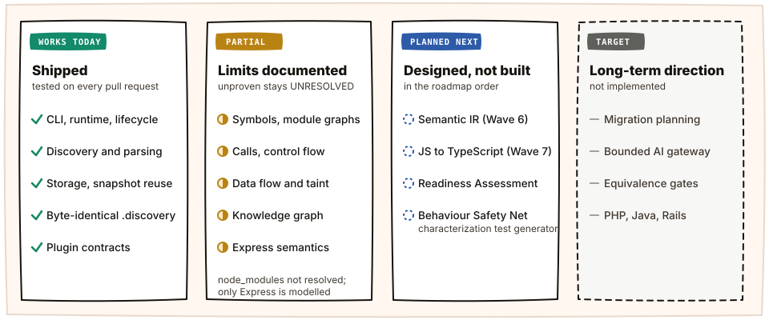
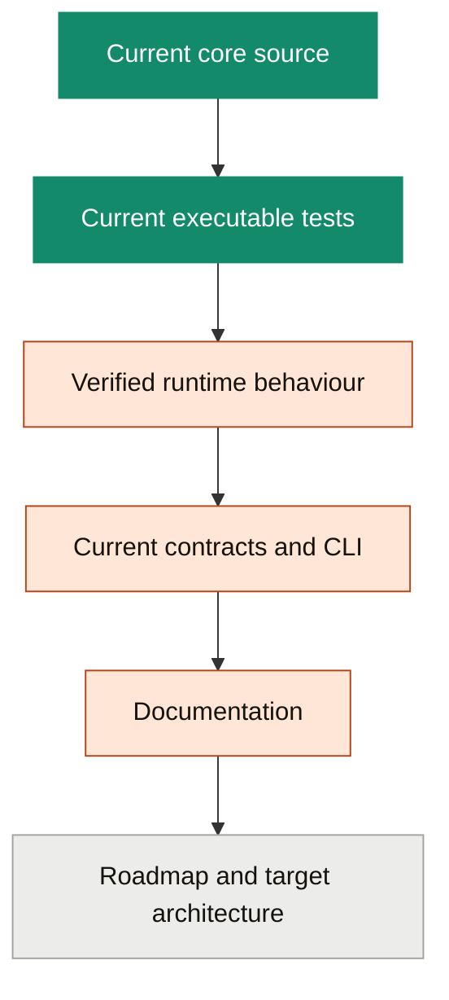

# LegacyExodus Documentation

Documentation follows implementation truth: it describes `main`, and it never claims a capability the code and tests do not show. Start with **[Current Implementation](CURRENT_IMPLEMENTATION.md)**.

  

## Read by purpose

<table>
  <tr>
    <td width="33%" valign="top">
      <b>Know what exists</b> 
      
        <a href="CURRENT_IMPLEMENTATION.md">Current Implementation</a>: the capability boundary 
        <a href="pipeline/pipeline-overview.md">Pipeline Overview</a>: stage by stage status 
        <a href="../ROADMAP.md">Roadmap</a>: what is next
      
    </td>
    <td width="33%" valign="top">
      <b>Understand the design</b> 
      
        <a href="architecture/system-overview.md">System Overview</a> 
        <a href="adr/README.md">Decision Records</a>: ADR-001 to ADR-011 
        <a href="GLOSSARY.md">Glossary</a>
      
    </td>
    <td width="33%" valign="top">
      <b>Work in the engine</b> 
      
        <a href="implementation/core-engine.md">Core Engine</a> 
        <a href="implementation/parser-strategy.md">Parser Strategy</a> ·
        <a href="implementation/storage-layer.md">Storage Layer</a> 
        <a href="implementation/knowledge-graph.md">Knowledge Graph</a>
      
    </td>
  </tr>
  <tr>
    <td valign="top">
      <b>Use the CLI</b> 
      <a href="development/cli/commands.md">CLI Command Reference</a>: every command and flag
    </td>
    <td valign="top">
      <b>Write documentation</b> 
      
        <a href="DOCUMENTATION_RULES.md">Documentation Rules</a> 
        <a href="DOCUMENTATION_MAP.md">Documentation Map</a>: every page
      
    </td>
    <td valign="top">
      <b>Contribute safely</b> 
      
        <a href="../CONTRIBUTING.md">Contributing</a> ·
        <a href="../SECURITY.md">Security</a>
      
    </td>
  </tr>
</table>

## Status language

Every material capability claim uses exactly one of these labels.

| Label | Meaning |
|---|---|
| `VERIFIED` | Implemented and supported by current passing evidence |
| `IMPLEMENTED` | Code exists and is integrated |
| `PARTIAL` | Useful implementation with material, documented limits |
| `EXPERIMENTAL` | Implemented, but not stable or default |
| `PLANNED` | An accepted or concrete plan without integrated code |
| `TARGET ARCHITECTURE` | Long-term direction, not current functionality |
| `NOT IMPLEMENTED` | No working integrated implementation |

Architecture, product, research and integration pages may describe future systems. Unless a page cites current core evidence and labels a feature `IMPLEMENTED` or `VERIFIED`, it describes direction, not a feature that exists today.

## Truth precedence

When two sources disagree, the higher one wins:

The stale `legacy-exodus-core/` snapshot on the retired `docs-foundation` branch is not implementation evidence. Documentation work reads `main`.
