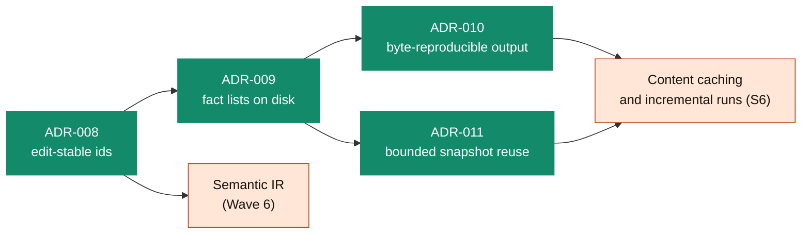

# Architecture Decision Records

Each record states one decision: the problem, what was chosen, what was rejected, and what must stay true. A record is **ACCEPTED** once the owner signs it off. Its status line then says where it is implemented. **PROPOSED / TARGET** records describe architecture that is not built yet.

## At a glance

| ADR | Decision | Status | Where it lives |
|---|---|:---:|---|
| [001](ADR-001-project-state-architecture.md) | Project state is immutable, versioned and schema-validated, not a shared mutable object | `ACCEPTED` | `src/contracts`, `src/shared/immutability.ts` |
| [002](ADR-002-event-system-governance.md) | Every state change is a structured, ordered domain event; commands are decoupled from projections | `ACCEPTED` | `src/core/events` |
| [003](ADR-003-plugin-system.md) | Plugins implement one contract and get a scoped context. They run in-process; there is no sandbox | `ACCEPTED` | `src/plugins` |
| [004](ADR-004-ai-gateway.md) | A zero-trust gateway between analysis and any LLM: secret redaction, grounded prompts, provider failover | `PROPOSED / TARGET` | Not implemented |
| [005](ADR-005-storage-strategy.md) | Storage behind an adapter (memory, SQLite); projections are streamed with backpressure | `ACCEPTED` | `src/storage` |
| [006](ADR-006-security-model.md) | Analyzed repositories are untrusted: contained paths, no symlink escape, no host paths in output, fail closed | `ACCEPTED` | `src/discovery`, `src/shared/git.ts` |
| [007](ADR-007-migration-pipeline.md) | Generated code passes compile, test and human gates before it counts | `PROPOSED / TARGET` | Not implemented. The first migration path is JS → TypeScript ([ROADMAP](../../ROADMAP.md)) |
| [008](ADR-008-edit-stable-identity.md) | Fact ids come from structure (owners, names, kinds), never positions, so an edit elsewhere keeps them | `ACCEPTED` · implemented | `src/shared/identity.ts`, `src/symbols/symbol-keys.ts` |
| [009](ADR-009-streaming-sharded-execution.md) | Whole-run fact lists live on disk (`FactArray`), so memory does not hold every fact at once | `ACCEPTED` · implemented | `src/shared/fact-array.ts` |
| [010](ADR-010-reproducible-projections.md) | Fact artifacts carry no run identity, so they are byte-reproducible; one stable project id per repository | `ACCEPTED` · implemented | `src/storage/projections`, `src/discovery/project-identity.ts` |
| [011](ADR-011-bounded-snapshot-reuse.md) | Snapshot reuse verifies while copying and restores lists on disk, so reuse costs less memory than analysing | `ACCEPTED` · implemented | `src/discovery/discovery-validator.ts`, `src/shared/json-document-reader.ts` |

## How the recent records build on each other

Stable ids (008) make facts comparable across runs and edits. Disk lists (009) make whole-repository runs fit in memory. Reproducible bytes (010) and cheap reuse (011) together are what content caching needs: the same input gives the same output, and reading it back is cheaper than computing it again.

## Writing a new record

1. Copy the shape of [ADR-010](ADR-010-reproducible-projections.md): **Status**, **Context**, **Decision**, **Invariants**, **Alternatives considered**, **Consequences**.
2. Number it next in sequence and add a row to the table above.
3. Open it as `PROPOSED`. Only the owner moves it to `ACCEPTED`.
4. Name the invariants as checks that can fail (a test, a gate, a fact-diff), not as intentions.
5. When it is implemented, say where in the status line, with the PRs.
