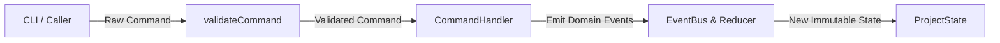

# Command Contracts Specification

This document details the command interface and schemas supported by the **LegacyExodus Orchestrator**.

---

## 1. Overview & CQRS Architecture

LegacyExodus applies a **CQRS (Command-Query Responsibility Segregation)** pattern. All mutations to project state are submitted as immutable, typed command structures validated via Zod (`src/contracts/commands.ts`).

---

## 2. Command Types & Schemas

### 2.1 `InitializeProject`
Creates and registers a new analysis project workspace.

* **Type:** `"InitializeProject"`
* **Payload:**
  * `projectId` (`string.uuid`): Unique identifier for the project.
  * `name` (`string`): Human-readable project name.

### 2.2 `DiscoverProject`
Triggers file discovery for a single discovered repository entry.

* **Type:** `"DiscoverProject"`
* **Payload:**
  * `projectId` (`string.uuid`): Target project ID.
  * `fileId` (`string.uuid`): Deterministic SHA-256 relative file identifier.
  * `path` (`string`): POSIX relative file path.
  * `language` (`string`): Detected language (`javascript`, `typescript`, etc.).

### 2.3 `AnalyzeProject`
Executes full multi-stage analysis (Discovery $\to$ Parsing $\to$ Symbols $\to$ Module Graph $\to$ Semantic Call Graph $\to$ CFG/DFG) on a target directory.

* **Type:** `"AnalyzeProject"`
* **Payload:**
  * `projectId` (`string.uuid`): Project ID.
  * `path` (`string`): Repository directory path.
  * `refresh` (`boolean`, optional): When `true`, forces fresh discovery and bypasses valid cached snapshots in `.discovery/`.

### 2.4 `UpdateKnowledge`
Updates the knowledge graph projection with a processed artifact.

* **Type:** `"UpdateKnowledge"`
* **Payload:**
  * `projectId` (`string.uuid`): Project ID.
  * `artifactId` (`string.uuid`): Processed artifact ID.

---

## 3. Validation & Error Handling

Commands are validated using `validateCommand(command)`. If schema validation fails, the orchestrator throws a `LegacyExodusError` with error code `"COMMAND_INVALID"`.

---

## Related Documentation

* **[Event Contracts](event-contracts.md):** Lifecycle events emitted by commands.
* **[Plugin API](plugin-api.md):** Plugin interfaces and lifecycle hooks.
* **[ADR-001: Project State](../adr/ADR-001-project-state-architecture.md):** State management design.
