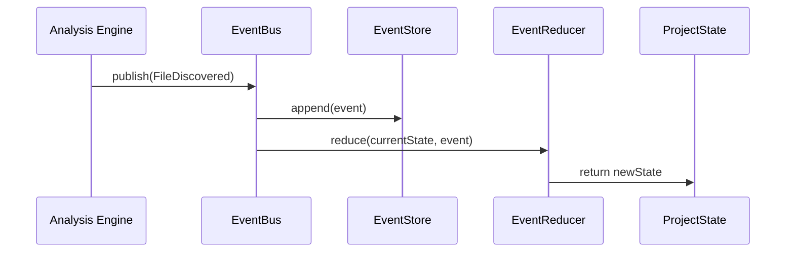

# Domain Event Contracts Specification

This document specifies the domain event interfaces and schemas emitted during **LegacyExodus** analysis execution (`src/contracts/events.ts`).

---

## 1. Event Model & Lifecycle

All lifecycle transitions within LegacyExodus are recorded as immutable `DomainEvent` objects published to the synchronous `EventBus` and stored in the `EventStore`.



---

## 2. Event Types & Schemas

### 2.1 Project & Discovery Events
* **`ProjectInitialized`:** Emitted when a project workspace is registered (`projectId`, `name`).
* **`FileDiscovered`:** Emitted for each candidate file (`fileId`, `path`, `language`).
* **`DependencyDetected`:** Emitted when `package.json` dependencies are detected (`name`, `version`).
* **`FrameworkDetected`:** Emitted when frameworks (Express, Fastify) are identified (`name`, `evidence`).
* **`DiscoveryCompleted`:** Emitted when repository scanning finishes (`projectId`, `fileCount`, `dependencyCount`, `frameworkCount`).
* **`DiscoveryEnumerationFailure`:** Emitted when directory traversal encounters an unreadable entry (`path`, `kind`, `code`).
* **`KnowledgeUpdated`:** Emitted when the knowledge graph projection is updated (`artifactId`).

### 2.2 Parser & Symbol Events
* **`FileParsed`:** Emitted when AST normalization completes (`fileId`, `path`, `parserId`, `nodeCount`, `errorCount`).
* **`SymbolsExtracted`:** Emitted when symbol and scope extraction completes (`fileId`, `path`, `symbolCount`).
* **`ParserFailure`:** Emitted when AST parsing encounters an unrecoverable syntax error (`fileId`, `path`, `code`).
* **`SymbolsExtractionFailure`:** Emitted when symbol extraction encounters an unrecoverable failure on a file (`fileId`, `path`, `code`).

### 2.3 Analysis Run Lifecycle Events
* **`AnalysisRunStarted`:** Emitted when an analysis execution begins (`projectId`, `analysisRunId`).
* **`AnalysisRunCompleted`:** Emitted when an analysis run completes successfully (`projectId`, `analysisRunId`, `durationMs`). Clears any previous `analysisError` metadata.
* **`AnalysisRunFailed`:** Emitted when an analysis run fails (`projectId`, `analysisRunId`, `error`). Clears any previous `analysisDurationMs` metadata.

---

## 3. Event Envelope Structure

Every event implements the `DomainEvent` envelope:

```typescript
export interface DomainEvent<Payload = unknown> {
  readonly id: string;            // UUID v4
  readonly type: string;          // e.g. "FileDiscovered"
  readonly timestamp: Date;       // ISO-8601 UTC
  readonly aggregateId: string;   // Project ID or File ID
  readonly payload: Readonly<Payload>;
}
```

---

## Related Documentation

* **[Command Contracts](command-contracts.md):** Commands triggering events.
* **[Plugin API](plugin-api.md):** Subscribing to events in plugins.
* **[ADR-002: Event System](../adr/ADR-002-event-system-governance.md):** Event architecture decision.
