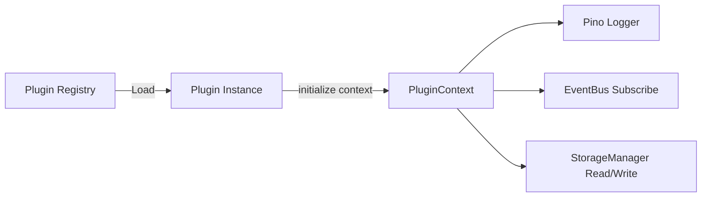

# Plugin API Specification

This document details the interface, lifecycle hooks, and context available to plugins extending **LegacyExodus** (`src/plugins/`).

---

## 1. Overview & Architecture

LegacyExodus provides an isolated plugin framework that allows third-party analyzers, exporters, and rules to integrate with the analysis lifecycle without modifying core engine source code.



---

## 2. The `LegacyExodusPlugin` Interface

Every plugin must implement the `LegacyExodusPlugin` interface (`src/plugins/plugin.ts`):

```typescript
import type { PluginContext } from "./plugin-context";
import type { PluginManifest } from "./plugin-manifest";

export interface LegacyExodusPlugin extends PluginManifest {
  initialize(context: PluginContext): Promise<void>;
  shutdown(): Promise<void>;
}
```

---

## 3. Plugin Context Services

When `initialize(context)` is called, the plugin receives:

1. **`logger` (`Logger`):** Structured Pino logger scoped to the plugin.
2. **`eventBus` (`EventBus`):** Allows subscribing to any domain event (e.g. `FileParsed`, `SymbolsExtracted`).
3. **`storage` (`StorageManager`):** Provides structured storage access for saving plugin-generated analysis projections.

---

## 4. Plugin Manifest

Every plugin must provide metadata defining its identity and version compatibility (`PluginManifest`):

```typescript
export interface PluginManifest {
  readonly name: string;
  readonly version: string;
  readonly description?: string;
  readonly author?: string;
}
```

---

## Related Documentation

* **[Plugin Architecture](../architecture/plugin-architecture.md):** Deep architectural overview.
* **[Event Contracts](event-contracts.md):** Available domain events.
* **[ADR-003: Plugin System](../adr/ADR-003-plugin-system.md):** Plugin architecture decision.
