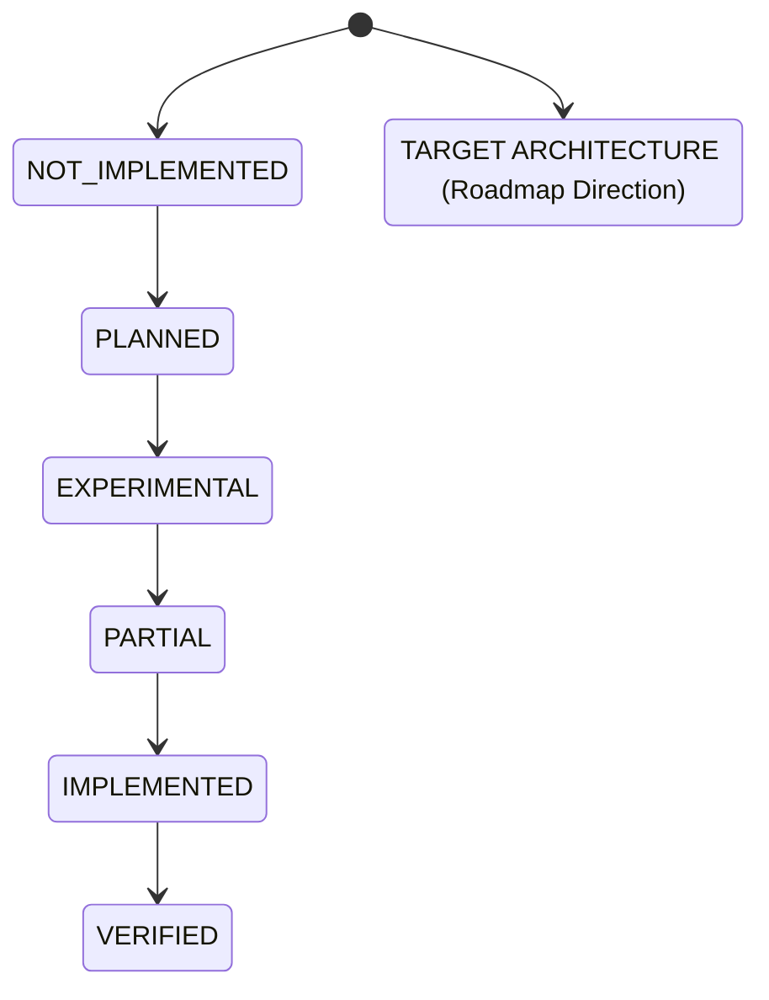
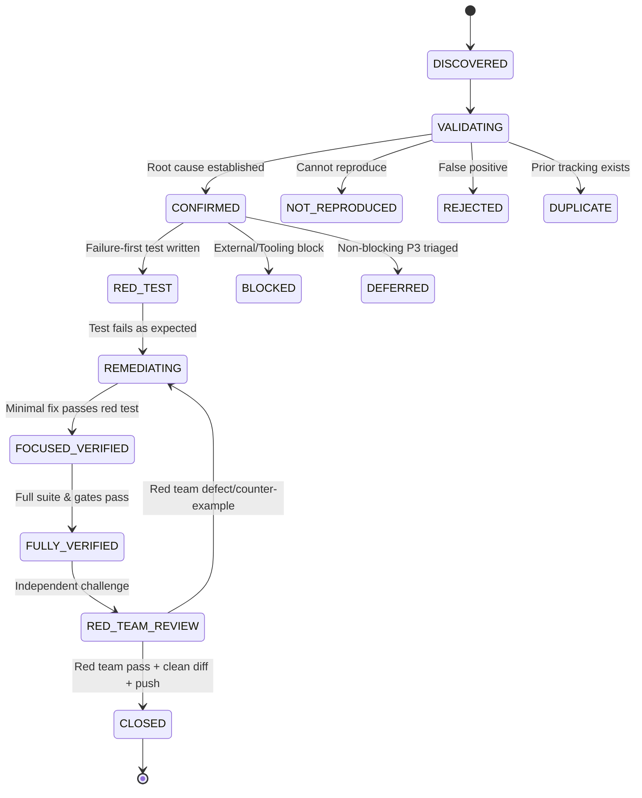

# LegacyExodus Permanent Engineering Charter

> **ARCHIVED (2026-11-03).** Historical governance, kept for reference. The canonical agent operating system is [`.agents/`](../../../.agents/README.md); where this document conflicts with it, `.agents/` governs.
## Canonical Constitutional Governance for AI-Assisted and Human Engineering

*Status: Authoritative & Active*
*Scope: Repository-Wide (`LegacyExodus`)*
*Jurisdiction: All contributors, AI coding agents, audit bots, and reviewers*

---

## 1. Purpose & Jurisdiction

LegacyExodus is a knowledge-first codebase modernization platform designed to perform deterministic, semantics-preserving migrations of legacy codebases. Because the engine must be trusted with mission-critical enterprise systems, every line of code, test, and specification must adhere to strict standards of correctness, verifiability, and transparency.

This Charter establishes the **permanent, non-negotiable constitutional rules** governing all software engineering, static analysis, performance optimization, documentation, and Git repository operations.

### Key Terminology (RFC 2119 / RFC 8174)
* **MUST / SHALL / REQUIRED**: Absolute requirement; non-compliance is an immediate blocking failure.
* **MUST NOT / SHALL NOT**: Absolute prohibition; non-compliance is an immediate blocking failure.
* **SHOULD / RECOMMENDED**: Mandatory unless an explicit, evidenced technical justification is documented.
* **SHOULD NOT / NOT RECOMMENDED**: Prohibited unless an explicit, evidenced technical justification is documented.
* **MAY / OPTIONAL**: Permissible within defined boundaries.

---

## 2. Source of Authority & Precedence Hierarchy

Executable reality always supersedes written prose. When discrepancies arise between code, tests, and documentation, the following strict hierarchy of authority MUST be enforced:

```text
┌─────────────────────────────────────────────────────────────────────────┐
│                       AUTHORITY PRECEDENCE ORDER                        │
├──────┬──────────────────────────────────────────┬───────────────────────┤
│ Rank │ Layer                                    │ Status                │
├──────┼──────────────────────────────────────────┼───────────────────────┤
│ 1    │ Current Production Implementation Code   │ Primary Truth         │
│ 2    │ Current Automated Test Suite             │ Executable Contract   │
│ 3    │ Current CI & Automated Verification Gate │ Operational Boundary  │
│ 4    │ Active Architecture Implementation       │ Concrete Structure    │
│ 5    │ Accepted Architecture Decision Records   │ Architectural Intent  │
│ 6    │ Current Synchronized Documentation       │ Explanatory Artifact  │
│ 7    │ Historical Documentation & Archives      │ Historical Record     │
│ 8    │ Draft Proposals, Roadmaps, & Research    │ Non-Authoritative     │
└──────┴──────────────────────────────────────────┴───────────────────────┘
```

### Precedence Rules
1. **No Prose Supremacy:** A document or roadmap MUST NOT override executable reality. If documentation states a feature exists but no working, integrated implementation exists in `legacy-exodus-core`, the feature MUST be treated as **NOT IMPLEMENTED**.
2. **Test as Specification:** The test suite defines the operational contract of the code. If code passes tests but violates an explicit architectural boundary defined in Rank 1–4, the test suite is incomplete.
3. **Single Source of Truth:** `main` is the implementation and test authority. The retired `docs-foundation` branch holds a historical, unverified `legacy-exodus-core` snapshot that MUST NOT be used as evidence. When a checkout may be behind, agents query `main` with branch-qualified Git commands (`git show origin/main:<path>`).

---

## 3. Core Engineering Principles

All contributors and AI agents MUST adhere to the canonical ten engineering principles:

1. **Facts before interpretation:** Document observed execution facts and exact values before proposing explanations.
2. **Evidence before confidence:** Confidence must scale strictly with reproducible proof, never with intuition.
3. **Determinism before convenience:** Identical inputs across platforms and runs must produce bit-for-bit identical outputs.
4. **Correctness before optimization:** Never optimize code or data structures at the expense of semantic precision or boundary contracts.
5. **Explicit unknowns before fabricated certainty:** Unresolved symbols, types, or edges must be explicitly labeled `UNRESOLVED` or `AMBIGUOUS`. Never guess.
6. **Conservative inference before speculative resolution:** Static analysis must refuse to infer connections without provable evidence.
7. **Reproducibility before cleverness:** Simple, auditable, and repeatable implementations strictly take precedence over opaque abstractions.
8. **Traceability before abstraction:** Every extracted fact, symbol, and edge must retain source location provenance and execution metadata.
9. **Failure visibility before silent recovery:** Errors and edge failures must be captured in domain event streams and accounting ledgers, never swallowed.
10. **Small verified changes before broad refactors:** Remediations must be minimal, surgical, and accompanied by dedicated regression proof.

---

## 4. Architecture State Model

To eliminate hallucinations and unwarranted claims of completion, all architecture discussions, documentation, and PR summaries MUST classify features and subsystems into exactly one of the following seven states:



| State | Strict Engineering Definition | Evidence Required |
| :--- | :--- | :--- |
| **`IMPLEMENTED`** | Source code exists, is fully integrated into the runtime pipeline, and compiles without error. | Concrete source files in `legacy-exodus-core/src/`. |
| **`VERIFIED`** | Implemented AND validated by automated, repeatable unit/integration tests, benchmarks, and verification gates. | Passing tests, zero typecheck errors, benchmark audit pass. |
| **`PARTIAL`** | Some intended functionality exists, but critical edge cases, AST variants, or subsystem integrations are incomplete. | Working subset with documented gaps and pending tests. |
| **`EXPERIMENTAL`** | Code is implemented but isolated behind flags or not guaranteed to be API-stable or deterministic. | Working code marked experimental with stability warnings. |
| **`PLANNED`** | Concrete design or architecture specification exists, but zero implementation code exists in the repository. | Accepted ADR or specification in `docs/`. |
| **`TARGET ARCHITECTURE`** | High-level future architectural direction, target language rewrite, or long-term vision. | Roadmap or whitepaper reference. |
| **`NOT IMPLEMENTED`** | Functionality does not exist in any working capacity within the codebase. | Absense of source code. |

### Prohibited State Confusions
* Contributors MUST NOT describe `TARGET ARCHITECTURE` (e.g., Rust/Axum engine rewrite, UIR/SSA lowerings, ZelvoxForge, VymosGate, AI Gateway) as `IMPLEMENTED` or `VERIFIED`.
* "Designed" does NOT mean "Implemented."
* "Documented" does NOT mean "Implemented."
* "Test exists" does NOT mean "Verified" unless the test demonstrably exercises the contract and passes in CI.

---

## 5. Finding Lifecycle & Forensic Remediation State Machine

Every defect, bug, audit finding, and vulnerability MUST transition through the standard forensic lifecycle. Agents MUST NOT skip states or jump directly from discovery to closure.



### State Definitions
1. **`DISCOVERED`**: Finding identified by bot, human, or agent review.
2. **`VALIDATING`**: Inspecting current source, AST structures, and test suites to verify legitimacy.
3. **`CONFIRMED`**: Finding reproduced; root cause identified; blast radius determined.
4. **`RED_TEST`**: Automated regression test written that demonstrably fails against the current defect.
5. **`REMEDIATING`**: Applying the smallest safe code change to address the root cause.
6. **`FOCUSED_VERIFIED`**: Focused regression test passes cleanly without regressions in the local suite.
7. **`FULLY_VERIFIED`**: Static typecheck, full test suite, benchmark audit, and CLI smoke test pass.
8. **`RED_TEAM_REVIEW`**: Adversarial review conducted to probe for missed edge cases or false confidence.
9. **`CLOSED`**: Remediated, verified, committed, pushed to temporary branch, and documented.

### Alternative Terminal States
* **`INCONCLUSIVE`**: Evidence is contradictory or insufficient to verify or disprove.
* **`BLOCKED`**: Cannot proceed due to environment, missing dependency, or architectural deadlock.
* **`NOT_REPRODUCED`**: Defect does not manifest under current code and test environments.
* **`DEFERRED`**: Valid minor finding formally scheduled for a subsequent milestone.
* **`REJECTED`**: Demonstrably invalid or based on a false premise.
* **`DUPLICATE`**: Finding is already tracked and being addressed under another finding ID.

---

## 6. Evidence Standard & Taxonomy

Every assertion, finding, and closure claim MUST be accompanied by an explicit evidence level. Higher evidence levels indicate greater empirical rigor:

```text
E0: ASSUMPTION ──────► Speculative claim without source citation or test execution.
E1: STATIC OBSERVATION ► Static code or AST inspection without runtime execution.
E2: REPRODUCED BEHAVIOR ► Runtime reproduction via CLI, script, or ad-hoc run.
E3: FOCUSED TEST EVIDENCE ► Deterministic, automated, focused unit/integration test.
E4: FULL VERIFICATION ──► Passing static typecheck + 100% full test suite + benchmark audit + CLI smoke test.
E5: INDEPENDENT / RED TEAM ► Independent red-team validation, invariant proof, fuzzing.
```

### Minimum Evidence Requirements for Closure
* **P0 Findings:** MUST achieve **E4** plus explicit **E5** red-team challenge.
* **P1 Findings:** MUST achieve **E4** (full verification pipeline).
* **P2 Findings:** MUST achieve at least **E3** (focused test evidence + typecheck).
* **P3 Findings:** MUST achieve at least **E2** or **E3**.

### Confidence Taxonomy
* **`CONFIRMED`**: Directly proven by source inspection, reproducible scenario, or failing test.
* **`LIKELY`**: Strong structural evidence indicates defect; reproduction requires specific setup.
* **`POSSIBLE`**: Plausible edge case identified; MUST be framed as a question or verification request.
* **`DESIGN QUESTION`**: Valid implementation that introduces architectural tradeoffs.
* **`FUTURE IMPROVEMENT`**: Non-blocking enhancement or optimization.

---

## 7. Severity Model

Severity MUST be classified based on objective operational impact, never on emotional urgency or artificial inflation:

| Level | Severity | Objective Impact Criteria | SLA / Gate |
| :--- | :--- | :--- | :--- |
| **`P0`** | **Blocking / Critical** | Security vulnerabilities (command injection, path traversal), canonical state/data loss, silent core-state corruption, false-positive/negative analysis defects that misguide migrations, unbounded memory leaks ($O(N)$ whole-repo retention). | Blocks release; must be remediated before any other work. |
| **`P1`** | **High** | Semantic analysis inaccuracies (dropped destructuring flow, wrong callee resolution), lifecycle races (`shutdown()` deadlock), storage run isolation leaks, severe performance degradation. | Must be remediated within the active milestone. |
| **`P2`** | **Medium** | Unhandled edge cases without data corruption, missing regression coverage on secondary branches, non-critical architectural boundary leakage. | Prioritized engineering task. |
| **`P3`** | **Low / Polish** | Minor robustness concerns, low-impact documentation drift, code polish without behavioral impact. | Handled in normal course of work. |

---

## 8. Testing Standards & Anti-Weakening Policy

Tests are the executable specification of LegacyExodus. Tampering with tests to simulate success is considered a catastrophic breach of engineering integrity.

### Absolute Prohibitions (Zero Tolerance)
1. **Never Delete Tests:** Agents MUST NOT delete existing tests to make a test suite pass.
2. **Never Weaken Assertions:** Agents MUST NOT widen assertion thresholds, remove `expect()` checks, or replace exact equality with loose checks solely to mask failures.
3. **Never Suppress Type Errors:** Agents MUST NOT introduce `@ts-ignore`, `@ts-expect-error`, or `any` casts merely to silence compiler errors during upgrades or refactors.
4. **Never Skip Tests:** Agents MUST NOT add `.skip`, `.todo`, or comment out tests without explicit written maintainer authorization.
5. **Never Alter Benchmark Targets:** Agents MUST NOT adjust benchmark tolerances or delete corpus files solely to pass a failing benchmark audit.

### Mandatory Test Standards
* **Failing-First (Red-Test) Requirement:** Every bug remediation MUST begin with a focused test that reproduces the defect and fails prior to code modification.
* **Boundary & Negative Coverage:** Tests must systematically evaluate null inputs, empty structures, maximum lengths, Windows vs. POSIX path separators, and cyclic dependencies.
* **Determinism Testing:** Tests asserting graph generation, symbol tables, or event logs MUST verify that output is identical across repeated executions.

---

## 9. Performance & Benchmark Governance

LegacyExodus processes massive enterprise codebases. Performance regressions destroy utility and trust.

### Bounded Memory Invariant
$$\text{Memory Working Set} = O(\text{active window}) \ll O(\text{whole repository})$$
The engine MUST stream and process files in bounded batches. Whole-repository AST retention, unbounded event arrays, or loading complete projection files back into memory after streaming is strictly prohibited.

### Performance Measurement Standard
1. **Baseline Capture:** Always measure the unchanged baseline under identical hardware and environment conditions prior to introducing optimizations.
2. **Warm-Up & Repeated Runs:** Discard cold-start anomalies; perform repeated runs (minimum 3) and evaluate median and variance.
3. **Memory Disclosure Invariant:** A small instantaneous RSS reading does NOT prove OOM safety. Memory claims MUST be classified as:
   * **`VERIFIED`**: Proven by heap snapshots, GC pressure tests, and stress tests on large corpus.
   * **`INCONCLUSIVE`**: Memory was measured but whole-repo scaling was not established.
   * **`REGRESSION`**: Working set or duration increased beyond acceptable variance.
   * **`IMPROVEMENT`**: Reproducible reduction in time or memory.
   * **`NO MATERIAL CHANGE`**: Variance within experimental error ($\pm 3\%$).

---

## 10. Git & Branch Governance

To maintain a clean, auditable release history, the repository enforces strict branch separation:

### Permanent Branch (Exactly One)
1. **`main`**: The single implementation, documentation and release truth. NEVER commit directly to `main`; all changes land on `main` via verified Pull Requests. `core-foundation` and `docs-foundation` are retired as integration branches (2026-10-28).

### Temporary Task Branches & Authoritative Bases
* All active engineering and documentation work MUST occur on temporary task branches created from `main`.
* Branch naming conventions:
  * `chore/<topic>`: Dependency, toolchain, or maintenance tasks.
  * `fix/<finding-id>`: Forensic defect remediation.
  * `feat/<feature-name>`: Verified new feature implementation.
  * `audit/<topic>`: Read-only investigative tasks.
* Temporary branches MUST be deleted locally and remotely following successful merge to prevent branch sprawl.
* Permanent branch sprawl (e.g., creating branches like `skills`, `agent-governance`, `skill.md`) is strictly prohibited.

### Commit Discipline & Clean-Tree Invariants
* Every commit MUST follow Conventional Commits (`type(scope): summary`).
* **Pre-Task Clean Worktree Precondition:** BEFORE beginning task execution or switching branches, `git status` MUST confirm a clean working tree (`nothing to commit, working tree clean`). Unexpected staged, unstaged, or untracked files MUST stop the task immediately.
* **Pre-Staging Hygiene:** BEFORE staging files, run `git diff --check` and `git status` to verify zero whitespace artifacts and confirm that strictly intended files are included.
* **Post-Push Clean Worktree Postcondition:** AFTER committing and pushing to origin, `git status` MUST confirm a clean working tree (`nothing to commit, working tree clean`).

### Force-Push Policy (Deterministic Boundary)
1. **Autonomous Agents & Contributors Prohibition:** Autonomous agents and general contributors MUST NOT force-push (`git push --force` or `--force-with-lease`) to shared branches (`main` and any retired integration branch).
2. **Normal Development Prohibition:** Normal day-to-day engineering and PR workflows MUST NEVER employ force-pushes on shared branches.
3. **Human Maintainer Emergency Exception:** Human Maintainers MAY execute a force-push ONLY as a narrowly defined emergency recovery operation (e.g., rectifying accidental credential leakage or catastrophic repository history corruption). Any emergency force-push MUST be deliberate, documented, and communicated to all maintainers.

---

## 11. Core & Documentation Isolation

To prevent semantic cross-contamination and noisy PRs:

1. **Strict Directory Boundary:** Core code lives in `legacy-exodus-core/`. Documentation lives in `docs/`.
2. **No Mixed PRs:** Core remediation PRs MUST NOT edit `README.md`, `CHANGELOG.md`, `docs/`, or architectural marketing materials unless explicitly required for technical build correctness.
3. **Retired-Branch Boundary:** The stale copy of `legacy-exodus-core` on the retired `docs-foundation` branch MUST NEVER be treated as current source truth. Documentation tasks inspect the current core on `main`:
   ```bash
   git show origin/main:legacy-exodus-core/src/some-file.ts
   git log origin/main --oneline -n 10
   ```
4. **No Revival:** Contributors MUST NOT merge into or develop on the retired `core-foundation` and `docs-foundation` branches.

---

## 12. Dependency & Toolchain Governance

Dependencies introduce security, supply-chain, and determinism risks.

1. **Frozen Lockfile Enforcement:** All CI and local installations MUST pass `bun install --frozen-lockfile`.
2. **Synchronized Lockfiles:** Any modification to `package.json` MUST be accompanied by the exact corresponding update to `bun.lock`. Committing a `package.json` edit without `bun.lock` is a blocking failure.
3. **Zero Blind Upgrades:** Dependency upgrades MUST be validated against the full verification gate (typecheck, tests, benchmarks, determinism).
4. **Compiler vs. Runtime Separation:** Differentiate build-time tools from runtime libraries. TypeScript is an analysis typechecker (`tsc --noEmit`), while `@babel/parser` is the runtime AST engine. Upgrades MUST NOT conflate toolchain roles.

---

## 13. Security & Repository Trust Boundaries

LegacyExodus analyzes arbitrary, potentially adversarial source code.

1. **Untrusted Input Invariant:** All target repositories, source files, and configuration files scanned by LegacyExodus MUST be treated as untrusted, hostile input.
2. **Subprocess Execution Safety:** Subprocesses MUST NEVER be launched with `shell: true` when consuming user or repository input. Arguments MUST be passed as an isolated array of strings:
   ```typescript
   // REQUIRED:
   spawn(cmd, argsArray, { shell: false, windowsHide: true });
   // FORBIDDEN:
   spawn(`${cmd} ${args}`, { shell: true });
   ```
3. **Batch File Execution Prohibition:** Execution of Windows batch scripts (`.bat`, `.cmd`) is prohibited to prevent Windows argument-injection exploits (CVE-2024-24576 / BatBadBut).
4. **Path Traversal Guard:** Directory traversal sequences (`../`, `..\`, absolute paths, drive letters, UNC paths) in manifests or projection configurations MUST be rejected before disk operations.
5. **Symlink Exclusion:** Directory scanning MUST skip symbolic links and junctions to prevent infinite traversal loops and out-of-boundary source reading.
6. **Secrets Hygiene:** Contributors and agents MUST NEVER print, log, commit, or expose API keys, passwords, bearer tokens, private keys, or credentials. Any detected credential MUST be redacted immediately.

---

## 14. Stop Conditions & Anti-Scope-Creep Invariants

Autonomous agents tend to accumulate unrelated changes if not bounded. The following rules enforce strict task boundaries:

### Mandatory Stop Conditions
An agent MUST immediately STOP execution and report when:
1. The assigned finding or task is fully remediated, verified, committed, and pushed.
2. An unexpected test failure or compiler break occurs in unrelated files.
3. An architectural invariant appears broken or contradictory.
4. Tooling or runtime environments return fatal unexpected errors.
5. The working tree is clean and the verification pipeline has succeeded.

### Anti-Scope-Creep Rules ("While I Was Here...")
Agents MUST NOT:
* Refactor nearby or unrelated code during a bug fix.
* Fix unrelated formatting, linting, or spelling errors outside the target file.
* Upgrade unrelated dependencies.
* Rewrite documentation while performing core code remediation.
* Address multiple unrelated findings in a single atomic branch/PR.

---

## 15. Red-Team Adversarial Protocol

To guard against self-certification bias, every substantive change SHOULD be subjected to red-team challenge.

```text
┌─────────────────────────────────────────────────────────────────────────┐
│                      RED-TEAM VERIFICATION PROTOCOL                     │
├─────────────────────────────────────────────────────────────────────────┤
│ 1. Challenge Assumptions: What premise could be invalid?                │
│ 2. Unchecked Invariants: Does the test pass for the wrong reason?       │
│ 3. Boundary Blindspots: What happens with null, circular, or empty ASTs?│
│ 4. Determinism Check: Does repeated execution alter output?            │
│ 5. Memory Check: Does the change retain references across loop cycles?  │
│ 6. Blast Radius Audit: Did behavior change for unedited callers?        │
└─────────────────────────────────────────────────────────────────────────┘
```

* **The External Reviewer Rule:** External bots, models, or agents (e.g., Grok, CodeRabbit, Copilot) MAY challenge or disprove a remediation, but CANNOT independently certify or close a finding without verified, executable proof.
* **Separation of Roles:** An agent that implements a fix MUST NOT act as the sole certifier of its correctness. Verification MUST be established by automated tests and independent review.
