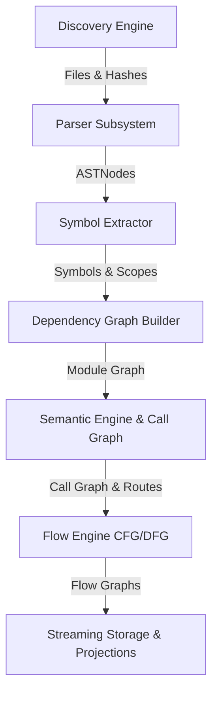

# Developer Guide

This guide describes how to extend and maintain the **LegacyExodus** static analysis engine, add new AST visitors, implement symbol extraction rules, and contribute to the dependency/call graph models.

---

## 1. Engine Subsystem Overview

The LegacyExodus engine is structured as a sequential pipeline with clear separation of responsibilities:

### Key Subsystems:
* **`src/discovery/`:** `FileScanner` and `ProjectDetector` enumerate files, compute SHA-256 relative path file IDs, and skip symlinks.
* **`src/parser/`:** Adapts `@babel/parser` to normalize ASTs into role-tagged immutable `ASTNode` structures.
* **`src/symbols/`:** `JavaScriptSymbolExtractor` derives lexical scopes, resolves `var` hoisting, extracts destructuring pattern bindings, isolates default parameter expressions, and captures CommonJS/prototype declarations.
* **`src/graph/`:** `ModuleResolver` and `DependencyGraphBuilder` map imports, exports, tsconfig path aliases, and cycle graphs.
* **`src/semantic/`:** `CallGraphBuilder` and `SemanticEngine` resolve call targets, constructor invocations (`NewExpression`), dead code, and Express routes.
* **`src/flow/`:** `DeterministicControlFlowGraphBuilder` and `DeterministicDataFlowGraphBuilder` construct basic blocks and def-use taint flow chains.
* **`src/storage/`:** `StreamingJsonWriter` writes bounded chunks (64KB backpressure) to disk.

---

## 2. Adding a New Static Analysis Rule

When enhancing the engine (e.g. extending AST pattern matching in `JavaScriptSymbolExtractor`):

1. **Locate the AST Mapper / Extractor:**
   * Modify `src/symbols/javascript-symbol-extractor.ts` for declarations or scoping.
   * Modify `src/semantic/call-graph-builder.ts` for call target resolution.
2. **Follow Conservative Semantics:**
   * If a relationship is ambiguous or dynamically computed (e.g. `obj[fn]()`), return `UNRESOLVED` or `null`. Never guess.
3. **Ensure Pure Determinism:**
   * Do not use non-deterministic keys (e.g. `Math.random()`, unordered sets). Sort all emitted collections alphabetically by deterministic IDs.

---

## 3. Extending Contracts & Schemas

All inter-subsystem data structures are defined as TypeScript interfaces and runtime Zod schemas under `src/contracts/`:

* `src/contracts/commands.ts` — Engine commands
* `src/contracts/events.ts` — Lifecycle domain events
* `src/contracts/discovery.ts` — Discovery outputs
* `src/contracts/fidelity.ts` — Ground-truth and fidelity schemas

When adding new properties, update both the TypeScript interface and its matching Zod schema in `state-schema.ts`.

---

## Related Documentation

* **[Coding Standards](coding-standards.md):** TypeScript guidelines.
* **[Testing Strategy](testing-strategy.md):** Unit and integration testing standards.
* **[ADR-001: Project State](../adr/ADR-001-project-state-architecture.md):** State management design.
* **[GOVERNANCE.md](../../GOVERNANCE.md):** Boundary rules and deterministic execution invariants.
