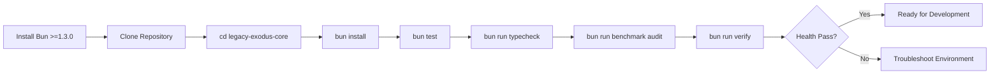

# Environment Setup

This document describes the environment requirements and setup process for developing and running **LegacyExodus**.

---

## 1. Prerequisites

LegacyExodus is built natively on **Bun** and requires a modern TypeScript runtime environment.

| Component | Minimum Version | Recommended | Notes |
|---|---|---|---|
| **Bun** | `1.3.0` | `1.3.14+` | Native JavaScript/TypeScript runtime and package manager |
| **Node.js** *(Optional)* | `18.0.0` | `20.x LTS` | Only needed if invoking legacy external tooling |
| **Git** | `2.40+` | Latest | Standard version control |
| **TypeScript** | `5.0+` | `5.9.x` | Managed via `devDependencies` |

---

## 2. Installation & Verification

### Step 1: Install Bun
If you do not have Bun installed:

* **Linux / macOS / WSL:**
  ```bash
  curl -fsSL https://bun.sh/install | bash
  ```
* **Windows (PowerShell):**
  ```powershell
  powershell -c "irm bun.sh/install.ps1 | iex"
  ```

Verify the installation:
```bash
bun --version    # Must output >= 1.3.0
```

### Step 2: Clone the Repository
```bash
git clone https://github.com/raitaskeen/LegacyExodus.git
cd LegacyExodus
```

### Step 3: Install Package Dependencies
All dependencies are managed within the canonical application directory `legacy-exodus-core/`:
```bash
cd legacy-exodus-core
bun install
```

---

## 3. Verifying Local Environment Health

Run the quality gate commands to confirm your local setup:

```bash
# 1. Type check the entire codebase
bun run typecheck

# 2. Run the test suite (800 tests across 92 files)
bun test

# 3. Verify benchmark governance checks
bun run benchmark audit

# 4. Run the 4-gate verification dashboard
bun run verify
```

If all commands exit with code `0`, your environment is fully operational.



---

## Related Documentation

* **[Contribution Guide](contribution-guide.md):** Contributor rules and Definition of Done.
* **[Local Development](local-development.md):** Day-to-day workflow and CLI commands.
* **[Troubleshooting CLI](cli/troubleshooting.md):** Common setup issues and solutions.
