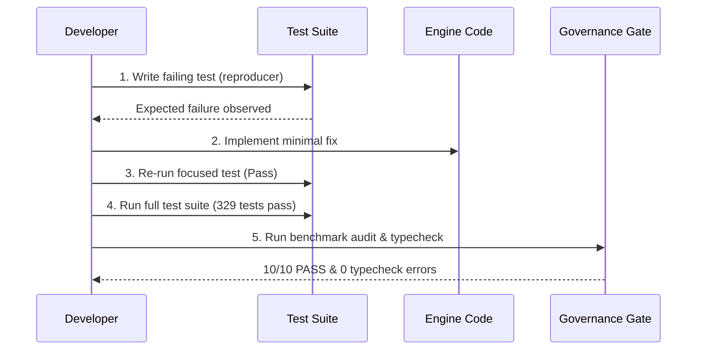

# Local Development Workflow

This document outlines the standard daily developer workflow for modifying, debugging, testing, and verifying the **LegacyExodus** static analysis engine.

---

## 1. Directory Context & Execution Root

Always execute development commands from the `legacy-exodus-core/` directory:

```bash
cd legacy-exodus-core
```

---

## 2. Interactive CLI Execution

You can run the LegacyExodus CLI directly using Bun without pre-compiling:

```bash
# Check engine status and loaded components
bun run src/cli/index.ts status

# Analyze a local target repository
bun run src/cli/index.ts analyze path/to/legacy-repo

# Output analysis results as JSON
bun run src/cli/index.ts analyze path/to/legacy-repo --json

# List registered plugins
bun run src/cli/index.ts plugins
```

---

## 3. Fast Feedback Loop with Watch Mode

To iterate on a specific subsystem or test suite in real time:

```bash
# Watch and re-run all tests on save
bun test --watch

# Watch a specific subsystem test file
bun test --watch tests/unit/symbols/destructuring-pattern-symbols.test.ts

# Watch the CLI entry point
bun --watch run src/cli/index.ts status
```

---

## 4. Controlled Failure-First Remediation Cycle

When implementing an analysis rule or fixing a bug, adhere to the 5-step controlled development workflow:



---

## 5. Working with Benchmark Targets

LegacyExodus maintains three tiers of real-world corpora in `benchmarks/corpus/`:
* **Tier 1 (`cookie-parser`):** 12 files — Fast sanity check.
* **Tier 2 (`fastify`):** 385 files — Scalability & complex plugin architecture.
* **Tier 3 (`express`):** 234 files — Deep prototype & CommonJS legacy patterns.

Run benchmark sweeps locally:
```bash
# Run self-governance audit
bun run benchmark audit

# Run Tier-1 benchmark
bun run benchmark run tier-1
```

---

## Related Documentation

* **[Environment Setup](environment-setup.md):** Initial toolchain setup.
* **[Coding Standards](coding-standards.md):** TypeScript guidelines and Zod schemas.
* **[Testing Strategy](testing-strategy.md):** Test hierarchy and coverage policies.
