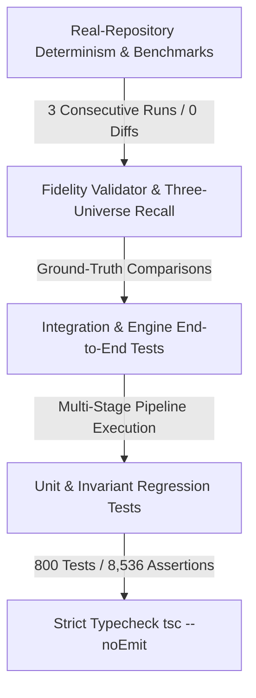

# Testing Strategy & Invariant Verification

LegacyExodus employs a multi-tiered testing strategy designed to guarantee **mathematical correctness, regression safety, multi-run determinism, and faithful ground-truth recall**.

---

## 1. Testing Pyramid

---

## 2. Test Tiers Overview

| Tier | Directory | Focus | Execution Command |
|---|---|---|---|
| **Static Typecheck** | `src/` | 100% strict TypeScript typing, zero `any` | `bun run typecheck` |
| **Unit Tests** | `tests/unit/` | Isolated tests for AST mapping, symbol extraction, scoping, CFG/DFG | `bun test tests/unit/` |
| **Domain Explorer** | `tests/` | Dynamic domain runner (`parser`, `symbols`, `semantic`, `flow`, etc.) | `legacy-exodus test <domain>` |
| **Integration Tests** | `tests/integration/` | End-to-end multi-stage pipeline and orchestration tests | `bun test tests/integration/` |
| **Fidelity Validation** | `src/governance/fidelity/` | Ground-truth recall and Three-Universe metric computation | `bun test tests/unit/governance/` |
| **Benchmark Determinism** | `benchmarks/` | 3-run bit-for-bit determinism sweeps across Tier 1, 2, and 3 repos | `bun run benchmark audit` |
| **Multi-Gate Dashboard** | Repository | 4-gate automated quality assurance | `bun run verify` |

---

## 3. The Failure-First Testing Invariant

Before changing any production static analysis logic:
1. **Write the Minimal Reproducer:** Create a standalone test file reproducing the weakness or missing pattern.
2. **Observe Baseline Failure:** Run `bun test <new-test-file>` and confirm it fails against baseline for the exact expected reason.
3. **Apply Minimal Fix:** Implement the minimal production change.
4. **Prove Resolution & Regression Safety:** Re-run the test (must pass) and then run the entire test suite (800/800 must pass).

---

## 4. Current Baseline Verification

As of Phase 3A / Core Hardening:
* **Passing Tests:** `800 / 800`
* **Test Files:** `92`
* **Assertions:** `8,536`
* **Typecheck Errors:** `0`
* **Benchmark Governance:** `10 / 10 PASS`
* **Verification Dashboard:** `4 / 4 PASS`

---

## Related Documentation

* **[Unit Testing Guide](testing/unit-testing.md):** Writing unit and symbol extraction tests.
* **[Integration Testing Guide](testing/integration-testing.md):** Writing multi-stage pipeline tests.
* **[BENCHMARK_REPORT.md](../../legacy-exodus-core/benchmarks/BENCHMARK_REPORT.md):** Benchmark methodology and determinism evidence.
