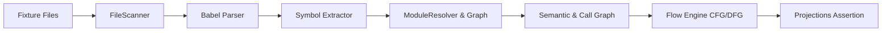

# Integration Testing Guide

This document covers end-to-end integration testing of the **LegacyExodus** multi-stage analysis pipeline and orchestrator.

---

## 1. Scope of Integration Tests

Integration tests execute multiple pipeline stages together against realistic fixtures or multi-file repositories located in `tests/fixtures/`:



---

## 2. Integration Test Locations

* **`tests/integration/engine/`:** Tests orchestrator command execution (`AnalyzeProject`, `DiscoverProject`).
* **`tests/integration/pipeline/`:** Tests multi-stage data flow from discovery through streaming JSON projection.
* **`tests/integration/fixtures/`:** Fixtures including Express routes, CommonJS exports, and circular dependencies.

---

## 3. Running Integration Tests

```bash
# Run all integration tests
bun test tests/integration/

# Run a specific integration test
bun test tests/integration/engine/engine-analysis.test.ts
```

---

## Related Documentation

* **[Testing Strategy](../testing-strategy.md):** Overall testing architecture.
* **[Unit Testing](unit-testing.md):** Unit test guidelines.
* **[Data Flow Architecture](../../architecture/data-flow.md):** Pipeline data flow details.
