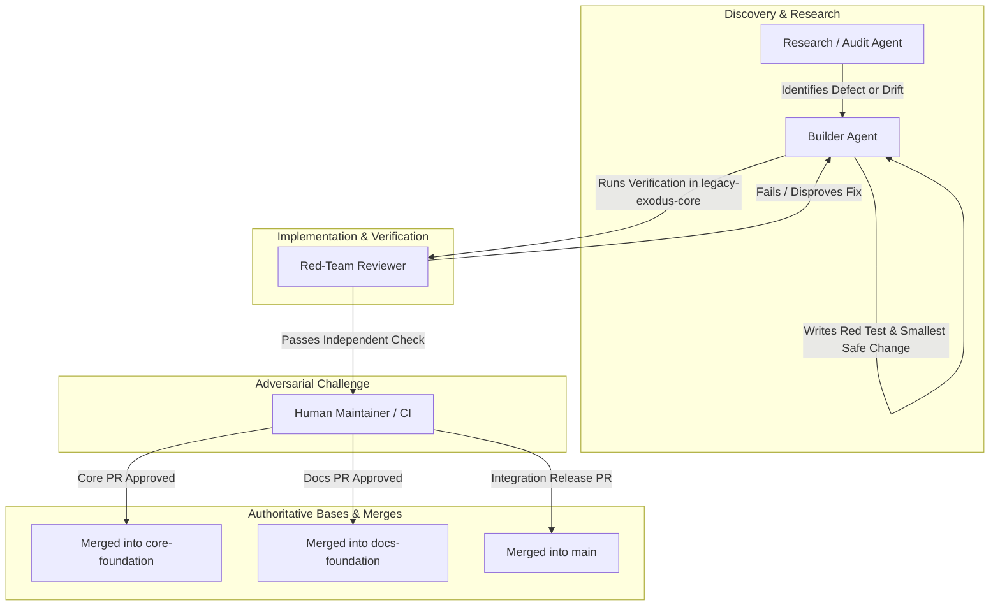

# LegacyExodus Multi-Agent Operating Model
## Role Architecture, Delegation Protocols, and Authority Boundaries

*Status: Authoritative & Active*
*Scope: Repository-Wide (`LegacyExodus`)*
*Jurisdiction: AI Coding Agents, Audit Reviewers, Automated Pipelines, and Human Maintainers*

---

## 1. Executive Summary & Separation of Powers

Autonomous AI agents operating on complex enterprise codebases are susceptible to cognitive biases: confirmation bias, scope creep, premature closure, and unwarranted confidence. To mitigate these risks, LegacyExodus adopts a strict **Separation of Powers** across distinct agent personas.

No single agent is permitted to discover, implement, and independently certify its own work. Authority is partitioned between implementation (Builder), investigation (Researcher), adversarial validation (Red Team), and constitutional governance (Human Maintainer).



---

## 2. Core Agent Personas & Authority Matrix

### 2.1 The Builder Agent
* **Primary Role:** The implementation engine responsible for surgical code changes, regression tests, and verification execution.
* **Representative Models/Tools:** Gemini, Claude, OpenAI Codex, GitHub Copilot.
* **Responsibilities:**
  1. Inspect the codebase, AST nodes, and test suites within the assigned finding boundary.
  2. Implement the failing-first regression test proving the defect.
  3. Implement the smallest safe code remediation.
  4. Execute the verification pipeline (typecheck, tests, benchmarks, diff check).
  5. Stage and commit changes under Conventional Commit standards.
  6. Push to the designated temporary task branch.
* **Authority Limits:**
  * **Write Authority:** Strictly scoped to the assigned finding. MUST NOT refactor adjacent code or edit files outside the defect boundary.
  * **Self-Certification Prohibition:** The Builder MUST NOT certify its own work as objectively complete or close a finding without independent challenge or automated test proof.

### 2.2 The Research & Audit Agent
* **Primary Role:** The deep investigative and analytical agent that explores repository state, maps architectures, and identifies systemic risks.
* **Operating Mode:** **READ-ONLY by default.**
* **Responsibilities:**
  1. Perform broad, cross-subsystem code audits without mutating files.
  2. Identify latent bugs, missing regression tests, and lifecycle concurrency risks.
  3. Compare live implementation code against architectural documentation to flag drift.
  4. Perform deep AST and control-flow tracing across complex call paths.
  5. Generate structured audit reports containing actionable reproduction steps.
* **Authority Limits:**
  * Zero commit or write authority unless explicitly reassigned to a Builder task.

### 2.3 The Red-Team Reviewer
* **Primary Role:** The adversarial challenger tasked with disproving remediations and identifying false confidence.
* **Representative Models/Tools:** Grok, specialized adversarial LLM instances, independent reviewer bots.
* **Responsibilities:**
  1. Actively challenge the assumptions of the Builder's fix.
  2. Formulate adversarial counter-examples (e.g., malformed ASTs, cyclic imports, edge values).
  3. Verify that tests pass for the *right* reasons, not due to weakened assertions or coincidental mocks.
  4. Audit memory retention, determinism, and potential regressions across untouched callers.
  5. Render a formal verdict: `RED-TEAM PASS` or `RED-TEAM FAIL`.
* **The External Reviewer Rule:**
  > **"An external reviewer (such as Grok or CodeRabbit) can challenge or disprove a finding, but cannot independently close a finding."**
  A finding is only closed when executable tests and verification gates prove remediation.

### 2.4 Human Maintainer (Final Authority)
* **Primary Role:** The ultimate authority on architecture, safety, licensing, and releases.
* **Exclusive Human Approval Triggers:**
  Human maintainer authorization is mandatory for:
  1. Architectural changes or subsystem boundary alterations.
  2. Security-sensitive modifications (subprocess handling, authentication, crypto).
  3. Destructive migrations or database schema version increments.
  4. Major toolchain or runtime upgrades (Bun runtime, compiler replacements).
  5. Branch strategy changes or permanent governance modifications.
  6. PR merges into `main`, `core-foundation`, or `docs-foundation`.
  7. Resolving contradictory evidence between Builder and Red Team.

---

## 3. Explicit Permissions & Authority Matrix

| Operational Capability | Builder Agent | Research Agent | Red-Team Reviewer | Human Maintainer |
| :--- | :---: | :---: | :---: | :---: |
| **Inspect Source & Tests (Read)** | YES | YES | YES | YES |
| **Modify Implementation Code** | YES (Scoped) | NO | NO | YES |
| **Modify Test Suites (Add Tests)** | YES | NO | NO | YES |
| **Delete or Weaken Existing Tests** | **NEVER** | **NEVER** | **NEVER** | **NEVER** |
| **Modify Documentation** | NO (in core PR) | NO | NO | YES |
| **Execute CLI / Verification Gates** | YES | YES | YES | YES |
| **Create Temporary Branches** | YES | NO | NO | YES |
| **Commit to Temporary Branches** | YES | NO | NO | YES |
| **Push to Temporary Branches** | YES | NO | NO | YES |
| **Commit/Push Directly to `main`** | **NEVER** | **NEVER** | **NEVER** | **NEVER** |
| **Force-Push Shared Branches** | **NEVER** | **NEVER** | **NEVER** | Maintainer Emergency Only* |
| **Issue Red-Team Challenge** | NO | YES | YES | YES |
| **Close Finding Independently** | **NEVER** | **NEVER** | **NEVER** | YES |
| **Final Merge Approval** | NO | NO | NO | YES |

*\*Autonomous agents and normal workflows MUST NEVER force-push shared branches. Human maintainers may force-push ONLY as a deliberate, documented, and communicated emergency recovery operation.*

---

## 4. Canonical Collaboration Workflows

### 4.1 Canonical Forensic Remediation Sequence

> **AUTHORITATIVE TRUTH NOTICE:**
> This section is the repository's **single source of truth** for the forensic code remediation sequence. All engineering agents, copilots, and autonomous assistants MUST execute this exact 17-step sequence in strict, deterministic order. No other document, skill, or instruction may define a competing or independent remediation sequence.

Every code remediation executed by an engineering agent MUST follow this 17-step pipeline within the canonical package root `legacy-exodus-core/` (as documented in [`GOVERNANCE.md`](../../GOVERNANCE.md) and [`CONTRIBUTING.md`](../../CONTRIBUTING.md)):

```text
┌─────────────────────────────────────────────────────────────────────────────┐
│                 CANONICAL FORENSIC REMEDIATION SEQUENCE                     │
│               Single Authoritative Truth (Steps 1 through 17)                │
└─────────────────────────────────────────────────────────────────────────────┘
  1. PRE-FLIGHT VALIDATION      ──► Clean tree, branch from origin/<base-branch>
  2. EVIDENCE COLLECTION        ──► Inspect live source, ASTs, contracts, logs
  3. FINDING CONFIRMATION       ──► Verify finding against current live code
  4. SMALLEST SAFE CHANGE DEF   ──► Isolate root cause; design minimal change
  5. FOCUSED RED TEST CREATION  ──► Author failure-first test in tests/
  6. RED TEST FAILURE PROOF     ──► Verify test demonstrably FAILS on live code
  7. APPLY SMALLEST SAFE CHANGE ──► Minimal code fix in legacy-exodus-core/src/
  8. FOCUSED TEST PASS PROOF    ──► Verify regression test now PASSES cleanly
  9. STATIC TYPECHECK           ──► bun run typecheck (0 compiler errors)
 10. FULL TEST SUITE            ──► bun test (100% pass across 113+ files)
 11. BENCHMARK GOVERNANCE AUDIT ──► bun run benchmark audit (10/10 pass)
 12. CLI SMOKE VERIFICATION     ──► bun run src/cli/index.ts --help (exit 0)
 13. DIFF & HYGIENE REVIEW      ──► git diff --stat & git diff --check clean
 14. COMPLETION REPORT          ──► 10-layer verification_report & memory state
 15. ATOMIC COMMIT              ──► Conventional Commit with co-authorship
 16. REMOTE PUSH & POST-CHECK   ──► Push origin <task-branch>; clean tree check
 17. MANDATORY HARD STOP        ──► Cease execution; output report; await human
```

#### Detailed Step Execution Contract

1. **Step 1: Pre-Flight Validation**
   * Confirm that the working tree is pristine: `git status` MUST report `nothing to commit, working tree clean`.
   * Confirm the current branch is a dedicated task branch branched from the fetched remote tracking base (`git fetch --all --prune && git checkout -b <type>/<task-name> origin/<base-branch>`).

2. **Step 2: Evidence Collection**
   * Inspect live source code, contracts, and relevant test files.
   * Gather primary evidence from live AST mappings, execution traces, or logs. Do not accept external review text without primary evidence.

3. **Step 3: Finding Confirmation**
   * Confirm the defect against current implementation code on `core-foundation:legacy-exodus-core/src/`.
   * Formulate a minimal reproduction scenario or CLI invocation proving the defect exists in executable reality.

4. **Step 4: Smallest Safe Change Definition**
   * Pinpoint the exact structural/algorithmic root cause (distinguishing causes from symptoms).
   * Define the smallest safe architectural change with minimal blast radius to fix the root cause.

5. **Step 5: Focused RED Regression Test Creation**
   * Author a dedicated regression test in the appropriate test suite under `legacy-exodus-core/tests/`.
   * Enforce strict assertions: loose assertions (`toBeTruthy()`, `toBeDefined()`) are strictly forbidden where exact contracts can be checked.

6. **Step 6: RED Test Failure Verification**
   * Execute the focused test before modifying implementation:
     ```bash
     bun test tests/path/to/regression.test.ts
     ```
   * Confirm and record that the test demonstrably FAILS for the expected root-cause reason.

7. **Step 7: Apply Smallest Safe Change**
   * Apply the minimal, surgical implementation change exclusively to `legacy-exodus-core/src/`.
   * Refactoring adjacent code, renaming unrelated identifiers, or modifying untouched contracts is strictly prohibited.
   * *Adversarial Loopback:* If a downstream Red-Team Review renders a `RED-TEAM FAIL`, the workflow returns directly to this step (**Step 7**). The existing minimal reproduction and RED test remain valid and are preserved; the Builder updates the implementation to resolve the counter-example, then re-runs Step 8 and all downstream verification gates.

8. **Step 8: Focused Test Verification**
   * Re-execute the focused regression test:
     ```bash
     bun test tests/path/to/regression.test.ts
     ```
   * Confirm that the regression test now PASSES cleanly with zero assertion failures.

9. **Step 9: Static Typecheck**
   * Run the TypeScript compiler check in package root `legacy-exodus-core/`:
     ```bash
     bun run typecheck
     ```
   * Confirm compilation exits with code 0 and zero compiler errors.

10. **Step 10: Full Test Suite Verification**
    * Run the complete test suite across the entire codebase:
      ```bash
      bun test
      ```
    * Confirm 100% test pass rate across all 113+ test files and ~9,388+ assertions.

11. **Step 11: Benchmark Governance Audit**
    * Run the benchmark governance audit in `legacy-exodus-core/`:
      ```bash
      bun run benchmark audit
      ```
    * Confirm `Verdict: PASS` with 10/10 audit checks satisfied.

12. **Step 12: CLI Smoke Verification**
    * Run the CLI smoke check:
      ```bash
      bun run src/cli/index.ts --help
      ```
    * Confirm clean help output emission and exit code 0.

13. **Step 13: Diff & Scope Hygiene Review**
    * Run diff checks:
      ```bash
      git diff --stat
      git diff --check
      ```
    * Ensure zero trailing whitespace, zero merge conflict artifacts, and that only intended files are modified.

14. **Step 14: Verification & Completion Report**
    * Compile the standard completion report explicitly incorporating the 10-layer `verification_report` contract defined in `.agents/skills/legacyexodus-test-verification/SKILL.md`.
    * Record total test files, passed/failed tests, total `expect()` assertion calls, all 10 verification layers with explicit results and evidence, static typecheck status, benchmark audit status, CLI smoke status, diff hygiene, memory classification status, and pre/post worktree checks.

15. **Step 15: Atomic Conventional Commit**
    * Stage exclusively the modified implementation and test files (`git add <file>`).
    * Create an atomic commit following Conventional Commits format with appropriate co-authorship trailers.

16. **Step 16: Remote Push & Post-Check**
    * Push the task branch to origin:
      ```bash
      git push origin <task-branch>
      ```
    * Confirm postcondition clean worktree: `git status` MUST report `nothing to commit, working tree clean`.

17. **Step 17: Mandatory Hard Stop**
    * Stop execution immediately.
    * Output the final completion report.
    * Await human maintainer or reviewer instruction; do NOT silently proceed to another finding.

### 4.2 Adversarial Red-Team Protocol
When a remediation is submitted for red-team review:

1. **Premise Invalidation:** The Red Team attempts to construct an AST or runtime state where the fix fails.
2. **Assertion Audit:** The Red Team reviews the regression test to ensure it does not use loose assertions (`toBeTruthy()`, `toBeDefined()`) where exact values are required.
3. **Determinism Verification:** The Red Team executes the test suite multiple times to verify zero flaky behavior.
4. **Verdict Generation:**
   * If any defect is found: Output `RED-TEAM FAIL` with minimal reproduction code and counter-example details. The cycle returns directly to **Step 7: Apply Smallest Safe Change** in the Canonical Forensic Remediation Sequence. The existing minimal reproduction and RED test remain valid and are preserved; the Builder updates the implementation to resolve the counter-example, then re-runs Step 8 (Focused Test Verification) and all downstream verification gates (Steps 9–17).
   * If no defects are found: Output `RED-TEAM PASS` with documented rationale.

### 4.3 Documentation Audit & Synchronization Workflow
When performing documentation maintenance:

```text
CURRENT SOURCE (core-foundation)
       │
       ▼
EVIDENCE CHECK (inspect live symbols, CLI help, exports)
       │
       ▼
DOC MODIFICATION (update docs/ or root markdown)
       │
       ▼
LINK & REFERENCE AUDIT (verify markdown anchors & cross-references)
       │
       ▼
HYGIENE CHECK (git diff --check)
       │
       ▼
COMMIT & PUSH (to docs-foundation or task branch)
       │
       ▼
HARD STOP
```

---

## 5. Standard Handoff Artifacts & Communication Contracts

To ensure seamless coordination between agents across context boundaries, all handoffs MUST use standardized JSON/Markdown schemas:

### 5.1 Finding Handoff Schema (Researcher $\to$ Builder)
```markdown
### FINDING: [Finding-ID] — <Concise Title>
* **Severity:** P0 | P1 | P2 | P3
* **Confidence:** CONFIRMED | LIKELY | POSSIBLE
* **Subsystem:** Discovery | Parser | Symbols | Graph | Semantic | Flow | Storage | Runtime | CLI
* **Target File:** `legacy-exodus-core/src/...:L123-L145`

#### 1. Observed Behavior vs. Expected Invariant
[Exact description of the failure mode]

#### 2. Root Cause Analysis
[Technical explanation of why the defect occurs]

#### 3. Minimal Reproduction Scenario
[Code snippet or CLI command that triggers the defect]

#### 4. Remediation Guidance & Invariants
[Guidance on the smallest safe architectural change]
```

### 5.2 Remediation Completion Report (Builder $\to$ Red Team / Human)
Every completed remediation task MUST terminate with the standard verification and remediation report incorporating the 10-layer `verification_report` contract defined in `.agents/skills/legacyexodus-test-verification/SKILL.md`:

```markdown
1. TASK: <Task Description>
2. BRANCH: <Temporary Branch Name>
3. BASE COMMIT: <Base SHA>
4. WORKTREE PRECONDITION: PASS (clean tree confirmed before work: git status)
5. FINDING: <Finding ID and Description>
6. ROOT CAUSE: <Exact Technical Root Cause>
7. FILES CHANGED: <List of changed files with diff stat>
8. RED TEST: <Path and assertion details of failure-first test>
9. FOCUSED VERIFICATION: <Duration and result of focused test run: bun test <test>>
10. TYPECHECK: PASS | FAIL (exit code 0, 0 compiler errors, duration: bun run typecheck)
11. FULL TEST SUITE: PASS | FAIL (files, tests passed/failed, assertion count, runtime: bun test)
12. BENCHMARK AUDIT: PASS | FAIL (10/10 checks verified: bun run benchmark audit)
13. CLI SMOKE: PASS | FAIL (exit code 0, clean help output: bun run src/cli/index.ts --help)
14. DETERMINISM: <Determinism audit results across repeated runs>
15. SECURITY & BOUNDARIES: <Subprocess, traversal, and memory audit confirmation>
16. MEMORY STATUS: VERIFIED | INCONCLUSIVE | REGRESSION | IMPROVEMENT | NO MATERIAL CHANGE
17. TEN-LAYER VERIFICATION REPORT: <Explicit YAML verification_report artifact per .agents/skills/legacyexodus-test-verification/SKILL.md covering all 10 layers>
18. DIFF & SCOPE HYGIENE: <git diff --check and git diff --stat results>
19. ATOMIC COMMIT: <Commit SHA and Conventional Commit message>
20. REMOTE PUSH: <Push confirmation to origin <task-branch>>
21. WORKTREE POSTCONDITION: PASS (clean tree confirmed after push: git status)
22. FINAL STATUS: FULLY REMEDIATED | SAFE WITH REQUIRED FOLLOW-UP | BLOCKED
```

---

## 6. Stop Triggers & Circuit Breakers

To prevent infinite loops, runaway tool usage, and context exhaustion, agents MUST observe strict stop triggers:

| Category | Trigger Condition | Mandatory Agent Action |
| :--- | :--- | :--- |
| **Task Completion** | Finding remediated, verified, committed, pushed, tree clean. | **HARD STOP.** Output final report. Do not start next task. |
| **Regression Breach** | Unrelated tests fail or compilation breaks in untouched files. | **HALT.** Revert changes; diagnose root cause; do not hack tests. |
| **Scope Expansion** | Remediation requires altering >3 files or cross-subsystem contracts. | **HALT.** Escalate to Human Maintainer for architectural review. |
| **Tooling Failure** | Bun, Git, or CI environment returns unrecoverable system errors. | **HALT.** Record diagnostic log; mark task `BLOCKED`. |
| **Contradictory Policy** | A requested change conflicts with the Permanent Charter. | **HALT.** Cite the Charter section; request maintainer clarification. |
| **Secret Detection** | Token, private key, or password encountered in input or logs. | **HALT.** Redact secret immediately; notify maintainers. |

---

## 7. Operational Axiom on Engineering Integrity

> **"Speed is worthless if the migration engine produces corrupt code or hallucinates architecture. We measure progress not by lines written or findings closed, but by the undeniable, reproducible proof that our systems remain true."**
