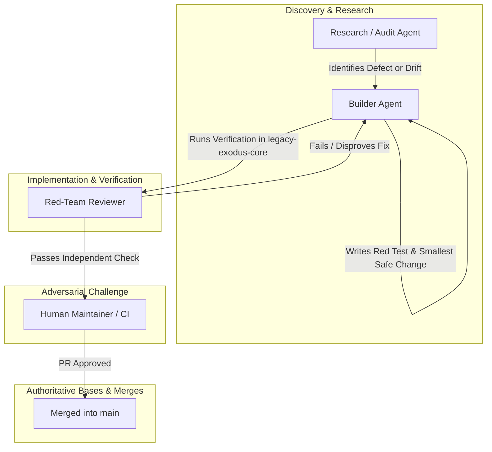

# LegacyExodus Multi-Agent Operating Model
## Role Architecture, Delegation Protocols, and Authority Boundaries

*Status: Authoritative & Active*
*Scope: Repository-Wide (`LegacyExodus`)*
*Jurisdiction: AI Coding Agents, Audit Reviewers, Automated Pipelines, and Human Maintainers*

---

## 1. Executive Summary & Separation of Powers

Autonomous AI agents operating on complex enterprise codebases are susceptible to cognitive biases: confirmation bias, scope creep, premature closure, and unwarranted confidence. To mitigate these risks, LegacyExodus adopts a strict **Separation of Powers** across distinct agent personas.

No single agent is permitted to discover, implement, and independently certify its own work. Authority is partitioned between implementation (Builder), investigation (Researcher), adversarial validation (Red Team), and constitutional governance (Human Maintainer).



---

## 2. Core Agent Personas & Authority Matrix

### 2.1 The Builder Agent
* **Primary Role:** The implementation engine responsible for surgical code changes, regression tests, and verification execution.
* **Representative Models/Tools:** Gemini, Claude, OpenAI Codex, GitHub Copilot.
* **Responsibilities:**
  1. Inspect the codebase, AST nodes, and test suites within the assigned finding boundary.
  2. Implement the failing-first regression test proving the defect.
  3. Implement the smallest safe code remediation.
  4. Execute the verification pipeline (typecheck, tests, benchmarks, diff check).
  5. Stage and commit changes under Conventional Commit standards.
  6. Push to the designated temporary task branch.
* **Authority Limits:**
  * **Write Authority:** Strictly scoped to the assigned finding. MUST NOT refactor adjacent code or edit files outside the defect boundary.
  * **Self-Certification Prohibition:** The Builder MUST NOT certify its own work as objectively complete or close a finding without independent challenge or automated test proof.

### 2.2 The Research & Audit Agent
* **Primary Role:** The deep investigative and analytical agent that explores repository state, maps architectures, and identifies systemic risks.
* **Operating Mode:** **READ-ONLY by default.**
* **Responsibilities:**
  1. Perform broad, cross-subsystem code audits without mutating files.
  2. Identify latent bugs, missing regression tests, and lifecycle concurrency risks.
  3. Compare live implementation code against architectural documentation to flag drift.
  4. Perform deep AST and control-flow tracing across complex call paths.
  5. Generate structured audit reports containing actionable reproduction steps.
* **Authority Limits:**
  * Zero commit or write authority unless explicitly reassigned to a Builder task.

### 2.3 The Red-Team Reviewer
* **Primary Role:** The adversarial challenger tasked with disproving remediations and identifying false confidence.
* **Representative Models/Tools:** Grok, specialized adversarial LLM instances, independent reviewer bots.
* **Responsibilities:**
  1. Actively challenge the assumptions of the Builder's fix.
  2. Formulate adversarial counter-examples (e.g., malformed ASTs, cyclic imports, edge values).
  3. Verify that tests pass for the *right* reasons, not due to weakened assertions or coincidental mocks.
  4. Audit memory retention, determinism, and potential regressions across untouched callers.
  5. Render a formal verdict: `RED-TEAM PASS` or `RED-TEAM FAIL`.
* **The External Reviewer Rule:**
  > **"An external reviewer (such as Grok or CodeRabbit) can challenge or disprove a finding, but cannot independently close a finding."**
  A finding is only closed when executable tests and verification gates prove remediation.

### 2.4 Human Maintainer (Final Authority)
* **Primary Role:** The ultimate authority on architecture, safety, licensing, and releases.
* **Exclusive Human Approval Triggers:**
  Human maintainer authorization is mandatory for:
  1. Architectural changes or subsystem boundary alterations.
  2. Security-sensitive modifications (subprocess handling, authentication, crypto).
  3. Destructive migrations or database schema version increments.
  4. Major toolchain or runtime upgrades (Bun runtime, compiler replacements).
  5. Branch strategy changes or permanent governance modifications.
  6. PR merges into `main`.
  7. Resolving contradictory evidence between Builder and Red Team.

---

## 3. Explicit Permissions & Authority Matrix

| Operational Capability | Builder Agent | Research Agent | Red-Team Reviewer | Human Maintainer |
| :--- | :---: | :---: | :---: | :---: |
| **Inspect Source & Tests (Read)** | YES | YES | YES | YES |
| **Modify Implementation Code** | YES (Scoped) | NO | NO | YES |
| **Modify Test Suites (Add Tests)** | YES | NO | NO | YES |
| **Delete or Weaken Existing Tests** | **NEVER** | **NEVER** | **NEVER** | **NEVER** |
| **Modify Documentation** | NO (in core PR) | NO | NO | YES |
| **Execute CLI / Verification Gates** | YES | YES | YES | YES |
| **Create Temporary Branches** | YES | NO | NO | YES |
| **Commit to Temporary Branches** | YES | NO | NO | YES |
| **Push to Temporary Branches** | YES | NO | NO | YES |
| **Commit/Push Directly to `main`** | **NEVER** | **NEVER** | **NEVER** | **NEVER** |
| **Force-Push Shared Branches** | **NEVER** | **NEVER** | **NEVER** | Maintainer Emergency Only* |
| **Issue Red-Team Challenge** | NO | YES | YES | YES |
| **Close Finding Independently** | **NEVER** | **NEVER** | **NEVER** | YES |
| **Final Merge Approval** | NO | NO | NO | YES |

*\*Autonomous agents and normal workflows MUST NEVER force-push shared branches. Human maintainers may force-push ONLY as a deliberate, documented, and communicated emergency recovery operation.*

---

## 4. Canonical Collaboration Workflows

### 4.1 Canonical Forensic Remediation Sequence

> **AUTHORITATIVE TRUTH NOTICE:**
> This section is the repository's **single source of truth** for the forensic code remediation sequence. All engineering agents, copilots, and autonomous assistants MUST execute this exact 20-step sequence in strict, deterministic order. No other document, skill, or instruction may define a competing or independent remediation sequence.

Every code remediation executed by an engineering agent MUST follow this 20-step pipeline within the canonical package root `legacy-exodus-core/` (as documented in [`GOVERNANCE.md`](../../GOVERNANCE.md) and [`CONTRIBUTING.md`](../../CONTRIBUTING.md)):

```text
┌─────────────────────────────────────────────────────────────────────────────┐
│                 CANONICAL FORENSIC REMEDIATION SEQUENCE                     │
│               Single Authoritative Truth (Steps 1 through 20)               │
└─────────────────────────────────────────────────────────────────────────────┘
  1. PRE-FLIGHT VALIDATION      ──► Clean tree, branch from origin/<base-branch>
  2. EVIDENCE COLLECTION        ──► Inspect live source, ASTs, contracts, logs
  3. FINDING CONFIRMATION       ──► Verify finding against current live code
  4. SMALLEST SAFE CHANGE DEF   ──► Isolate root cause; design minimal change
  5. FOCUSED RED TEST CREATION  ──► Author failure-first test in tests/
  6. RED TEST FAILURE PROOF     ──► Verify test demonstrably FAILS on live code
  7. APPLY SMALLEST SAFE CHANGE ──► Minimal code fix in legacy-exodus-core/src/
  8. FOCUSED TEST PASS PROOF    ──► Verify regression test now PASSES cleanly
  9. STATIC TYPECHECK           ──► bun run typecheck (0 compiler errors)
 10. FULL TEST SUITE            ──► bun test (100% pass across full test suite)
 11. BENCHMARK GOVERNANCE AUDIT ──► bun run benchmark audit (all checks pass)
 12. CLI SMOKE VERIFICATION     ──► bun run src/cli/index.ts --help (exit 0)
 13. ADVERSARIAL RED-TEAM GATE  ──► Read-only challenge; RED-TEAM PASS required
 14. DIFF & HYGIENE REVIEW      ──► git diff --stat & git diff --check clean
 15. DRAFT VERIFICATION REPORT  ──► Compile pre-commit report (commit/push PENDING)
 16. ATOMIC COMMIT              ──► Conventional Commit with co-authorship
 17. REMOTE PUSH                ──► Push to origin <task-branch>
 18. POST-PUSH WORKTREE CHECK   ──► git status confirms clean tree post-push
 19. FINAL COMPLETION REPORT    ──► Finalize report with commit SHA & push evidence
 20. MANDATORY HARD STOP        ──► Cease execution; output report; await human
```

#### Detailed Step Execution Contract

1. **Step 1: Pre-Flight Validation**
   * Confirm that the working tree is pristine: `git status` MUST report `nothing to commit, working tree clean`.
   * Confirm the current branch is a dedicated task branch branched from the fetched remote tracking base (`git fetch --all --prune && git checkout -b <type>/<task-name> origin/<base-branch>`).

2. **Step 2: Evidence Collection**
   * Inspect live source code, contracts, and relevant test files.
   * Gather primary evidence from live AST mappings, execution traces, or logs. Do not accept external review text without primary evidence.

3. **Step 3: Finding Confirmation**
   * Confirm the defect against current implementation code on `main:legacy-exodus-core/src/`.
   * Formulate a minimal reproduction scenario or CLI invocation proving the defect exists in executable reality.

4. **Step 4: Smallest Safe Change Definition**
   * Pinpoint the exact structural/algorithmic root cause (distinguishing causes from symptoms).
   * Define the smallest safe architectural change with minimal blast radius to fix the root cause.

5. **Step 5: Focused RED Regression Test Creation**
   * Author a dedicated regression test in the appropriate test suite under `legacy-exodus-core/tests/`.
   * Enforce strict assertions: loose assertions (`toBeTruthy()`, `toBeDefined()`) are strictly forbidden where exact contracts can be checked.
   * *Test-Quality Loopback (Path B):* If a downstream Red-Team Review renders a `RED-TEAM FAIL` due to a test-quality defect (e.g. failing Assertion Audit due to loose assertions, misleading assertions, wrong expectations, or invalid failure proof), the workflow returns to this step (**Step 5**) to author a valid, strict replacement test. The invalid RED test is discarded and replaced, not preserved.

6. **Step 6: RED Test Failure Verification**
   * Execute the focused test before modifying implementation:
     ```bash
     bun test tests/path/to/regression.test.ts
     ```
   * Confirm and record that the test demonstrably FAILS for the expected root-cause reason.
   * For Path B loopbacks, verify that the corrected/replaced regression test produces valid failure proof before proceeding to Step 7.

7. **Step 7: Apply Smallest Safe Change**
   * Apply the minimal, surgical implementation change exclusively to `legacy-exodus-core/src/`.
   * Refactoring adjacent code, renaming unrelated identifiers, or modifying untouched contracts is strictly prohibited.
   * Step 7 is dedicated exclusively to resolving implementation defects.
   * *Implementation Defect Loopback (Path A):* If a downstream Red-Team Review renders a `RED-TEAM FAIL` due to a genuine implementation defect (e.g. unhandled counter-example or edge case), the workflow returns directly to this step (**Step 7**). The existing valid minimal reproduction and RED test remain preserved; the Builder updates the implementation to resolve the counter-example, then re-runs Step 8 and all downstream verification gates (Steps 9–13).

8. **Step 8: Focused Test Verification**
   * Re-execute the focused regression test:
     ```bash
     bun test tests/path/to/regression.test.ts
     ```
   * Confirm that the regression test now PASSES cleanly with zero assertion failures.

9. **Step 9: Static Typecheck**
   * Run the TypeScript compiler check in package root `legacy-exodus-core/`:
     ```bash
     bun run typecheck
     ```
   * Confirm compilation exits with code 0 and zero compiler errors.

10. **Step 10: Full Test Suite Verification**
    * Run the complete test suite across the entire codebase:
      ```bash
      bun test
      ```
    * Confirm 100% test pass rate across the full test suite with zero unexpected failures.

11. **Step 11: Benchmark Governance Audit**
    * Run the benchmark governance audit in `legacy-exodus-core/`:
      ```bash
      bun run benchmark audit
      ```
    * Confirm `Verdict: PASS` with all benchmark audit checks satisfied.

12. **Step 12: CLI Smoke Verification**
    * Run the CLI smoke check:
      ```bash
      bun run src/cli/index.ts --help
      ```
    * Confirm clean help output emission and exit code 0.

13. **Step 13: Adversarial Red-Team Review Gate**
    * Mandatory checkpoint prior to diff review and commit.
    * The Red-Team reviewer executes the adversarial review protocol defined in [`.agents/skills/legacyexodus-red-team-review/SKILL.md`](../../.agents/skills/legacyexodus-red-team-review/SKILL.md), operating strictly under read-only/challenge-only authority against an isolated verification environment.
    * Red-Team evaluates the change against the 11 probing questions and issues a formal verdict:
      * **`RED-TEAM PASS`**: All 11 questions answered satisfactorily; proceed to Step 14.
      * **`RED-TEAM FAIL`**: Defect detected. The review MUST classify the failure into one of two explicit paths without altering canonical sequence numbering:
        * **Path A — Implementation Defect:** The defect is structural or algorithmic in runtime code. Cycle returns directly to **Step 7: Apply Smallest Safe Change**. The existing valid minimal reproduction and RED test remain preserved; the Builder updates the implementation to resolve the counter-example, then re-runs Step 8 and all downstream verification gates (Steps 9–13).
        * **Path B — Test-Quality Defect:** The regression test or failure proof is invalid, misleading, weak (e.g. failing Assertion Audit due to loose assertions), or flawed. Cycle returns to **Step 5: Focused RED Regression Test Creation** and **Step 6: RED Test Failure Verification**. The invalid RED test is discarded and replaced, a valid failure proof is established, and the workflow advances to Step 7 only after valid RED evidence exists. All downstream verification gates (Steps 8–13) are preserved and must re-run.
    * The Red-Team agent itself NEVER modifies source code or tests.

14. **Step 14: Diff & Scope Hygiene Review**
    * Run diff checks:
      ```bash
      git diff --stat
      git diff --check
      ```
    * Ensure zero trailing whitespace, zero merge conflict artifacts, and that only intended files are modified.

15. **Step 15: Draft Verification Report Compilation**
    * Compile the draft verification report capturing all gate results, 10-layer verification evidence, test metrics, and memory status.
    * *Draft Temporal Guard:* Future events that have not yet occurred MUST be explicitly marked `PENDING` (e.g., `COMMIT SHA: PENDING`, `REMOTE PUSH: PENDING`, `WORKTREE POSTCONDITION: PENDING`). Agents MUST NOT falsely populate commit SHAs, push confirmations, or post-push statuses prior to actual execution.

16. **Step 16: Atomic Conventional Commit**
    * Stage exclusively the modified implementation and test files (`git add <file>`).
    * Create an atomic commit following Conventional Commits format with appropriate co-authorship trailers.
    * Record the actual generated commit SHA and commit subject.

17. **Step 17: Remote Push**
    * Push the task branch to origin:
      ```bash
      git push origin <task-branch>
      ```
    * Verify remote acceptance of the pushed commit.

18. **Step 18: Post-Push Worktree Status Check**
    * Execute `git status` immediately following remote push.
    * Confirm and record that `git status` reports `nothing to commit, working tree clean`.

19. **Step 19: Final Completion Report Generation**
    * Finalize the remediation completion report by populating the recorded commit SHA, commit subject, push confirmation to `origin <task-branch>`, and clean postcondition verification.
    * Verify that all `PENDING` placeholders are fully resolved with concrete execution evidence.

20. **Step 20: Mandatory Hard Stop**
    * Stop execution immediately.
    * Output the final completion report.
    * Await human maintainer or reviewer instruction; do NOT silently proceed to another finding.

### 4.2 Adversarial Red-Team Protocol
When a remediation is submitted for red-team review in Step 13:

1. **Premise Invalidation:** The Red Team attempts to construct an AST or runtime state where the fix fails.
2. **Assertion Audit:** The Red Team reviews the regression test to ensure it does not use loose assertions (`toBeTruthy()`, `toBeDefined()`) where exact values are required. If the Assertion Audit reveals loose assertions, missing negative checks, false positive proof, or misleading assertions, this is classified as a Test-Quality Defect (Path B) routing back to Steps 5–6; it MUST NOT route directly to Step 7 and invalid RED evidence MUST NOT be preserved.
3. **Determinism Verification:** The Red Team executes the test suite multiple times to verify zero flaky behavior.
4. **Verdict Generation:**
   * If any defect is found: Output `RED-TEAM FAIL` with minimal reproduction code, counter-example details, and failure classification:
     * **Path A (Implementation Defect):** Counter-example or edge case in runtime code. The cycle returns directly to **Step 7: Apply Smallest Safe Change** in the Canonical Forensic Remediation Sequence. The existing valid minimal reproduction and RED test remain valid and are preserved; the Builder updates the implementation to resolve the counter-example, then re-runs Step 8 (Focused Test Verification) and all downstream verification gates (Steps 9–13).
     * **Path B (Test-Quality Defect):** Weak assertions, invalid failure proof, or flawed regression test. The cycle returns to **Step 5: Focused RED Regression Test Creation** and **Step 6: RED Test Failure Verification**. The invalid RED test is discarded and replaced, valid failure proof is established, and the workflow proceeds to Step 7 and all downstream verification gates (Steps 8–13).
   * If no defects are found: Output `RED-TEAM PASS` with documented rationale. Progression to Step 14 (Diff & Scope Hygiene Review) is authorized.

### 4.3 Documentation Audit & Synchronization Workflow
When performing documentation maintenance:

```text
CURRENT SOURCE (main)
       │
       ▼
EVIDENCE CHECK (inspect live symbols, CLI help, exports)
       │
       ▼
DOC MODIFICATION (update docs/ or root markdown)
       │
       ▼
LINK & REFERENCE AUDIT (verify markdown anchors & cross-references)
       │
       ▼
HYGIENE CHECK (git diff --check)
       │
       ▼
COMMIT & PUSH (to a task branch, PR into main)
       │
       ▼
HARD STOP
```

---

## 5. Standard Handoff Artifacts & Communication Contracts

To ensure seamless coordination between agents across context boundaries, all handoffs MUST use standardized JSON/Markdown schemas:

### 5.1 Finding Handoff Schema (Researcher $\to$ Builder)
```markdown
### FINDING: [Finding-ID] — <Concise Title>
* **Severity:** P0 | P1 | P2 | P3
* **Confidence:** CONFIRMED | LIKELY | POSSIBLE
* **Subsystem:** Discovery | Parser | Symbols | Graph | Semantic | Flow | Storage | Runtime | CLI
* **Target File:** `legacy-exodus-core/src/...:L123-L145`

#### 1. Observed Behavior vs. Expected Invariant
[Exact description of the failure mode]

#### 2. Root Cause Analysis
[Technical explanation of why the defect occurs]

#### 3. Minimal Reproduction Scenario
[Code snippet or CLI command that triggers the defect]

#### 4. Remediation Guidance & Invariants
[Guidance on the smallest safe architectural change]
```

### 5.2 Remediation Reporting Contracts

To eliminate temporal contradictions, remediation reports are partitioned into two distinct stages:

#### 5.2.1 Draft Verification Report (Step 15 — Pre-Commit)
Prepared before commit and push. All future events MUST be marked `PENDING`:

```markdown
1. TASK: <Task Description>
2. BRANCH: <Temporary Branch Name>
3. BASE COMMIT: <Base SHA>
4. WORKTREE PRECONDITION: PASS (clean tree confirmed before work: git status)
5. FINDING: <Finding ID and Description>
6. ROOT CAUSE: <Exact Technical Root Cause>
7. FILES CHANGED: <List of changed files with diff stat>
8. RED TEST: <Path and assertion details of failure-first test>
9. FOCUSED VERIFICATION: <Duration and result of focused test run: bun test <test>>
10. TYPECHECK: PASS | FAIL (exit code 0, 0 compiler errors, duration: bun run typecheck)
11. FULL TEST SUITE: PASS | FAIL (files, tests passed/failed, assertion count, runtime: bun test)
12. BENCHMARK AUDIT: PASS | FAIL (all checks verified: bun run benchmark audit)
13. CLI SMOKE: PASS | FAIL (exit code 0, clean help output: bun run src/cli/index.ts --help)
14. RED-TEAM ADVERSARIAL GATE: RED-TEAM PASS (all required probes verified per .agents/skills/legacyexodus-red-team-review/SKILL.md)
15. DETERMINISM: <Determinism audit results across repeated runs>
16. SECURITY & BOUNDARIES: <Subprocess, traversal, and memory audit confirmation>
17. MEMORY STATUS: VERIFIED | INCONCLUSIVE | REGRESSION | IMPROVEMENT | NO MATERIAL CHANGE
18. TEN-LAYER VERIFICATION REPORT: <Explicit YAML verification_report artifact per .agents/skills/legacyexodus-test-verification/SKILL.md covering all 10 layers>
19. DIFF & SCOPE HYGIENE: <git diff --check and git diff --stat results>
20. ATOMIC COMMIT: PENDING (executed in Step 16)
21. REMOTE PUSH: PENDING (executed in Step 17)
22. WORKTREE POSTCONDITION: PENDING (verified in Step 18)
23. FINAL STATUS: PENDING_COMMIT_AND_PUSH
```

#### 5.2.2 Final Remediation Completion Report (Step 19 — Post-Push Verified)
Generated ONLY after commit succeeds, remote push succeeds, and post-push clean worktree check passes. Zero `PENDING` placeholders permitted:

```markdown
1. TASK: <Task Description>
2. BRANCH: <Temporary Branch Name>
3. BASE COMMIT: <Base SHA>
4. WORKTREE PRECONDITION: PASS (clean tree confirmed before work: git status)
5. FINDING: <Finding ID and Description>
6. ROOT CAUSE: <Exact Technical Root Cause>
7. FILES CHANGED: <List of changed files with diff stat>
8. RED TEST: <Path and assertion details of failure-first test>
9. FOCUSED VERIFICATION: <Duration and result of focused test run: bun test <test>>
10. TYPECHECK: PASS | FAIL (exit code 0, 0 compiler errors, duration: bun run typecheck)
11. FULL TEST SUITE: PASS | FAIL (files, tests passed/failed, assertion count, runtime: bun test)
12. BENCHMARK AUDIT: PASS | FAIL (all checks verified: bun run benchmark audit)
13. CLI SMOKE: PASS | FAIL (exit code 0, clean help output: bun run src/cli/index.ts --help)
14. RED-TEAM ADVERSARIAL GATE: RED-TEAM PASS (all required probes verified per .agents/skills/legacyexodus-red-team-review/SKILL.md)
15. DETERMINISM: <Determinism audit results across repeated runs>
16. SECURITY & BOUNDARIES: <Subprocess, traversal, and memory audit confirmation>
17. MEMORY STATUS: VERIFIED | INCONCLUSIVE | REGRESSION | IMPROVEMENT | NO MATERIAL CHANGE
18. TEN-LAYER VERIFICATION REPORT: <Explicit YAML verification_report artifact per .agents/skills/legacyexodus-test-verification/SKILL.md covering all 10 layers>
19. DIFF & SCOPE HYGIENE: <git diff --check and git diff --stat results>
20. ATOMIC COMMIT: <Actual Commit SHA and Conventional Commit message>
21. REMOTE PUSH: <Push confirmation to origin <task-branch>>
22. WORKTREE POSTCONDITION: PASS (clean tree confirmed after push: git status)
23. FINAL STATUS: FULLY REMEDIATED | SAFE WITH REQUIRED FOLLOW-UP | BLOCKED
```

---

## 6. Stop Triggers & Circuit Breakers

To prevent infinite loops, runaway tool usage, and context exhaustion, agents MUST observe strict stop triggers:

| Category | Trigger Condition | Mandatory Agent Action |
| :--- | :--- | :--- |
| **Task Completion** | Finding remediated, verified, committed, pushed, tree clean. | **HARD STOP.** Output final report. Do not start next task. |
| **Regression Breach** | Unrelated tests fail or compilation breaks in untouched files. | **HALT.** Revert changes; diagnose root cause; do not hack tests. |
| **Scope Expansion** | Remediation requires altering >3 files or cross-subsystem contracts. | **HALT.** Escalate to Human Maintainer for architectural review. |
| **Tooling Failure** | Bun, Git, or CI environment returns unrecoverable system errors. | **HALT.** Record diagnostic log; mark task `BLOCKED`. |
| **Contradictory Policy** | A requested change conflicts with the Permanent Charter. | **HALT.** Cite the Charter section; request maintainer clarification. |
| **Secret Detection** | Token, private key, or password encountered in input or logs. | **HALT.** Redact secret immediately; notify maintainers. |

---

## 7. Operational Axiom on Engineering Integrity

> **"Speed is worthless if the migration engine produces corrupt code or hallucinates architecture. We measure progress not by lines written or findings closed, but by the undeniable, reproducible proof that our systems remain true."**
