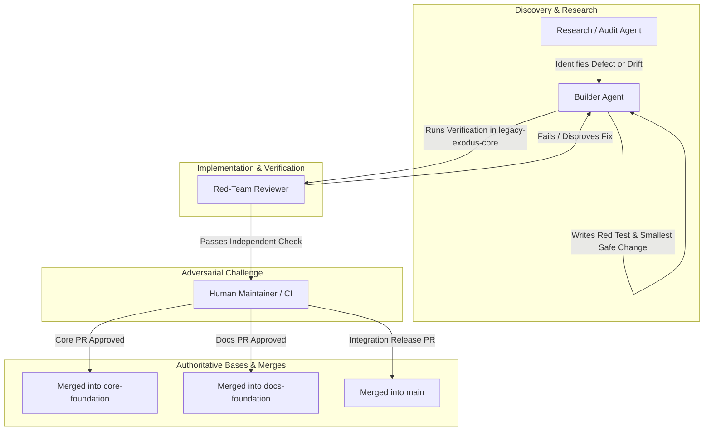

# LegacyExodus Multi-Agent Operating Model
## Role Architecture, Delegation Protocols, and Authority Boundaries

*Status: Authoritative & Active*
*Scope: Repository-Wide (`LegacyExodus`)*
*Jurisdiction: AI Coding Agents, Audit Reviewers, Automated Pipelines, and Human Maintainers*

---

## 1. Executive Summary & Separation of Powers

Autonomous AI agents operating on complex enterprise codebases are susceptible to cognitive biases: confirmation bias, scope creep, premature closure, and unwarranted confidence. To mitigate these risks, LegacyExodus adopts a strict **Separation of Powers** across distinct agent personas.

No single agent is permitted to discover, implement, and independently certify its own work. Authority is partitioned between implementation (Builder), investigation (Researcher), adversarial validation (Red Team), and constitutional governance (Human Maintainer).



---

## 2. Core Agent Personas & Authority Matrix

### 2.1 The Builder Agent
* **Primary Role:** The implementation engine responsible for surgical code changes, regression tests, and verification execution.
* **Representative Models/Tools:** Gemini, Claude, OpenAI Codex, GitHub Copilot.
* **Responsibilities:**
  1. Inspect the codebase, AST nodes, and test suites within the assigned finding boundary.
  2. Implement the failing-first regression test proving the defect.
  3. Implement the smallest safe code remediation.
  4. Execute the verification pipeline (typecheck, tests, benchmarks, diff check).
  5. Stage and commit changes under Conventional Commit standards.
  6. Push to the designated temporary task branch.
* **Authority Limits:**
  * **Write Authority:** Strictly scoped to the assigned finding. MUST NOT refactor adjacent code or edit files outside the defect boundary.
  * **Self-Certification Prohibition:** The Builder MUST NOT certify its own work as objectively complete or close a finding without independent challenge or automated test proof.

### 2.2 The Research & Audit Agent
* **Primary Role:** The deep investigative and analytical agent that explores repository state, maps architectures, and identifies systemic risks.
* **Operating Mode:** **READ-ONLY by default.**
* **Responsibilities:**
  1. Perform broad, cross-subsystem code audits without mutating files.
  2. Identify latent bugs, missing regression tests, and lifecycle concurrency risks.
  3. Compare live implementation code against architectural documentation to flag drift.
  4. Perform deep AST and control-flow tracing across complex call paths.
  5. Generate structured audit reports containing actionable reproduction steps.
* **Authority Limits:**
  * Zero commit or write authority unless explicitly reassigned to a Builder task.

### 2.3 The Red-Team Reviewer
* **Primary Role:** The adversarial challenger tasked with disproving remediations and identifying false confidence.
* **Representative Models/Tools:** Grok, specialized adversarial LLM instances, independent reviewer bots.
* **Responsibilities:**
  1. Actively challenge the assumptions of the Builder's fix.
  2. Formulate adversarial counter-examples (e.g., malformed ASTs, cyclic imports, edge values).
  3. Verify that tests pass for the *right* reasons, not due to weakened assertions or coincidental mocks.
  4. Audit memory retention, determinism, and potential regressions across untouched callers.
  5. Render a formal verdict: `RED-TEAM PASS` or `RED-TEAM FAIL`.
* **The External Reviewer Rule:**
  > **"An external reviewer (such as Grok or CodeRabbit) can challenge or disprove a finding, but cannot independently close a finding."**
  A finding is only closed when executable tests and verification gates prove remediation.

### 2.4 Human Maintainer (Final Authority)
* **Primary Role:** The ultimate authority on architecture, safety, licensing, and releases.
* **Exclusive Human Approval Triggers:**
  Human maintainer authorization is mandatory for:
  1. Architectural changes or subsystem boundary alterations.
  2. Security-sensitive modifications (subprocess handling, authentication, crypto).
  3. Destructive migrations or database schema version increments.
  4. Major toolchain or runtime upgrades (Bun runtime, compiler replacements).
  5. Branch strategy changes or permanent governance modifications.
  6. PR merges into `main`, `core-foundation`, or `docs-foundation`.
  7. Resolving contradictory evidence between Builder and Red Team.

---

## 3. Explicit Permissions & Authority Matrix

| Operational Capability | Builder Agent | Research Agent | Red-Team Reviewer | Human Maintainer |
| :--- | :---: | :---: | :---: | :---: |
| **Inspect Source & Tests (Read)** | YES | YES | YES | YES |
| **Modify Implementation Code** | YES (Scoped) | NO | NO | YES |
| **Modify Test Suites (Add Tests)** | YES | NO | NO | YES |
| **Delete or Weaken Existing Tests** | **NEVER** | **NEVER** | **NEVER** | **NEVER** |
| **Modify Documentation** | NO (in core PR) | NO | NO | YES |
| **Execute CLI / Verification Gates** | YES | YES | YES | YES |
| **Create Temporary Branches** | YES | NO | NO | YES |
| **Commit to Temporary Branches** | YES | NO | NO | YES |
| **Push to Temporary Branches** | YES | NO | NO | YES |
| **Commit/Push Directly to `main`** | **NEVER** | **NEVER** | **NEVER** | **NEVER** |
| **Force-Push Shared Branches** | **NEVER** | **NEVER** | **NEVER** | Maintainer Emergency Only* |
| **Issue Red-Team Challenge** | NO | YES | YES | YES |
| **Close Finding Independently** | **NEVER** | **NEVER** | **NEVER** | YES |
| **Final Merge Approval** | NO | NO | NO | YES |

*\*Autonomous agents and normal workflows MUST NEVER force-push shared branches. Human maintainers may force-push ONLY as a deliberate, documented, and communicated emergency recovery operation.*

---

## 4. Canonical Collaboration Workflows

### 4.1 Forensic Remediation Workflow (The Standard Pipeline)
Every code remediation executed by a Builder agent MUST follow this 15-step sequence, operating within the canonical package root `legacy-exodus-core/` (as documented in the repository Contribution Guide):

```text
1. PRE-FLIGHT CHECK   ──► Verify git status: nothing to commit, working tree clean.
2. EVIDENCE           ──► Inspect live code, AST contracts, and logs to verify finding.
3. REPRODUCTION       ──► Reproduce defect via CLI or isolated script.
4. ROOT CAUSE         ──► Pinpoint exact architectural/semantic flaw (not symptoms).
5. RED TEST           ──► Author minimal regression test; verify that it demonstrably fails.
6. SMALLEST FIX       ──► Apply smallest correct code change in legacy-exodus-core/src/.
7. FOCUSED TEST       ──► Verify that the red test now passes cleanly.
8. FULL TEST SUITE    ──► Run complete test suite (bun test) across all 113+ files.
9. STATIC TYPECHECK   ──► Run bun run typecheck in legacy-exodus-core/ (0 errors).
10. BENCHMARK AUDIT   ──► Run bun run benchmark audit (10/10 checks verified).
11. CLI SMOKE TEST    ──► Run bun run src/cli/index.ts --help (exit code 0).
12. DIFF REVIEW       ──► Inspect git diff --stat and git diff --check for hygiene.
13. ATOMIC COMMIT     ──► Commit with Conventional Commit message and co-authorship.
14. PUSH & POST-CHECK ──► Push to origin <branch> and verify git status is clean.
15. HARD STOP         ──► Stop execution; output forensic report; await instruction.
```

### 4.2 Adversarial Red-Team Protocol
When a remediation is submitted for red-team review:

1. **Premise Invalidation:** The Red Team attempts to construct an AST or runtime state where the fix fails.
2. **Assertion Audit:** The Red Team reviews the regression test to ensure it does not use loose assertions (`toBeTruthy()`, `toBeDefined()`) where exact values are required.
3. **Determinism Verification:** The Red Team executes the test suite multiple times to verify zero flaky behavior.
4. **Verdict Generation:**
   * If any defect is found: Output `RED-TEAM FAIL` with minimal reproduction code. The cycle returns to Step 5 (Smallest Fix).
   * If no defects are found: Output `RED-TEAM PASS` with documented rationale.

### 4.3 Documentation Audit & Synchronization Workflow
When performing documentation maintenance:

```text
CURRENT SOURCE (core-foundation)
       │
       ▼
EVIDENCE CHECK (inspect live symbols, CLI help, exports)
       │
       ▼
DOC MODIFICATION (update docs/ or root markdown)
       │
       ▼
LINK & REFERENCE AUDIT (verify markdown anchors & cross-references)
       │
       ▼
HYGIENE CHECK (git diff --check)
       │
       ▼
COMMIT & PUSH (to docs-foundation or task branch)
       │
       ▼
HARD STOP
```

---

## 5. Standard Handoff Artifacts & Communication Contracts

To ensure seamless coordination between agents across context boundaries, all handoffs MUST use standardized JSON/Markdown schemas:

### 5.1 Finding Handoff Schema (Researcher $\to$ Builder)
```markdown
### FINDING: [Finding-ID] — <Concise Title>
* **Severity:** P0 | P1 | P2 | P3
* **Confidence:** CONFIRMED | LIKELY | POSSIBLE
* **Subsystem:** Discovery | Parser | Symbols | Graph | Semantic | Flow | Storage | Runtime | CLI
* **Target File:** `legacy-exodus-core/src/...:L123-L145`

#### 1. Observed Behavior vs. Expected Invariant
[Exact description of the failure mode]

#### 2. Root Cause Analysis
[Technical explanation of why the defect occurs]

#### 3. Minimal Reproduction Scenario
[Code snippet or CLI command that triggers the defect]

#### 4. Remediation Guidance & Invariants
[Guidance on the smallest safe architectural change]
```

### 5.2 Remediation Completion Report (Builder $\to$ Red Team / Human)
Every completed remediation task MUST terminate with the standard verification and remediation report:

```markdown
1. TASK: <Task Description>
2. BRANCH: <Temporary Branch Name>
3. BASE COMMIT: <Base SHA>
4. WORKTREE PRECONDITION: PASS (clean tree confirmed before work)
5. FINDING: <Finding ID and Description>
6. ROOT CAUSE: <Exact Technical Root Cause>
7. FILES CHANGED: <List of changed files with diff stat>
8. RED TEST: <Path and assertion details of failure-first test>
9. FOCUSED VERIFICATION: <Duration and result of focused test run>
10. TYPECHECK: PASS | FAIL (exit code 0, 0 compiler errors, duration)
11. FULL TEST SUITE: PASS | FAIL (files, tests passed/failed, assertion count, runtime)
12. BENCHMARK AUDIT: PASS | FAIL (10/10 checks verified)
13. CLI SMOKE: PASS | FAIL (exit code 0, clean help output)
14. DETERMINISM: <Determinism audit results across repeated runs>
15. SECURITY & BOUNDARIES: <Subprocess, traversal, and memory audit confirmation>
16. MEMORY STATUS: VERIFIED | INCONCLUSIVE | REGRESSION | IMPROVEMENT | NO MATERIAL CHANGE
17. DIFF HYGIENE: <git diff --check result>
18. ATOMIC COMMIT: <Commit SHA and Conventional Commit message>
19. REMOTE PUSH: <Push confirmation to origin <branch>>
20. WORKTREE POSTCONDITION: PASS (clean tree confirmed after push)
21. FINAL STATUS: FULLY REMEDIATED | SAFE WITH REQUIRED FOLLOW-UP | BLOCKED
```

---

## 6. Stop Triggers & Circuit Breakers

To prevent infinite loops, runaway tool usage, and context exhaustion, agents MUST observe strict stop triggers:

| Category | Trigger Condition | Mandatory Agent Action |
| :--- | :--- | :--- |
| **Task Completion** | Finding remediated, verified, committed, pushed, tree clean. | **HARD STOP.** Output final report. Do not start next task. |
| **Regression Breach** | Unrelated tests fail or compilation breaks in untouched files. | **HALT.** Revert changes; diagnose root cause; do not hack tests. |
| **Scope Expansion** | Remediation requires altering >3 files or cross-subsystem contracts. | **HALT.** Escalate to Human Maintainer for architectural review. |
| **Tooling Failure** | Bun, Git, or CI environment returns unrecoverable system errors. | **HALT.** Record diagnostic log; mark task `BLOCKED`. |
| **Contradictory Policy** | A requested change conflicts with the Permanent Charter. | **HALT.** Cite the Charter section; request maintainer clarification. |
| **Secret Detection** | Token, private key, or password encountered in input or logs. | **HALT.** Redact secret immediately; notify maintainers. |

---

## 7. Operational Axiom on Engineering Integrity

> **"Speed is worthless if the migration engine produces corrupt code or hallucinates architecture. We measure progress not by lines written or findings closed, but by the undeniable, reproducible proof that our systems remain true."**
