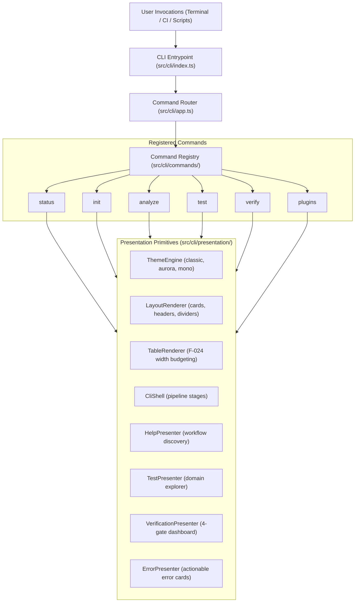

# CLI Presentation Architecture & Error Boundary Design

This document details the architectural design and presentation primitives of the **LegacyExodus CLI** located in `src/cli/`.

---

## 1. CLI Architecture Overview

The CLI uses a modular architecture separating command routing, engine execution, terminal presentation, and error boundaries:

---

## 2. Presentation Layer Components

The CLI presentation layer (`src/cli/presentation/`) provides reusable UI primitives:

### 2.1 Theme Engine (`theme.ts`)
- **Semantic Roles:** `brand`, `heading`, `text`, `muted`, `border`, `success`, `warning`, `error`, `info`, `active`, `highlight`.
- **Themes:**
  - `classic`: TrueColor sky/emerald palette for interactive terminals.
  - `aurora`: Soft lavender/teal dark palette.
  - `mono`: High-contrast monochrome output with bold/dim styling for CI and accessibility.
- **Standards:** Full compliance with `NO_COLOR` and ANSI code stripping (`stripAnsi`).

### 2.2 Table Renderer & F-024 Width Budgeting (`tables.ts`)
- **Column Width Budgeting:** Automatically calculates and balances column widths to fit available terminal width (`process.stdout.columns`).
- **ANSI-Safe Truncation:** Truncates long cells with ellipsis (`…`) while preserving ANSI escape sequences without visual boundary corruption.

### 2.3 Help Presenter (`help.ts`)
- Configured recursively via Commander's `configureHelp()`.
- Groups commands into structured workflows (`Workspace & Runtime`, `Repository Analysis`, `Quality & Verification`, `Plugins & Extensions`).
- Emits safety badges (`[read-only]` vs `[mutates workspace]`) and executable examples.

### 2.4 Test Presenter (`test-runner.ts`)
- Formats test execution results from Bun with domain highlights, assertion counts, execution duration, and failure diagnostic cards.
- Supports `-v, --verbose` for detailed per-test traces without terminal flooding in default runs.

---

## 3. Error Boundary Architecture

The CLI wraps all command executions in error boundaries (`src/cli/errors.ts`):
* **Domain Error Mapping:** Translates `LegacyExodusError` subclasses into structured codes and remediation guidance.
* **Format-Aware Presentation:** Emits styled cards in interactive TTY mode and clean plain text in CI / non-TTY environments.
* **JSON Purity:** When `--json` is active, errors emit structured JSON objects with exit code `1`.
* **Zero Stack Trace Leakage:** Internal stack traces are suppressed in production mode to prevent terminal clutter.

---

## 4. Implementation Evidence

* **Source Location:** [`src/cli/`](../../legacy-exodus-core/src/cli).
* **Test Suites:** 14 unit test files in `tests/unit/cli/` (89 tests, 417 assertions).
* **Related Documentation:** **[CLI Commands Reference](../development/cli/commands.md)**, **[CLI Configuration](../development/cli/configuration.md)**.
