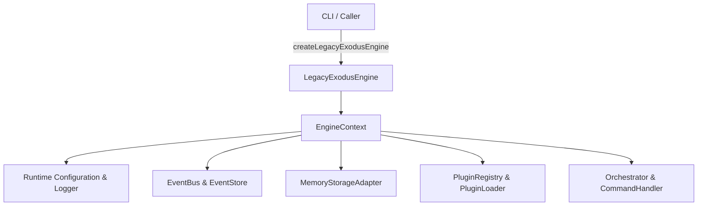
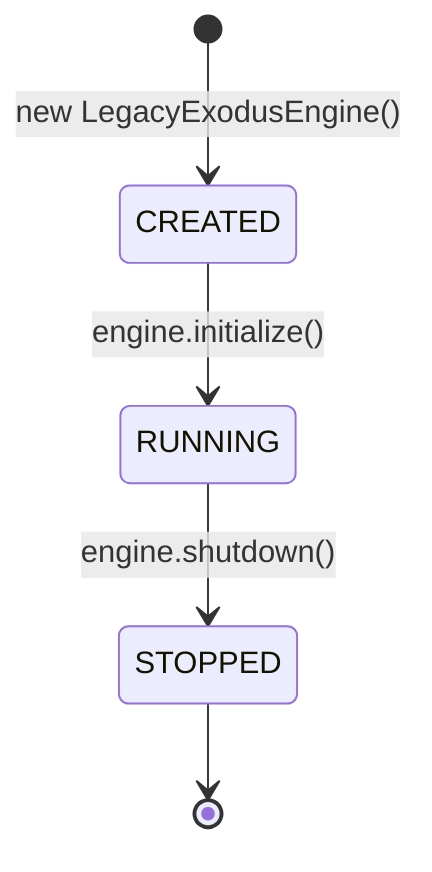

# Core Engine Implementation

This document describes the boundary, composition, and lifecycle of `LegacyExodusEngine` implemented in `src/core/engine/`.

---

## 1. Engine Boundary & Composition

`LegacyExodusEngine` serves as the single public entry point for CLI and programmatic callers into the deterministic core analysis pipeline.

---

## 2. Engine Lifecycle

The engine adheres to a strict state machine lifecycle:

1. **`initialize()`:** Transitions from `created` to `running`. Validates runtime composition, mounts plugins, and starts the internal event bus.
2. **`status()`:** Returns stable component health for runtime, storage, plugins, and event subsystems.
3. **`shutdown()`:** Flushes event stores, unloads plugins, and transitions to `stopped`. A stopped engine cannot be restarted.

---

## 3. Implementation Evidence

* **Source Location:** [`src/core/engine/`](../../legacy-exodus-core/src/core/engine), [`src/runtime/composition/services.ts`](../../legacy-exodus-core/src/runtime/composition/services.ts).
* **Tests:** `engine.test.ts`, `runtime.test.ts` (100% passing tests).
* **Related Documentation:**
  * **[Runtime Architecture](../architecture/runtime-architecture.md):** Detailed composition model.
  * **[Command Contracts](../api/command-contracts.md):** Engine command specifications.
  * **[ADR-001: Project State Architecture](../adr/ADR-001-project-state-architecture.md):** State management design.
