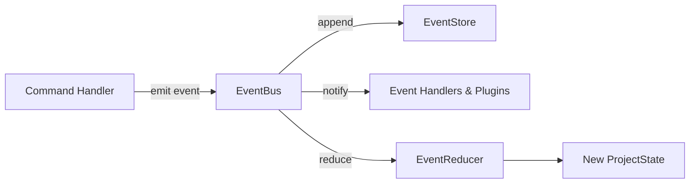

# Event System Implementation

This document describes the design and implementation of the synchronous event bus and event store in `src/core/events/`.

---

## 1. Components & Data Flow

* **`EventBus` (`event-bus.ts`):** Synchronous publish-subscribe bus supporting typed subscriptions.
* **`EventStore` (`event-store.ts`):** Append-only in-memory ledger storing all events in chronological order.
* **`EventReducer` (`event-reducer.ts`):** Pure reducer applying event payloads to update `ProjectState`.

---

## 2. Invariants

* **Deterministic Delivery:** Event handlers execute synchronously in registration order.
* **Snapshot Dispatch Safety:** `EventBus.publish` iterates over an immutable snapshot of registered handlers, ensuring handler unsubscriptions or subscriptions during an active dispatch cannot offset or skip sibling handlers.
* **Replay Determinism:** `reduceProjectState(initialState, events)` is pure and deterministic, producing deeply frozen `ProjectState` aggregates across repeated passes.
* **Audit-Grade Traceability:** Every state mutation traces back to an immutable event with an ISO timestamp and aggregate ID.

---

## 3. Implementation Evidence

* **Source Location:** [`src/core/events/`](../../legacy-exodus-core/src/core/events).
* **Tests:** `event-bus.test.ts`, `event-reducer.test.ts`, `event-store.test.ts`, `event-behavioral-integrity.test.ts`.
* **Related ADR:** **[ADR-002: Event System Governance](../adr/ADR-002-event-system-governance.md)**.
