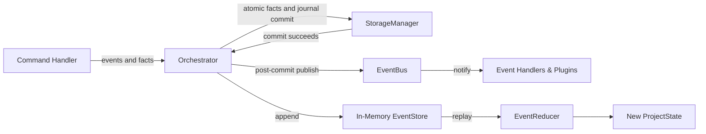

# Event System Implementation

This document describes the design and implementation of the synchronous event bus and event store in `src/core/events/`.

---

## 1. Components & Data Flow

* **`EventBus` (`event-bus.ts`):** Synchronous publish-subscribe bus supporting typed subscriptions.
* **`EventStore` (`event-store.ts`):** Append-only in-memory ledger storing all events in chronological order.
* **Durable event journal (`durable-event-journal.ts`):** Persists ordered domain events in the same storage transaction as command facts.
* **`EventReducer` (`event-reducer.ts`):** Pure reducer applying event payloads to update `ProjectState`.

> [!NOTE]
> The durable journal persists event evidence, but the current runtime does not hydrate `InMemoryEventStore` from that journal on startup. `Orchestrator.replay()` therefore replays the current in-memory event store rather than providing process-restart durable replay. State reconstruction after process restart is available via `Orchestrator.replayDurable(projectId, analysisRunId)`.

---

## 2. Invariants

* **Deterministic Delivery:** Event handlers execute synchronously in registration order.
* **Snapshot Dispatch Safety:** `EventBus.publish` iterates over an immutable snapshot of registered handlers, ensuring handler unsubscriptions or subscriptions during an active dispatch cannot offset or skip sibling handlers.
* **Durable Commit Defines Command Success:** Once `StorageManager.commitBatch` commits command facts and durable events, a later synchronous in-memory subscriber failure cannot retroactively report that committed command as failed.
* **Observable Post-Commit Failure:** The orchestrator records post-commit delivery failures for the latest execution and the composed runtime reports them through structured logging. It continues copying the already-committed event sequence into the in-memory replay store.
* **Pre-Commit Failure Remains Fatal:** Persistence failure prevents in-memory publication and still rejects command execution.
* **Replay Determinism:** `reduceProjectState(initialState, events)` is pure and deterministic, producing deeply frozen `ProjectState` aggregates across repeated passes.
* **Audit-Grade Traceability:** Every state mutation traces back to an immutable event with an ISO timestamp and aggregate ID.

`EventBus.publish` itself remains synchronous and fail-fast. The success rule above is enforced specifically by the orchestrator after durable commit; it does not promise delivery retries or isolation between subscribers to the same event. Discovery projection runs outside this transaction boundary, and its failure semantics are not changed by ARCH-001.

---

## 3. Implementation Evidence

* **Source Location:** [`src/core/events/`](../../legacy-exodus-core/src/core/events).
* **Tests:** `event-store.test.ts`, `event-behavioral-integrity.test.ts`, `durable-event-journal.test.ts`.
* **Related ADR:** **[ADR-002: Event System Governance](../adr/ADR-002-event-system-governance.md)**.
