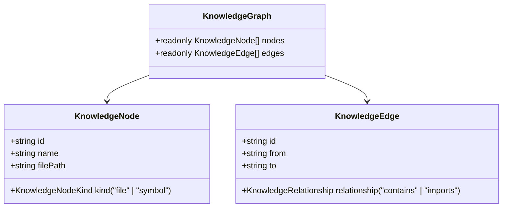

# Knowledge Graph Implementation

This document describes the design and implementation of the unified knowledge graph builder in `src/knowledge/`.

---

## 1. Responsibilities & Data Model

The `DeterministicKnowledgeGraphBuilder` unifies disparate symbol tables and dependency graph edges into an immutable, queryable knowledge graph representation.

---

## 2. Invariants & Determinism

1. **Deterministic Edge Hashing:** Every edge ID is computed via SHA-256: `sha256("${from}:${relationship}:${to}")`.
2. **Deterministic Sort Order:** All emitted `nodes` and `edges` arrays are sorted lexicographically by `id`.
3. **Deep Immutability:** Nodes, edges, and the top-level `KnowledgeGraph` object are deeply frozen with `Object.freeze()`.
4. **Zod Runtime Schema Validation:** Schema validation guarantees structural integrity before freezing.

---

## 3. Implementation Evidence

* **Source Location:** [`src/knowledge/knowledge-graph.ts`](../../legacy-exodus-core/src/knowledge/knowledge-graph.ts).
* **Tests:** `knowledge-graph.test.ts` (100% passing tests).
* **Architecture Spec:** **[Knowledge Service Architecture](../architecture/components/knowledge-service.md)**.
