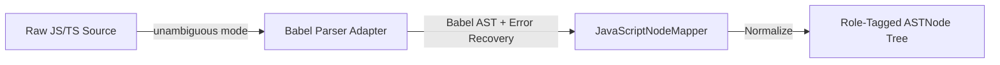

# Parser Strategy & AST Normalization

This document details the AST parsing and normalization subsystem implemented in `src/parser/`.

---

## 1. Architecture & Flow

LegacyExodus uses an adapter architecture over `@babel/parser`:

---

## 2. Configuration & Error Recovery

1. **Unambiguous Source Mode:** Parses ES Modules (`import/export`) and CommonJS (`require/module.exports`) without manual configuration.
2. **Enabled Plugins:** `typescript`, `jsx`, `classProperties`, `dynamicImport`.
3. **Error Recovery:** `errorRecovery: true` ensures that malformed syntax in non-standard template files does not crash the pipeline.

---

## 3. Node Normalization & Role Tagging

`JavaScriptNodeMapper` translates raw Babel nodes into immutable `ASTNode` instances:
* Annotates nodes with `role` labels (`declaration`, `expression`, `statement`, `pattern`).
* Strips redundant metadata to maintain a lean AST memory profile.

---

## 4. Implementation Evidence

* **Source Location:** [`src/parser/adapters/javascript/`](../../legacy-exodus-core/src/parser/adapters/javascript).
* **Tests:** `javascript-parser.test.ts` (14 passing tests).
* **Architecture Docs:** **[Parser Service Architecture](../architecture/components/parser-service.md)**.
