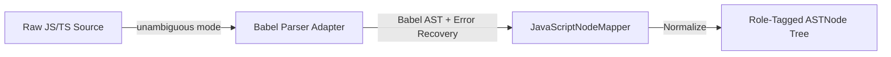

# Parser Strategy & AST Normalization

This document details the AST parsing and normalization subsystem implemented in `src/parser/`.

---

## 1. Architecture & Flow

LegacyExodus uses an adapter architecture over `@babel/parser`:

---

## 2. Configuration & Error Recovery

1. **Unambiguous Source Mode:** Parses ES Modules (`import/export`) and CommonJS (`require/module.exports`) without manual configuration.
2. **Enabled syntax:** The JavaScript adapter enables the Babel plugins declared by the current implementation for JavaScript/TypeScript and JSX/TSX inputs.
3. **Failure isolation:** Parser diagnostics and per-file failure handling prevent one unsupported or malformed source file from silently terminating analysis of otherwise valid files. Error recovery does not imply that every malformed file yields a valid AST.

---

## 3. Node Normalization & Role Tagging

`JavaScriptNodeMapper` translates raw Babel nodes into immutable `ASTNode` instances:
* Annotates nodes with `role` labels (`declaration`, `expression`, `statement`, `pattern`).
* Strips redundant metadata to maintain a lean AST memory profile.

---

## 4. AST Immutability, Validation Provenance & Fast-Path Trust Boundary

To eliminate redundant $O(N)$ Zod schema traversals and deep object allocations across downstream pipeline consumers (such as `JavaScriptSymbolExtractor`), the parser contracts enforce **validation provenance alongside deep-freeze immutability**:

* **Immutability Signal vs. Validation Trust Boundary:** `Object.isFrozen()` is an immutability optimization signal, **not** proof of schema validity (`Frozen ≠ Validated`). A caller cannot bypass validation by manually freezing a malformed object.
* **Module-Private Validation Provenance:** `validateASTResult`, `validateASTNode`, and `validateParseResponse` maintain module-private `WeakSet<object>` registries. Object identities are recorded in these sets **exclusively after** successful Zod schema parsing and deep freezing.
* **Validation Fast-Path ($O(1)$):** The constant-time fast-path is granted **only** when an object is both deeply frozen (`Object.isFrozen`) and present in the corresponding module-private validation `WeakSet`. Pre-validated immutable ASTs are returned directly by reference without recursive schema re-parsing or object re-allocation.
* **Defensive Boundary:** Any unknown, unfrozen, or manually frozen input outside the provenance registry undergoes full structural Zod schema validation. Malformed frozen objects are immediately rejected with deterministic `LegacyExodusError` diagnostics.

---

## 5. Implementation Evidence

* **Source Location:** [`src/parser/adapters/javascript/`](../../legacy-exodus-core/src/parser/adapters/javascript).
* **Validation & Provenance Contracts:** [`src/parser/contracts/ast-node.ts`](../../legacy-exodus-core/src/parser/contracts/ast-node.ts), [`src/parser/contracts/ast-result.ts`](../../legacy-exodus-core/src/parser/contracts/ast-result.ts), [`src/parser/models/parse-response.ts`](../../legacy-exodus-core/src/parser/models/parse-response.ts).
* **Tests:** `javascript-parser.test.ts`, `ast-validation-performance.test.ts`.
* **Architecture Docs:** **[Parser Service Architecture](../architecture/components/parser-service.md)**.
