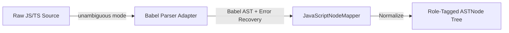

# Parser Strategy & AST Normalization

This document details the AST parsing and normalization subsystem implemented in `src/parser/`.

---

## 1. Architecture & Flow

LegacyExodus uses an adapter architecture over `@babel/parser`:

---

## 2. Configuration & Error Recovery

1. **Unambiguous Source Mode:** Parses ES Modules (`import/export`) and CommonJS (`require/module.exports`) without manual configuration.
2. **Enabled Plugins:** `typescript`, `jsx`, `classProperties`, `dynamicImport`.
3. **Error Recovery:** `errorRecovery: true` ensures that malformed syntax in non-standard template files does not crash the pipeline.

---

## 3. Node Normalization & Role Tagging

`JavaScriptNodeMapper` translates raw Babel nodes into immutable `ASTNode` instances:
* Annotates nodes with `role` labels (`declaration`, `expression`, `statement`, `pattern`).
* Strips redundant metadata to maintain a lean AST memory profile.

---

## 4. AST Immutability, Deep-Freeze Idempotency & Validation Fast-Path

To eliminate redundant $O(N)$ Zod schema traversals and deep object allocations across downstream pipeline consumers (e.g. `JavaScriptSymbolExtractor`), the parser contracts enforce **deep-freeze idempotency**:

* **Immutable Root Invariant:** Once an `ASTResult` is validated by `ParserManager`, its root node, children, metadata, diagnostics, and statistics are deeply frozen (`Object.freeze`).
* **Validation Fast-Path ($O(1)$):** `validateASTResult`, `validateASTNode`, and `validateParseResponse` perform constant-time verification of pre-frozen inputs. If an object is already validated and deeply frozen, it is returned directly by reference without re-allocating nodes or executing recursive Zod schema passes.
* **Security & Contract Boundary:** Unvalidated or mutated structures entering the subsystem boundary continue to undergo full Zod schema validation and structural freezing, maintaining 100% boundary safety.

---

## 5. Implementation Evidence

* **Source Location:** [`src/parser/adapters/javascript/`](../../legacy-exodus-core/src/parser/adapters/javascript).
* **Validation & Fast-Path Contracts:** [`src/parser/contracts/ast-node.ts`](../../legacy-exodus-core/src/parser/contracts/ast-node.ts), [`src/parser/contracts/ast-result.ts`](../../legacy-exodus-core/src/parser/contracts/ast-result.ts), [`src/parser/models/parse-response.ts`](../../legacy-exodus-core/src/parser/models/parse-response.ts).
* **Tests:** `javascript-parser.test.ts`, `ast-validation-performance.test.ts`.
* **Architecture Docs:** **[Parser Service Architecture](../architecture/components/parser-service.md)**.
