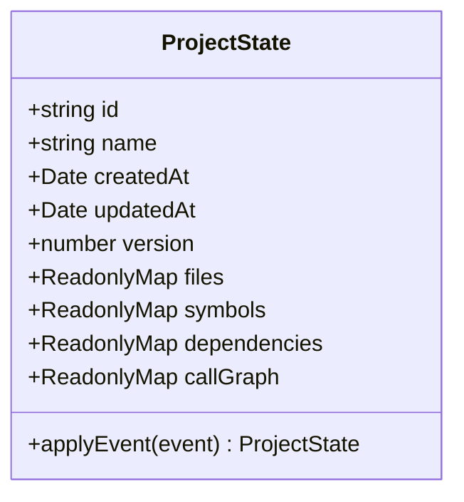

# Project State Model Implementation

This document describes the immutable state model and aggregate lifecycle implemented in `src/core/state/`.

---

## 1. Responsibilities & Structure

The `ProjectState` model serves as the single source of truth for all in-memory static intelligence accumulated during an analysis run.

---

## 2. Invariant Properties

1. **Strict Immutability:** State properties cannot be mutated directly. `StateFactory` produces initial state aggregates, and `EventReducer` generates fresh state instances for every event.
2. **Deterministic Versioning:** Every state transition increments `version` by 1.
3. **Zod Runtime Validation:** State schemas are verified using `state-schema.ts`.

---

## 3. Implementation Evidence

* **Source Location:** [`src/core/state/project-state.ts`](../../legacy-exodus-core/src/core/state/project-state.ts), [`src/core/state/state-factory.ts`](../../legacy-exodus-core/src/core/state/state-factory.ts).
* **Tests:** `project-state.test.ts`, `state-factory.test.ts`.
* **Related ADR:** **[ADR-001: Project State Architecture](../adr/ADR-001-project-state-architecture.md)**.
