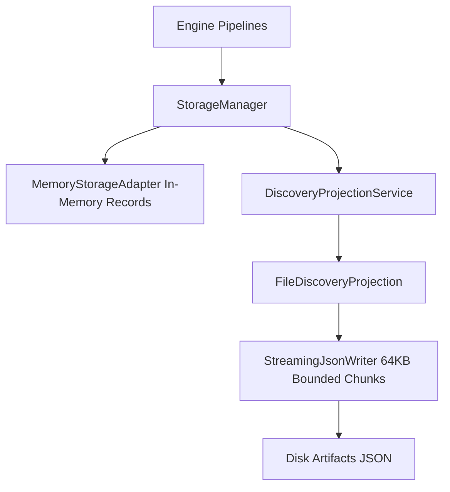

# Storage Layer Implementation

This document describes the design and implementation of the storage and projection subsystem located in `src/storage/`.

---

## 1. Storage Architecture Overview

The storage layer provides abstracted persistence and streaming projection services for static analysis results:

---

## 2. Key Components

1. **`StorageManager` (`storage-manager.ts`):** High-level storage facade managing storage providers and projection pipelines. Implements `findScoped(criteria)` to delegate bounded queries.
2. **`StorageProvider` (`storage-provider.ts`):** Canonical persistence contract supporting `save`, `findById`, `findAll`, and `findScoped(criteria: StorageQueryCriteria)`.
3. **`MemoryStorageAdapter` (`adapters/memory-storage.ts`):** High-performance in-memory storage provider with index-aware scoped querying.
4. **`SqliteStorageAdapter` (`adapters/sqlite-storage.ts`):** Durable SQLite persistence provider with parameterized SQL queries utilizing composite indexes (`idx_records_lookup`, `idx_records_file`) for zero-overhead bounded retrieval.
5. **`StreamingJsonWriter` (`projections/streaming-json-writer.ts`):** Low-memory streaming writer that splits JSON output into bounded 64KB chunks with backpressure handling to prevent out-of-memory errors on large repositories.
6. **`FileDiscoveryProjection` (`projections/file-discovery-projection.ts`):** Generates structured discovery ledgers mapping file paths, languages, hashes, and symbol counts.

---

## 3. Query Scoping & Bounded Retrieval

`StorageQueryCriteria` allows consumers (`DiscoveryQueryService`, `DiscoveryProjectionService`) to retrieve precisely bounded record sets without broad table scans:

* **`type`**: Target record category (e.g. `discovery.project`, `discovery.file`).
* **`projectId`**: Optional partition key scoping records to a specific project.
* **`analysisRunId`**: Optional execution isolation key filtering records to the active analysis run.
* **`filePath`**: Optional file path filter for fine-grained per-file queries.

---

## 4. Implementation Evidence

* **Source Location:** [`src/storage/`](../../legacy-exodus-core/src/storage).
* **Tests:** `memory-storage.test.ts`, `storage-manager.test.ts`, `storage-scoped-query.test.ts`, `streaming-json-writer.test.ts`.
* **Related ADR:** **[ADR-005: Storage Strategy](../adr/ADR-005-storage-strategy.md)**.
* **Architecture Spec:** **[Storage Service Architecture](../architecture/components/storage-service.md)**.
