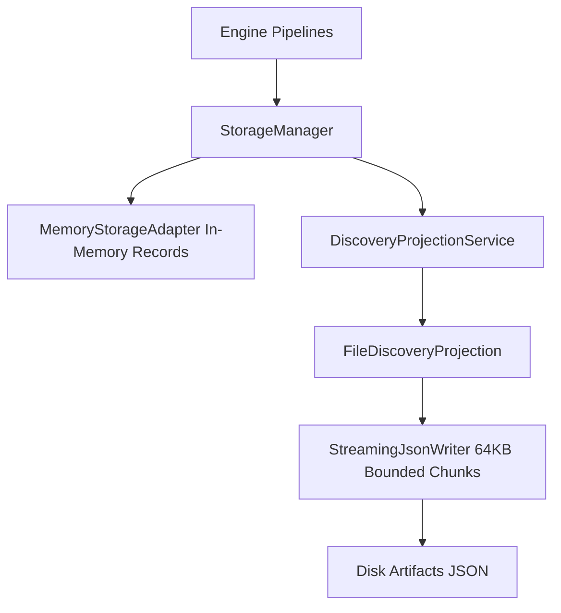

# Storage Layer Implementation

This document describes the design and implementation of the storage and projection subsystem located in `src/storage/`.

---

## 1. Storage Architecture Overview

The storage layer provides abstracted persistence and streaming projection services for static analysis results:

---

## 2. Key Components

1. **`StorageManager` (`storage-manager.ts`):** High-level storage facade managing storage adapters and projection pipelines.
2. **`MemoryStorageAdapter` (`adapters/memory-storage.ts`):** High-performance in-memory key-value store for transient pipeline execution records.
3. **`StreamingJsonWriter` (`projections/streaming-json-writer.ts`):** Low-memory streaming writer that splits JSON output into bounded 64KB chunks with backpressure handling to prevent out-of-memory errors on large repositories.
4. **`FileDiscoveryProjection` (`projections/file-discovery-projection.ts`):** Generates structured discovery ledgers mapping file paths, languages, hashes, and symbol counts.

---

## 3. Implementation Evidence

* **Source Location:** [`src/storage/`](../../legacy-exodus-core/src/storage).
* **Tests:** `memory-storage.test.ts`, `streaming-json-writer.test.ts` (8 passing tests).
* **Related ADR:** **[ADR-005: Storage Strategy](../adr/ADR-005-storage-strategy.md)**.
* **Architecture Spec:** **[Storage Service Architecture](../architecture/components/storage-service.md)**.
