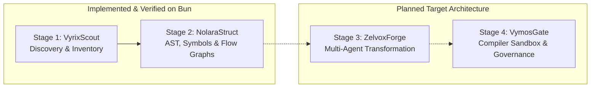

# LegacyExodus Pipeline Architecture Overview

This document describes the 4-stage modernization pipeline of **LegacyExodus**, strictly demarcating **implemented capabilities** from **target architecture**.

---

## 1. The 4-Stage Modernization Flow

---

## 2. Stage Breakdown & Implementation Status

| Stage | Name | Responsibilities | Implementation Status |
|---|---|---|:---:|
| **Stage 1** | **VyrixScout** | Directory traversal, symlink isolation, SHA-256 relative path hashing, package & framework detection | **`IMPLEMENTED & VERIFIED`** |
| **Stage 2** | **NolaraStruct** | Babel AST parsing, scope & symbol extraction, module/dependency graphs, semantic call graph, basic-block CFG, def-use DFG | **`IMPLEMENTED & VERIFIED`** |
| **Stage 3** | **ZelvoxForge** | Multi-agent code generation swarms, Rust / Axum / SQLx synthesis | **`TARGET ARCHITECTURE`** |
| **Stage 4** | **VymosGate** | Isolated compiler sandbox (`cargo check`), automated repair loops, human sign-off | **`TARGET ARCHITECTURE`** |

---

## 3. Implemented Stage Details

### Stage 1: VyrixScout (Discovery Engine)
* Implemented in `src/discovery/`.
* Recursively traverses target directory using `FileScanner`, skipping symlinks to prevent traversal escapes.
* Detects frameworks (Express, Fastify) and third-party dependencies from `package.json`.

### Stage 2: NolaraStruct (Understanding & Modeling Engine)
* Implemented in `src/parser/`, `src/symbols/`, `src/graph/`, `src/semantic/`, and `src/flow/`.
* Extracts lexical scopes, `var` hoisting, destructuring patterns, and parameter defaults.
* Builds deterministic basic-block CFGs and intraprocedural def-use DFGs with interprocedural taint flow.
* Streams projections to disk via `StreamingJsonWriter` (64KB bounded backpressure).

---

## Related Documentation

* **[PROJECT_CONTEXT.md](../PROJECT_CONTEXT.md):** Detailed stage specifications.
* **[Data Flow Architecture](../architecture/data-flow.md):** Technical data flow.
* **[ROADMAP.md](../../ROADMAP.md):** Track status and milestones.
