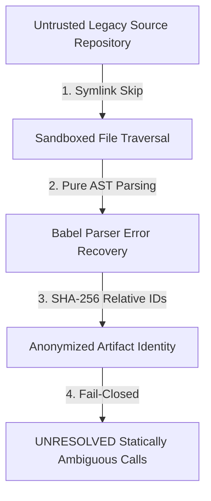

# Security Principles & Trust Boundaries

This document defines the core security principles, sandboxing models, and trust boundaries enforced by **LegacyExodus**.

---

## 1. Zero-Trust Static Analysis Principles

1. **Zero Code Execution:** LegacyExodus never evaluates, runs, or imports target source code during static analysis. Analysis is performed strictly via AST parsing and symbolic traversal.
2. **Symlink Traversal Isolation:** `FileScanner` detects and ignores symbolic links to prevent directory traversal boundary escapes and circular symlink infinite loops.
3. **Relative Path Anonymization:** Emitted artifact IDs (`FileId`, `SymbolId`) are derived from POSIX relative paths and SHA-256 content hashes. Host environment paths are never leaked in projections.
4. **Fail-Closed Conservative Resolution:** When static analysis cannot prove a relationship with certainty, it resolves to `UNRESOLVED` or `null` rather than guessing or fabricating.

---

## 2. Target Architecture Security (Planned)

The following security features are planned for future transformation and compilation phases:
* **VymosGate Sandboxing:** Running target `cargo check` and `cargo test` inside isolated ephemeral containers (gVisor/Docker).
* **Zero-Trust AI Gateway:** Secret token redaction, prompt injection filtering, and token budgeting for LLM interactions.

---

## Related Documentation

* **[Security Architecture](../architecture/security-architecture.md):** Deep architectural security specification.
* **[ADR-006: Security Model](../adr/ADR-006-security-model.md):** Security architecture decision.
* **[GOVERNANCE.md](../../GOVERNANCE.md):** Boundary execution invariants.
