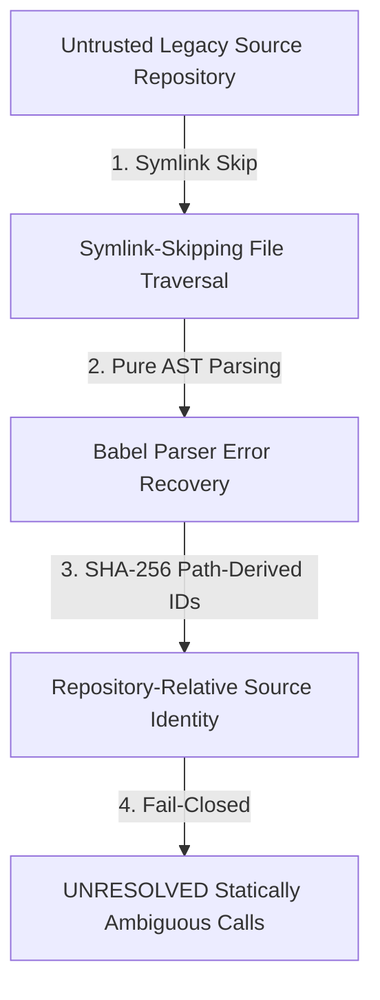

# Security Principles & Trust Boundaries

This document defines the core security principles, sandboxing models, and trust boundaries enforced by **LegacyExodus**.

---

## 1. Zero-Trust Static Analysis Principles

1. **Zero Code Execution:** LegacyExodus never evaluates, runs, or imports target source code during static analysis. Analysis is performed strictly via AST parsing and symbolic traversal.
2. **Symlink-Skipping Traversal:** `FileScanner` skips symbolic-link directory entries encountered during repository traversal. This prevents traversal through those entries, including symlink cycles, duplicate source analysis, and escapes through encountered links; it is not an operating-system sandbox.
3. **Repository-Relative Source Identity:** Discovered source-file paths are normalized relative to the repository for file artifacts, and deterministic file and symbol IDs are derived from path and symbol context. Project-level projection metadata is different: it intentionally retains the supplied `projectPath`, including `project.json`'s `path` and the discovery manifest's `repository.path`. Projections therefore do not provide universal host-path anonymization.
4. **Fail-Closed Conservative Resolution:** When static analysis cannot prove a relationship with certainty, it resolves to `UNRESOLVED` or `null` rather than guessing or fabricating.

---

## 2. Target Architecture Security (Planned)

The following security features are planned for future transformation and compilation phases:
* **VymosGate Sandboxing:** Running target `cargo check` and `cargo test` inside isolated ephemeral containers (gVisor/Docker).
* **Zero-Trust AI Gateway:** Secret token redaction, prompt injection filtering, and token budgeting for LLM interactions.

---

## Related Documentation

* **[Security Architecture](../architecture/security-architecture.md):** Deep architectural security specification.
* **[ADR-006: Security Model](../adr/ADR-006-security-model.md):** Security architecture decision.
* **[GOVERNANCE.md](../../GOVERNANCE.md):** Boundary execution invariants.
